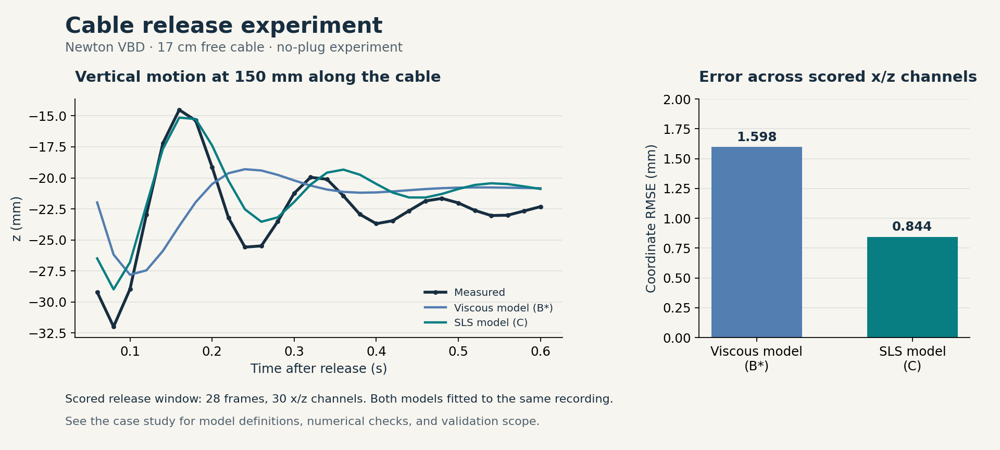

# Newton Calibration

Newton Calibration estimates simulation parameters from experimental observations. It combines simulator adapters, parameter search, numerical checks, and validation in a reproducible workflow. Each run records the selected parameters, settings, predictions, and validation results.

Start with a Newton XPBD sliding example, then connect your own measurements and model. The cable study shows how static and dynamic experiments guide parameter estimation and model refinement.

**[Quickstart](docs/quickstart-preview.md) · [Calibration workflow](docs/calibration-guide.md) · [API reference](docs/api-reference-preview.md) · [Examples](#examples)**

## Quickstart

Fit the friction of a sliding box with Newton's `SolverXPBD`. This example runs on CPU and compares simulated motion with analytical reference trajectories whose friction is known.

From a repository checkout, activate a Python 3.11+ environment and install the tested Newton and Warp versions:

```bash
python -m pip install -e . "warp-lang==1.17.0" \
  "newton @ git+https://github.com/newton-physics/newton.git@d37f4d3d341ccce1e06a1dff21e9a054759b4855"
python -m examples.sliding_calibration.run --workspace workspace/newton-sliding
```

The example uses Newton 1.6.0.dev0 at the pinned revision above. The first run compiles Warp kernels. See the [setup and scope](examples/sliding_calibration/README.md) for environment details.

Expect `accepted` and a friction coefficient close to `0.35`. The command prints the run directory and accepted asset path. Open `result.json` for the outcome and `run_state.json` for the analysis and validation reports.

Continue with the **[step-by-step quickstart](docs/quickstart-preview.md)** to inspect the saved run, assemble the calibration yourself, replace the simulator adapter, or switch from a single environment to multiple environments.

## Examples

| Example | What it demonstrates | Start here |
|---|---|---|
| Sliding box · Newton XPBD | Fit one physical parameter against analytical evidence, check numerical accuracy, and validate at a held-out initial speed | [Run and inspect](docs/quickstart-preview.md) · [Source](examples/sliding_calibration/) |
| Measured cable · Newton VBD | Use static shapes and release motion to fit parameters, interpret residuals, and refine the model | [Calibration workflow](docs/calibration-guide.md) · [Case study](examples/cable_calibration/README.md) |

### Cable release experiment

[](examples/cable_calibration/README.md)

The completed no-plug experiment compares viscous bending damping (B*) with a standard linear solid (SLS) model (C), using the same observations and objective. Coordinate RMSE decreases from **1.598 mm to 0.844 mm** over the scored x/z channels. These are errors on the fitting recording; the archived run's formal outcome remains `rejected_validation`.

The [case study](examples/cable_calibration/README.md) explains the experimental conditions, model changes, numerical checks, and limits of these results. It also includes the measured data, archived predictions, and solver setup. View the [English report](examples/cable_calibration/reports/cable_calibration_en.html) or [Chinese report](examples/cable_calibration/reports/cable_calibration_zh.html) using the [local preview instructions](docs/publishing-results.md).

To check the archived cable scores on CPU with the core dependencies installed:

```bash
python -m examples.cable_calibration.verify
```

This command re-scores saved traces without starting Newton. For lightweight sliding and oscillator demos using NumPy, see the [user guide](docs/user-guide.md).

## How it works

A `Tuning` instance brings together the evidence, simulator adapter, physical parameters, and search and validation rules:

```text
Define evidence and parameters → check baseline and numerical accuracy
→ search physical parameters with fixed numerical settings
→ reload the candidate → validate and recheck numerical accuracy
→ release an asset if accepted
```

The adapter owns model construction, parameter application, simulation, and observations. The calibration members handle execution, scoring, search, and validation through one `Tuning.run()` lifecycle.

- **[Calibration workflow](docs/calibration-guide.md):** choose the goal, design experiments, and decide what the evidence supports.
- **[Quickstart](docs/quickstart-preview.md):** connect observations and a simulator, then run the workflow.
- **[API reference](docs/api-reference-preview.md):** configure members, implement adapters, and read result files.
- **[Capabilities and limits](docs/implementation-status.md):** check supported execution modes and the scope of diagnostics.

## Development

```bash
python -m pip install -e ".[cma,dev]"
python -m newton_calibration.tests
python -m examples.cable_calibration.verify
uvx pre-commit run -a
```

See [Contributing](CONTRIBUTING.md) for development and validation guidelines, and [Codex skills](docs/codex-skills.md) for configuring calibration tasks with the bundled skills.

[Class diagram](docs/tuning-class-diagram.md) · [Workflow design](docs/generic-calibration-workflow-design.md) · [Repository instructions](AGENTS.md) · [Apache-2.0 license](LICENSE)
