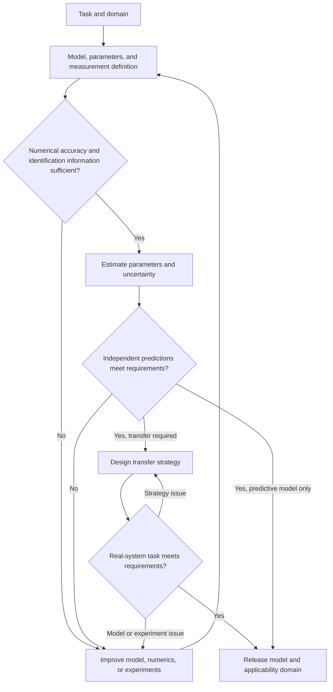
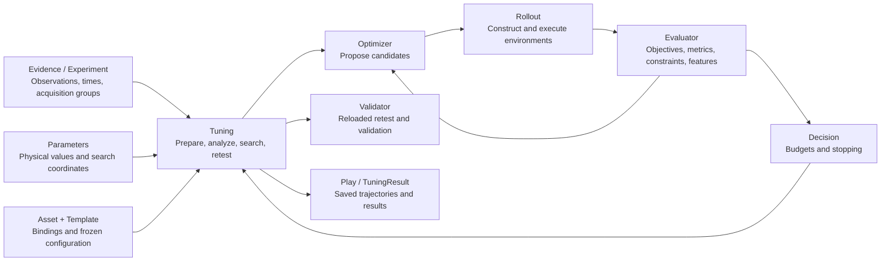

# Task-oriented parameter identification and simulation calibration

[Home](../README.md) · [Installation and quick start](user-guide.md) · [Cable example](../examples/cable_calibration/README.md)

This guide explains how to define an identification problem, design experiments, choose estimation methods, interpret calibration results, and connect that work to Newton Calibration. It covers rigid bodies, deformable bodies, contact, and combined robotic systems.

The guide follows four connected questions. What should the evidence establish? How should experiments and evidence be organized? How do the software members execute the problem? Which conclusions do the results support? Experimental design, physical interpretation, and real-system acceptance require work alongside the software lifecycle.

Start with [Section 3](#3-connecting-a-problem-to-newton-calibration) if you already have data and an adapter. Follow [Section 2](#2-workflow-and-stage-deliverables) to define a new problem. Use [Section 4](#4-using-residuals-to-plan-the-next-iteration) to investigate unsuccessful results.

## 1 Goals, methods, and the role of the module

### 1.1 Three related goals with distinct evidence requirements

Physical parameter credibility, predictive accuracy, and task success each require specific evidence.

| Goal | What the evidence should establish |
|---|---|
| Credible physical parameters | Parameters have a clear physical meaning and sufficient measurement and identifiability support |
| Credible simulation predictions | The model predicts real responses under conditions withheld from fitting |
| Effective task transfer | Control trained or planned with the model accomplishes the task on the real system |

These forms of evidence can support one another. Compensating parameters can produce similar trajectories. A biased model can predict accurately within a restricted operating range. Robust control can tolerate substantial parameter error. State the primary goal and the conclusions still awaiting validation. Model reliability involves model assumptions, numerical error, and uncertainty together. [R1] [R6]

The basic calibration deliverable in this guide is **evidence-supported parameters and response predictions under a declared model, numerical configuration, dataset, and domain of applicability, with unresolved uncertainty retained**. Claims about sim-to-real transfer also require real-system task acceptance after freezing the model and strategy.

### 1.2 Identification methods

Method selection depends on the available equations, observations, gradients, statistical objectives, and computational cost. Model structure, estimation criteria, and optimization tools are separate choices. The same physical model can be used with several solution methods, and the following approaches can be combined. [R4]

| Approach | How it uses information | Applicability and limitations |
|---|---|---|
| Structured regression and physically constrained identification | Exploit linear structure in parameters or parameter combinations and impose physical constraints | Requires a known dynamics structure and reliable inputs and torque data. Often identifies base parameter combinations. Constraints still require informative experiments |
| State-space and prediction-error identification | Specify state transitions, observations, initial states, delays, and noise, then minimize prediction error | Suits input–output dynamics and hidden states. Evaluate one-step prediction, multistep prediction, and free forward rollout separately |
| Black-box forward-simulation search | Evaluate candidate parameters through simulation and scoring | Requires only forward evaluations. Cost depends on dimension, rollout cost, and search difficulty |
| Differentiable simulation and gradient methods | Obtain loss derivatives through automatic differentiation or adjoints | Can be efficient with reliable gradients. Check contact transitions, long-horizon backpropagation, scaling, and local minima |
| Bayesian identification and simulation-based inference (SBI) | Estimate parameter or predictive distributions under explicit prior, noise, and model-discrepancy assumptions | Supports uncertainty and multiple solutions. Check prior sensitivity, inference calibration, and posterior predictions |
| Physical models with residual models | Use learnable terms to represent missing behavior | Specify whether compensation enters dynamics, observations, or control, and assess generalization and confounding with physical parameters |

Physical-consistency constraints for robot inertial parameters, differentiable joint identification in DPSI, conditional-density-based SBI, and Universal Differential Equations illustrate these approaches. Their software availability in Newton Calibration is described separately below. [R5] [R7] [R8] [R9]

### 1.3 Newton Calibration uses black-box forward simulation and search

The current module evaluates candidates through the following sequence.

$$
\theta
\longrightarrow \text{simulation}
\longrightarrow \text{predicted observations}
\longrightarrow \text{loss}.
$$

Here, black-box describes the interface between search and simulation. The optimizer proposes parameters, the simulator returns responses, and the evaluator computes objectives. The underlying model can still contain explicit geometry, dynamics, constitutive equations, and contact laws.

CMA-ES, the cross-entropy method (CEM), parallel sampling, and Bayesian optimization are possible methods for this class of problem. Parallel simulation can reduce wall-clock time for candidate batches. Actual speedup depends on backend batching, resource use, and individual simulation cost.

**The built-in optimizers are `GridSearch` and `CMAES`.** CEM, Bayesian optimization, differentiable optimization, and Bayesian posterior inference require additional member implementations or external workflows. Automated physical experiment design, policy training, domain-randomization training, and online adaptation also require external systems. [User guide](user-guide.md)

The module organizes a common lifecycle that freezes the problem, checks parameter bindings and numerical settings, analyzes local sensitivity and identifiability, evaluates and scores candidates, manages budgets, and exports, reloads, retests, and validates the selected candidate. Measurement, model selection, and real-system experiments complete the surrounding engineering workflow.

## 2 Workflow and stage deliverables

The following stages apply to rigid bodies, deformable bodies, contact, and combined robotic systems. Their practical order depends on observability, cost, and error dependencies. Model, numerical, and experimental decisions may require several iterations.

| Stage | Main work | Required record |
|---|---|---|
| 1 Task and domain of applicability | Define task, speed, load, initial state, contact modes, and quantities of interest (QOIs) | Task specification, acceptance thresholds, error budget, and operating domain |
| 2 Model definition | Select rigid/deformable representations, constitutive laws, contact, actuation, observations, and internal states | Assumptions, candidate models, represented and unsupported phenomena |
| 3 Parameter and evidence registration | Measure known quantities, list unknowns, establish prior information and dependencies | Parameter Registry, Prior Envelope, and evidence sources |
| 4 Measurement and data design | Calibrate the measurement chain, synchronize, repeat acquisitions, and split by experiment | Data protocol, initial and boundary conditions, fitting/development/sealed datasets |
| 5 Numerical qualification | Check effects of discretization, integration, iteration, precision, and coupling on QOIs | Frozen configuration with a stated scope and numerical-error records |
| 6 Identifiability and experiment design | Assess sensitivity, correlated directions, and prior dependence, then design additional excitation | Identifiable parameters or combinations and an active experiment plan |
| 7 Parameter estimation | Estimate jointly or in stages using physical constraints and multiple evidence types | Values and intervals or feasible sets, losses, and residual diagnostics |
| 8 Independent response prediction | Test new motions, speeds, loads, boundaries, and contact modes | Prediction errors, intervals, mismatch types, and model-revision decisions |
| 9 Transfer strategy design | Translate remaining uncertainty into randomization, online adaptation, or residual compensation | Training distribution, adaptation mechanism, and coverage limits |
| 10 Sealed task acceptance | Freeze model and strategy, then perform independent real-system tests | Success rate and confidence interval, forces, timing, failure modes, and applicability |
| 11 Versioned release and maintenance | Preserve model, numerical, data, parameter, and validation versions | Reproducible parameter package, model card, and recalibration triggers |

This organization draws on verification, validation, and uncertainty quantification (VVUQ), application-oriented identification, and active experiment design. It is an engineering organization of deliverables, with influences from several sources. [R1] [R2] [R3]

Reported intervals require an explicit statistical procedure. If that work is incomplete, report “not estimated” and retain feasible-set or sensitivity evidence. Stages 9 and 10 concern transfer goals. A predictive-model deliverable can mark them inapplicable and state its scope. A task-transfer claim requires Stage 10 evidence.



### Stage 1 Task and domain of applicability

Decompose the task into quantities of interest before choosing parameters to fit. Transport, alignment, initial contact, guided insertion, and latch engagement in cable insertion place different demands on the model.

| Object or phase | QOIs | Available observations | Relevant mechanisms |
|---|---|---|---|
| Robot joint motion | Tracking error, phase lag, reversal, and limit response | Commands, joint position/velocity, torque feedback | Actuation, inertia, friction, control timing, limits |
| Static cable loading | Sag, tip position, directional differences | Centerline, load, clamp pose | Stiffness, natural shape, mass, boundaries |
| Dynamic cable release | Peak/trough timing, amplitude, decay, final equilibrium | Time-varying centerline | Inertia, elasticity, dissipation, material history, release state |
| Plug insertion and locking | Axial/lateral forces, torque, latch events | Displacement and force records, success events | Contact geometry, friction, latch and contact-component deformation |

Record parameters and responses separately. Tracking lag may depend on drive gains, inertia, friction, and control delay. Tip sag may depend on stiffness, free length, mass, and clamp angle.

Define the primary objective, critical acceptance metrics, and diagnostic metrics before searching. Preserve critical peaks, event timing, and local worst-case errors alongside average error. Set thresholds using task tolerances, measurement error, and the numerical-error allowance. Retain previous definitions and reasons when revising them. The applicability domain should cover the object, speed, load, temperature or rate conditions, initial state, and contact modes.

The stage delivers a task-to-QOI map, applicability domain, acceptance thresholds, and error budget.

### Stage 2 Model definition

Trace each required mechanism through physical phenomenon, model equation, parameter, and solver implementation. Specify actuation, friction, limits, and control timing for robots. Specify bending, torsion, natural shape, dissipation, and material memory for deformables. Contact problems also require collision geometry, contact laws, and material pairs.

A complete forward problem can be written as

$$
\hat y_e=\mathcal H_{\eta_e}\!\left[
\operatorname{Sim}_{M,\nu}(\theta;u_e,x_{0,e},b_e,z_{0,e})
\right].
$$

Here, $M$ is the model structure, $\nu$ the numerical configuration, $\theta$ the physical or effective parameters, $u_e$ the input, $x_{0,e}$ and $b_e$ the initial and boundary conditions, and $z_{0,e}$ internal states such as material memory. The observation model $\mathcal H_{\eta_e}$ includes coordinate transforms, projection, and offsets. Scoring compares predicted $\hat y_e$ with real measurements of the same meaning.

Record phenomena the model represents, intentionally omits, or cannot express. When an important mechanism is missing, parameter compensation may reduce local error while degrading other conditions. [R6]

Select a solver by checking physical capabilities, parameter binding and observation interfaces, numerical accuracy, and budget. Newton's feature matrix helps shortlist candidates. Verify the actual version and backend, including whether the backend consumes each field used by the adapter. [R10]

The stage delivers assumptions and candidate models, required internal states, the solver revision, and explicit capabilities and limitations.

### Stage 3 Parameter and evidence registration

#### Classify quantities by their role in the equations

| Category | Typical quantities | Management principle |
|---|---|---|
| Geometry and kinematics | Lengths, radii, collision surfaces, joint axes, mounting poses, natural shape | Prefer direct measurement and retain uncertainty and geometry versions |
| Inertia | Mass, center of mass, inertia, linear density | Combine measurements and CAD information, identifying observable combinations |
| Constitutive behavior | EA, bending matrix B, GJ, viscoelastic time constants, yield and plasticity parameters | Define units and mappings from the actual solver equations |
| Interactions | Friction, adhesion, physical contact compliance, connection compliance | Attribute values to material pairs and conditions |
| Actuation and control | Gains, delay, saturation, transmission friction, dead zones, filtering | Identify alongside command and actual-input semantics |
| Measurement and initial state | Transforms, offsets, time shifts, initial velocity, prestress | Calibrate independently or treat as nuisance parameters with prior information |
| Numerical configuration | dt, substeps, resolution, iterations, tolerances, precision | Select through numerical-error checks and retain as conditions of the parameter result |

Nuisance parameters are auxiliary quantities needed to interpret observations correctly while estimating the primary parameters. Manage the seven categories separately and justify which quantities enter a joint search.

Fields such as `stiffness`, `margin`, and `softness` can represent physical effective compliance, collision-geometry offsets, or numerical regularization. Classify them after checking their equations, dimensions, and software version. Normally, Stage 5 selects numerical settings. If they are deliberately co-tuned to obtain a task-equivalent model, state the resulting conditional interpretation and validate the new configuration. [R10]

#### Build a Parameter Registry and Prior Envelope

The Parameter Registry records physical definitions, units, software mappings, sources, ranges, direct-measurement status, search participation, dependencies, applicable temperature/rate/load conditions, and versions. Include the following information to make the definition executable.

| Information | What to record |
|---|---|
| Definition and implementation | Owning object, equation role, field or adapter entry point, units, discretization mapping |
| Baseline and evidence | Current value, measurement/CAD/historical identification/exploratory assumption, evidence version, uncertainty |
| Search and constraints | Bounds, linear/log scale, coupled constraints, measured/searched/frozen/diagnostic status |
| Identifiability support | Constraining experiments and observations, correlated parameters, identifiable combinations |
| Application and checks | When values take effect, rebuild/reset requirements, actual-object readback, perturbation response |
| Applicability and maintenance | Temperature, rate, load, control mode, discretization, model and parameter versions |

The Prior Envelope records justified ranges and dependencies. Distinguish hard physical constraints, measurement- or literature-supported ranges, and provisional exploration ranges. A probabilistic prior or confidence interval requires additional statistical definitions beyond search bounds. Preserve component evidence during system-level calibration so that component parameters remain constrained by their own measurements.

Positive parameters spanning orders of magnitude can use logarithmic search. Handle zero-valued friction or damping separately when needed. Check actual readback, rebuilding/resetting, single-parameter perturbations, and state isolation between candidates for every search parameter. Material-memory initialization is also part of the problem definition.

The stage delivers the Registry and Prior Envelope with evidence and dependencies, plus records confirming that the parameters affect simulation.

### Stage 4 Measurement and data design

Record timestamps, frames, units, sampling and filtering, commands and feedback, sensor calibration, initial and boundary conditions, processing scripts, and data versions. Repeat experiments to estimate noise and experimental variability before interpreting small improvements.

Record **measurement sampling rate, command update rate, controller update rate, physics integration step, and output sampling rate** individually. A 50 Hz recording can require a much faster physical integrator. Image-derived centerlines require projection, occlusion, and pixel-to-physical-coordinate definitions. Models such as the standard linear solid (SLS) also require preload, hold duration, and pre-release history.

State which quantities are inputs and which are predictions under test. Prescribed measured end-effector motion supports evaluation of an object's response under that boundary motion. Robot dynamics and control response require their own tests.

Split by independent experiment or acquisition group. Fitting data support estimation, development data support residual diagnosis and model selection, and sealed data support acceptance after freezing decisions. Time slices from one recording usually share initial conditions, noise, and processing errors. Once a dataset informs changes to model, bounds, loss, or thresholds, register it as development evidence for subsequent work.

Reserve evidence separately for Stage 8 response validation and Stage 10 real-system task acceptance. With limited data, development-stage cross-validation can help, while the absence of an independent sealed test remains an explicit limitation.

The stage delivers measurement and synchronization protocols, initialization records, reproducible processing, and grouped datasets with declared uses.

### Stage 5 Numerical qualification

Assess whether simulation is sufficiently stable under numerical changes before interpreting fitting residuals. Check time integration, substeps, iterations, tolerances, spatial discretization, precision, and solver coupling wherever they affect QOIs. Use representative parameters and high-risk conditions, and repeat checks for the final candidate. [R1]

Keep the physical problem consistent during comparisons. Spatial refinement requires appropriate mappings for mass, stiffness, damping, and boundaries. Record the refinement sequence, QOI changes, and allowed numerical-error budget while keeping constitutive assumptions fixed.

Repeated agreement at fixed settings establishes repeatability. Accuracy claims need suitable refinement evidence. Nonmonotonic changes are diagnostic information. Acceptance follows the declared error budget, protocol, and scope.

When estimating effective parameters for a particular discretization, spatial changes may be designated diagnostic while deployment time/iteration accuracy remains an acceptance condition. The parameter package then carries that discretization, and cross-discretization transfer requires separate evidence.

The stage delivers a frozen numerical configuration, accuracy or repeatability mode, checked conditions and boundaries, and numerical-error records. Reassess qualification when the model, parameter range, or deployment configuration changes.

### Stage 6 Identifiability and experiment design

Identifiability concerns whether different parameters produce distinguishable responses under the current model, experiments, and observation precision. Task sensitivity concerns whether parameter changes affect the task's QOIs. Assess both dimensions.

#### Use two dimensions to set priorities

| Task sensitivity | Current identifiability | Action |
|---|---|---|
| High | High | Prioritize measurement and calibration |
| High | Low | Improve experiments, add observations, or retain correlated parameter sets |
| Low | High | Record through low-cost measurement and reduce optimization effort |
| Low | Low | Simplify, fix using documented prior information, or retain uncertainty |

Start with single-parameter perturbations. Check reproducibility, compare response changes with measurement noise and numerical error, and examine whether different parameters cause similar changes. With explicit scaling, singular values and correlated parameter directions characterize local information. Stronger conclusions may require profile likelihood, repeated experiments, or posterior analysis. [R11]

Local full rank depends on the analysis point, scaling, and threshold. Global uniqueness and statistical confidence require further analysis. Also distinguish information supplied by data from conditional identifiability obtained by fixing other quantities through prior assumptions.

#### Use experiments to distinguish competing explanations

| Experiment | Main purpose | Conditions to control or record |
|---|---|---|
| Multifrequency robot joint motion | Separate dynamic responses across time scales | Mode, frequency, amplitude, time axis, load, limits |
| Low-speed forward/reverse motion, reversals, varying loads | Separate friction, direction effects, and control influences | Temperature, velocity, torque semantics, repetitions |
| Static cantilevers in multiple directions or lengths | Constrain stiffness, natural shape, and clamping | Free length, mass, clamp pose, relaxation wait |
| Releases at multiple amplitudes, holds, cyclic loading | Separate inertia, damping, viscoelasticity, and history | Release state, preload, history, sampling, force/displacement |
| Contact/sliding motions at different normal loads | Separate contact parameters, boundaries, and drive compensation | Material pair, geometry, normal force, surface, velocity |

Material and contact parameters can affect the same observations. Friction depends on normal load, which depends on geometry, material, clamping, and control. DPSI treats material and environment parameters within a shared differentiable forward process. Such joint identification addresses coupling, while multiple actions, observations, and independent predictions help constrain compensating explanations. [R7]

Low-cost experiments with relatively isolated mechanisms can constrain parameters before joint system-level checks. Retain their uncertainty when fixing stage-wise estimates, since treating estimates as exact transfers error into later parameters. Active experiment design can choose excitation to reduce target uncertainty. The current module supplies local sensitivity analysis, while choosing and executing physical experiments remains external work. [R2] [R3]

The stage delivers identifiable parameters or combinations, temporarily fixed quantities and their justification, and prioritized additional experiments and observations.

### Stage 7 Parameter estimation

Estimate within the declared model, observations, initial states, boundaries, and numerical settings. Choose staged or joint estimation based on information, cost, and dependencies. Preserve earlier evidence and uncertainty in staged estimation, perform constrained joint rechecks where needed, and verify that system-level adjustments still explain component experiments.

#### Different evidence types constrain different responses

| Data | Information provided | Common gaps |
|---|---|---|
| Static shape or centerline | Equilibrium stiffness, natural shape, boundaries | Dynamic inertia, damping, relaxation time |
| Motion trajectories | Dynamics, frequency, phase, decay | Unmeasured force scale and hidden internal states |
| Forces and torques | Resistance, load paths, stiffness, dissipation | Sensor offsets and gravity/inertia-compensation errors |
| Tactile observations and slip | Local contact, grasping, tangential response | Confounding between sensing elastomer and object parameters |
| Force–displacement and cyclic curves | Contact events, energy, hysteresis, locking | Time alignment and rate effects |
| Task-success events | Task boundaries and failure modes | Incorrect loads and compensation during successful execution |

These data provide relevant information, with uniqueness depending on the full problem. Shape and motion also depend on mass, boundaries, and initial states. Interpreting static observations as long-term stiffness requires hold-time and relaxation-state records. DiffTactile illustrates combining motion, force, and tactile evidence. [R16]

#### Construct losses from evidence

Specify scales, temporal correlation, modality weights, and experiment normalization. Normalize squared millimeters, newtons, and pixels before combining them. Choose normalization so an experiment's frame count alone does not determine its importance. Record noise scales, which describe measurement reliability, separately from task weights, which describe importance.

- **Corresponded trajectories and shapes** require time and spatial alignment. Retain period, decay, and peak/trough timing alongside residuals. Model estimated time offsets explicitly, since unconstrained time warping can hide control delay.
- **Uncorresponded point clouds** can use Chamfer distance or Earth Mover's Distance (EMD). Specify occlusion, point density, squared or unsquared distance, and whether observations represent surfaces or reconstructed volumes. Filled particles incorporate reconstruction assumptions. DPSI compares observation representations and distance choices. [R7]
- **Force, torque, tactile, and slip observations** require frame, reference-point, offset, and gravity/inertia-compensation checks. Preserve peaks, impulse, slip onset, and sustained limit violations alongside averages.
- **Contact, latch, and success events** require detection, matching, and missing-event rules before timing, ordering, or probability comparisons. Missing events must remain represented in scoring.
- **Work and cyclic hysteresis** can be calculated from synchronized force–displacement curves. Equal work can accompany different peaks and timing, and measured dissipation can include fixture, contact, and drive effects.
- **Multimodal objectives** should retain physical-unit metrics and critical hard constraints for each channel. Explicit noise covariance or correlated-error models require appropriate implementations and statistical assumptions.

The default `Evaluator(loss="squared_error")` uses a normalized weighted mean squared error. For experiment $e$, repeat $r$, and valid observation set $\mathcal I_e$, the objective is

$$
L(\theta)=\sum_e\frac{w_e}{\sum_jw_j}\frac{1}{R_e}
\sum_{r=1}^{R_e}\frac{1}{N_e}
\sum_{i\in\mathcal I_e}
\left(\frac{\hat y_{e,r,i}(\theta)-y_{e,i}}{s_{e,i}}\right)^2.
$$

Here, $s$ is `Experiment.scale`, $N_e$ counts valid observations, $w_e$ is experiment weight, and $R_e$ is `Experiment.repeats`, the number of simulation repetitions against the same reference. Register independently acquired real repetitions as separate experiments. The default metrics, `normalized_rmse` and `normalized_max_error`, are dimensionless.

The built-in `cross_entropy` mode requires complete normalized probability rows. Event times, impulses, and work can be constructed as additional observation features under a declared protocol. MAE, Huber, Chamfer, or EMD require a suitable `Evaluator` implementation. Event extraction and probability calibration remain separate steps. Custom scoring must preserve the objective, metric, constraint, validity-mask, and feature contracts. Keep feature scales and dimensions consistent throughout a run for sensitivity and numerical checks. See Section 3.4 for metric-column requirements.

#### Choose estimators for the problem structure

| Conditions | Methods to consider | Main checks |
|---|---|---|
| Known linear parameter structure and reliable dynamic data | Weighted least squares, maximum likelihood, or suitable instrumental-variable methods according to noise assumptions | Base parameter combinations, regressor/noise correlation, likelihood or instrument validity, physical constraints |
| Low dimension, frequent contact transitions, inexpensive rollouts | CMA-ES, CEM, parallel sampling | Multiple starts, bounds, validation error |
| Expensive simulation and low dimension | Bayesian optimization or a surrogate | Surrogate error, budget, full-model verification |
| Higher dimension, reliable gradients, favorable local basin | Gauss–Newton for nonlinear least squares, L-BFGS or Adam for other smooth objectives | Parameter scaling, directional derivatives, local minima |
| Multiple modes with useful gradients in some regions | Global search followed by local differentiable refinement | Equal-budget comparison with a gradient-free baseline |
| Uncertainty estimation or multiple solutions | MCMC, SMC, approximate SBI, profile likelihood, bootstrap | Prior sensitivity, statistical assumptions, interval or posterior coverage |
| Persistent mismatch across conditions | Revise constitutive or boundary models, possibly add a residual model | Generalization, interpretability, model version |

This table guides method selection. Least squares specifies an objective and CMA-ES specifies a solution method, so they can be combined. Useful gradients can coexist with difficult simulation objectives. Compare hybrid methods against equal-budget baselines. [R4] [R15]

#### What an estimate should include

Report candidate parameters, stopping reason, bound hits, training residuals, and correlated parameter directions. Agreement across search seeds supports search stability. Interpret search bounds, near-optimal candidate sets, and CMA-ES sampling covariance according to their algorithmic roles.

When reporting intervals, state whether they come from repeated experiments, profile likelihood, bootstrap, or an explicit statistical model. Posterior samples, Bayesian credible intervals, frequentist confidence intervals, and engineering acceptance ranges have distinct meanings. BayesSim provides an example of dedicated probabilistic inference. A conventional black-box search needs additional inference work for such outputs. [R11] [R12]

Recheck candidate numerical accuracy under critical conditions and assess how uncertainty affects QOIs. Return to Stage 6 when several parameter sets explain the data equally well, and to Stage 5 when numerical changes exceed budget. Persistent structured residuals after those checks motivate tests of model and boundary assumptions.

The stage delivers parameter values and interpretation conditions, intervals or feasible sets with their methods, loss and residual diagnostics, and unresolved issues.

### Stage 8 Independent response prediction

Freeze the candidate, then predict shapes, trajectories, forces, or events using data withheld from parameter, model, scoring, and threshold selection. Cover the claimed motions, speeds, loads, lengths, boundaries, and contact modes. Report aggregate and local errors, systematic bias, and failure conditions.

Separate any observation prefix used for initialization from the prediction-scoring window. With measured tool motion as input, conclusions concern object response under that boundary. Export/reload checks reproducibility, and numerical refinement checks sensitivity to solver settings. Retain these as separate evidence alongside independent prediction.

Report both coverage and width for prediction intervals, specifying whether observation noise or model discrepancy is included. Resampling should preserve complete trajectories or experimental groups when neighboring frames are correlated. Once Stage 8 results inform revisions, they become development evidence. A revised model needs new independent testing or an explicit validation limitation. Keep Stage 10 sealed task data outside parameter, model, randomization-range, controller, and threshold selection.

The stage delivers errors, residuals, and interval evidence for the frozen candidate under new conditions, plus a decision to use it, restrict its applicability, or revise the model.

### Stage 9 Transfer strategy design

Select nominal-model training, evidence-based domain randomization, robust control, online adaptation, or residual compensation according to the goal. Mark this stage inapplicable for a parameter-only or predictive-model deliverable. Dynamics randomization has research support, and its use should still be related to the current task and uncertainty. [R13]

Distinguish uncertainty about one object's parameters, real variation between objects, and robustness stress-test ranges. Preserve parameter correlations and physical constraints when sampling. After expanding the training domain, check numerical usability for representative high-risk configurations.

For online adaptation, state the observations available, updated states or parameters, and update timing. For residual compensation, identify whether it enters dynamics, observations, or control. Correct missing mechanisms and alignment errors as evidence warrants. Use development data for strategy selection, then freeze the strategy and permitted online-update rules.

The stage delivers a training distribution or nominal model, adaptation/compensation mechanisms, coverage limits, and model and strategy versions. Training and deployment are external to the current module.

### Stage 10 Sealed task acceptance

Freeze the model, numerical settings, controller or policy, initialization protocol, success definition, critical thresholds, and statistical method before independent real-system testing. Report success rate together with force peaks, errors, timing, maintained states, and failure modes. State the task-success evidence and physical-parameter evidence separately.

Use independent real-system episodes as the statistical unit. Report successes, total trials, conditions, and interval method. Frames, control steps, and simulation replays belong to their originating episodes. Fixed-sample designs can preselect Wilson or exact binomial intervals and a confidence level. If stopping depends on observed results, use an appropriate sequential design, because repeatedly inspecting a fixed-sample interval changes its interpretation. [R14]

Handle correlation between objects, batches, or consecutive trials through experimental grouping, stratified reporting, or suitable statistical methods. Preserve failed acceptance results and return to experimental, model, numerical, or transfer design as supported by evidence. Arrange new independent acceptance tests for revisions informed by those results.

The stage delivers real-system results for a frozen version, statistical intervals, constraint compliance, failure categories, and an explicit applicability domain.

### Stage 11 Versioned release and maintenance

A release should let another user reconstruct the problem and interpret the conclusion. Preserve model and solver versions, numerical settings, parameters and Registry, data and processing versions, scoring and thresholds, search records, post-freeze validation, applicability, and unresolved issues.

The model card should state what evidence supports each of the three goals and which goals remain incomplete. Software status `accepted` covers the configured checks, data, and thresholds. Record the scope of fixed-configuration repeatability or pending real-system testing explicitly.

Recalibration triggers can include geometry or sensor changes, maintenance and wear, controller updates, loads/rates/temperatures outside the supported domain, solver or discretization changes, and persistent excessive residuals. Retain previous results and identify new evidence and validation conditions for each update.

The stage delivers a reproducible parameter package, model card, version dependencies, and maintenance triggers.

## 3 Connecting a problem to Newton Calibration

The eleven stages describe the full calibration project. The software receives a defined problem and performs data checks, analysis, search, retesting, and recording. Real measurements, model selection, statistical inference, and real-system acceptance require their respective surrounding workflows. [User guide](user-guide.md)

### 3.1 Run a complete minimal example

Use Python 3.11 or newer and install from the repository root. The core uses NumPy. CMA-ES requires the `cma` extra, and each physics case supplies its Newton solver installation separately.

```bash
python -m pip install -e ".[cma]"
```

The built-in oscillator factory demonstrates the full lifecycle and result access.

```python
from newton_calibration.examples import make_tuning

tuning = make_tuning(
    "oscillator",
    workspace="workspace/api_example",
    optimizer="cma_es",
    capacity=4,
)
result = tuning.run()

print(result.acceptance)
print(result.termination_reason)
print(result.parameters)
print(result.run_directory)
print(result.asset_path)
```

The factory constructs the members. `run()` starts simulation and optimization and executes the lifecycle. Create a fresh `Tuning` instance for each run and call `run()` directly, since `prepare()` itself begins the lifecycle. [User guide](user-guide.md)

This synthetic example demonstrates software usage. Real-object calibration requires measured evidence and an adapter implementing the contracts below.

### 3.2 Mapping the problem definition to software members

The user expresses the task, model, parameters, and experimental data through software members. `Tuning` organizes numerical checks, analysis, search, validation, and recording.

Members and engineering stages have a many-to-many relationship. One member can support several stages, and a stage usually involves several members. The table describes the work each member supports within a stage.

#### Members and the eleven stages

| Problem definition | Member or organizer | Related stages | What to supply or check |
|---|---|---|---|
| Observations and data split | `Evidence`, `Experiment` | Primarily **4 measurement/data design** and **8 independent prediction**, supporting evidence registration in 3 | References, times, scales, masks, weights, simulation repeats, acquisition groups, training and validation datasets |
| Search parameters | `Parameter`, `Parameters` | Primarily **3 registration** and **7 estimation**, supporting analysis in 6 | Names, units, bounds, baselines, linear/log transforms, analyzed combinations, and a separately maintained full Registry |
| Assets and bindings | `Asset`, `Environment` | Implements **2 model definition**, simulates for **5–8**, exports for **11** | Model construction, parameter application/readback, initial/internal state, outputs, export/reload |
| Fixed problem configuration | `Template` | Primarily **2 model definition**, **4 experimental conditions**, **5 numerical qualification** | Fixed physical quantities, numerics, discretization, per-experiment inputs/boundaries/seeds, qualification mode, refinements, tolerance |
| Execution and scoring | `Rollout`, `Evaluator` | Primarily **7 estimation**, reused in **5 numerics**, **6 identifiability**, **8 prediction** | Independent or batched execution, validity, objectives, metrics, constraints, residual features, user-defined QOIs and scoring |
| Search and stopping | `Optimizer`, `Decision` | Primarily **7 estimation**, with lifecycle-wide budgeting | Candidate proposals/feedback, budgets, continue/stop decisions, built-in `GridSearch` and `CMAES` |
| Post-freeze checks | `Validator` | Primarily **8 independent prediction**, plus training retest | Reloaded-candidate training retest, validation scores and thresholds, declared data and scope |
| Presentation | `Play` | Diagnostics and **11 result presentation** | Comparison and export of saved trajectories |
| Shared lifecycle | `Tuning` | Implemented work in **5–8**, archiving and conditional release in **11**, checking/freezing inputs from **2–4** | Numerical qualification, local sensitivity/SVD, search, export/reload, retest, validation, state, results, accepted release packages |

`Tuning` is assembled from ten members named `evidence`, `asset`, `evaluator`, `parameters`, `rollout`, `optimizer`, `decision`, `validator`, `template`, and `play`. As their organizer, it owns `RunState` and produces `TuningResult`. Numerical qualification and local identifiability analysis are included in the shared lifecycle. Sections 3.4–3.6 describe their execution scope.

#### Current boundaries and additional work

The module accepts, executes, and records a particular calibration problem. Users and external tools supply task requirements, physical evidence, and the following additional analysis and decisions.

| Work or boundary | Stages | Current support and additional work |
|---|---|---|
| Task definition and model selection | **1–2** | Define task, QOIs, error budget, acceptance criteria, applicability, and constitutive/contact/actuation/observation models. Connect them through `Asset`, `Template`, `Evaluator`, and other members |
| Complete parameter and evidence registration | **3** | Bounds, baselines, and transforms are represented. Maintain physical definitions, measurement sources, dependencies, applicability, and the full Prior Envelope separately |
| Measurement and evidence-use management | **4, 8** | Observation containers and acquisition-group checks are provided. Sensor calibration, synchronization, real repeats, raw-data processing, and fitting/development/sealed-data management remain external. Independence requires acquisition evidence beyond group labels |
| Numerical verification beyond current coverage | **5, 8** | Initial and final core checks use training experiments. Choose meaningful refinements and tolerances, then add checks for claimed new loads, boundaries, or contacts |
| Global identifiability and active experiment design | **6** | Finite-difference sensitivity and local SVD are provided. Global uniqueness, prior dependence, additional excitation/observations, physical acquisition, and statistical intervals need further work |
| Task-specific scoring, other estimators, uncertainty | **7–8** | Default scoring, black-box search, and frozen-response validation are provided. Extend members or external workflows for special losses/constraints, other estimators, intervals/posteriors, and model revision |
| Transfer strategy and real-task acceptance | **9–10** | Domain randomization, policy training, adaptation, residual compensation, frozen real-task tests, and their statistics are external |
| Long-term release and maintenance | **11** | Run records, result files, and conditional release packages are provided. Complete model cards, long-term data/dependency management, deployment monitoring, and recalibration triggers belong to the engineering workflow |

#### Design choices and example integration

The core prioritizes essential, reusable work with stable interfaces and independently checkable behavior. This includes problem freezing, binding checks, numerical qualification, local identifiability, candidate search/scoring, export/reload, retesting, validation, and recording.

Model selection, experiments, task evaluation, and transfer strategy also determine calibration quality. Their implementation depends heavily on the object, sensors, control mode, and application. Composable members provide extension points for adapters and analysis connected to external experimental or control tools. New evidence can then motivate another calibration iteration with revised models or experiments.

The bundled cable example demonstrates this division of work through static and dynamic measurements, a material model, clamp boundaries, parameters, and validation conditions. It uses Newton Calibration for numerical checks, analysis, search, and response validation, then uses residual evidence to motivate further measurement or model revision. [Cable walkthrough](../examples/cable_calibration/README.md) · [Cable factory](../examples/cable_calibration/run.py)

### 3.3 Module usage reference

Each entry describes responsibilities, constructor arguments, invocation, and results. The organization follows the overview, capability, and interface style of Newton's solver documentation. [R10]

The interfaces and defaults below describe Newton Calibration 0.2.0. Import core classes through `newton_calibration` and synthetic examples through `newton_calibration.examples`. Section 3.3.12 provides a complete assembled example. [Public API](../newton_calibration/__init__.py) · [Synthetic example exports](../newton_calibration/examples.py)



#### 3.3.1 Evidence and Experiment store observations

`Experiment` describes the reference outputs and scoring conditions of one experiment. `Evidence` groups experiments into training and validation data and records provenance. Put control commands, loads, and initial states in `Template.experiment_settings` under the same experiment ID, so the environment can run the forward problem.

```text
Experiment(id, group, reference, times=None, scale=1.0,
           mask=None, weight=1.0, repeats=1)
Evidence(train_data, validation_data=(), *, sources=None)
```

| Argument | Type or default | Usage |
|---|---|---|
| `id` | Required string | Unique across all training and validation experiments, and a key in `experiment_settings` |
| `group` | Required string | Real acquisition group. Training and validation group labels must be disjoint |
| `reference` | Nonempty `[T,D]` array | `T` times and `D` observation channels, converted to NumPy `float64` during preparation |
| `times` | `None` or `[T]` array | Finite, nonnegative, strictly increasing observation times. Record units, such as seconds. Omitted times become `0, 1, …, T-1` |
| `scale` | `1.0` | Positive finite scalar, `[D]`, or array broadcastable to `[T,D]`, used to normalize residuals |
| `mask` | `None` | Boolean `[T,D]`, with `True` selecting observations for scoring. Defaults to all valid, and must retain at least one element |
| `weight` | `1.0` | Positive finite relative experiment weight in the combined objective |
| `repeats` | `1` | Simulation repeats against the same reference, executed with experiment `seed + repeat` |
| `train_data` | Experiment sequence | At least one experiment for analysis and search |
| `validation_data` | `()` | Held-out experiments for individual evaluation after freezing the candidate |
| `sources` | `None` | Provenance dictionary for data versions, processing protocols, and measurement sources, included in the fingerprint |

`Evidence.prepare()` normalizes inputs, checks shapes, finiteness, IDs, and groups, then creates `evidence_id`. `Tuning` calls it during a complete run. For a standalone data check, construct `Evidence`, call `prepare()`, and inspect `train_data`, `validation_data`, and `fingerprint()`.

Robot channels might be `[q_1, …, q_n, qd_1, …, qd_n]` with separate position and velocity scales. Cable centerlines can be flattened into channels at fixed arc-length samples, with masks for occlusion and initialization windows. Register independent real recordings as separate `Experiment`s and preserve acquisition relationships with `group`. Document channel order, frames, and units.

#### 3.3.2 Parameter and Parameters define the search space

`Parameter` defines one scalar to estimate. `Parameters` orders the parameter vector and converts among physical values, normalized values, and combination search coordinates. `Asset` applies values to the actual solver.

```text
Parameter(name, bounds, baseline, unit="1", transform="linear")
Parameters(definitions)
```

| Argument | Requirements and meaning |
|---|---|
| `name` | Nonempty and unique, matching the asset's parameter key |
| `bounds` | Finite `(lower, upper)` with `lower < upper` |
| `baseline` | Finite and within the closed bounds, representing the pre-calibration value |
| `unit` | Unit description, default `"1"`. Data processing and adapters perform the agreed conversions |
| `transform` | `"linear"` or `"log"`. Logarithmic normalization requires a positive lower bound |
| `definitions` | Nonempty `Parameter` sequence whose order defines physical-vector columns |

For example, `Parameter("friction", (0.05, 0.65), 0.15)` defines dimensionless friction. `Parameter("tau", (0.001, 0.1), 0.02, unit="s", transform="log")` defines a positive time constant spanning two orders of magnitude, provided the material model and adapter implement the mechanism represented by `tau`.

| Interface | Result or purpose |
|---|---|
| `names`, `bounds`, `baseline` | Names, `[P,2]` bounds, and `[P]` baseline |
| `as_dict(row)` | Map one physical row to names, commonly for constructing the asset baseline |
| `to_normalized(values)` / `from_normalized(values)` | Convert between physical values and per-parameter `[0,1]` coordinates |
| `encode(values)` / `decode(values)` | Convert between physical values and the current combination search space, whose size is `dimension` |
| `check_bounds(values)` | Boolean validity of each physical row against finiteness and bounds |
| `snapshot()`, `parameter_space_id` | Record definitions, combination mapping, and identity |

The initial mapping normalizes each parameter independently. After identifiability analysis, `Tuning` can call `set_mapping(origin, basis)` to establish combination coordinates, then `freeze()` to lock the space. Decoded candidates still undergo physical-bound checks. Construct new `Parameters` when changing bounds or baseline for another run. Keep physical definitions, evidence, and dependencies in the Section 2 Registry.

#### 3.3.3 Template fixes a run's configuration

`Template` stores physical conditions, numerical settings, and experiment inputs shared across candidates. It combines fixed and candidate parameters when constructing an environment, then passes the relevant experimental settings to the asset adapter. The adapter defines the dictionary keys and must consume them consistently.

```text
Template(*, numeric_settings, discretization, fixed_parameters,
         experiment_settings, refinements=(), precision_tolerance=0.05,
         qualification_mode="refinement")
```

| Argument | Usage |
|---|---|
| `numeric_settings` | Required nonempty dictionary for integrator, timestep, substeps, iterations, and related settings, using keys understood by the environment |
| `discretization` | Required dictionary for rod segments, mesh resolution, or degrees of freedom. May be empty when appropriate |
| `fixed_parameters` | Required dictionary of fixed physical scalars, with keys disjoint from search parameters |
| `experiment_settings` | Required nonempty dictionary keyed by every experiment `id`. Each entry explicitly includes `seed` and adapter-specific inputs |
| `refinements` | Default `()`. Each configuration override may contain only `numeric_settings` and `discretization` |
| `precision_tolerance` | Default `0.05`, positive and finite, limiting maximum feature changes in numerical checks |
| `qualification_mode` | Default `"refinement"`, requiring valid refinement settings during a run. `"repeatability"` with empty `refinements` checks a fixed configuration |

The sliding example uses `numeric_settings={"dt": 0.02, "integrator": "event_trapezoid", "dtype": "float64"}`, fixes gravity with `fixed_parameters={"gravity": 9.81}`, and refines time with `{"numeric_settings": {"dt": 0.01}}`. A robot environment must consume the physics step, control period, and command sequence explicitly. A cable SLS environment must also preserve pre-release history and internal-state initialization conditions. [Cable factory](../examples/cable_calibration/run.py)

`resolve()` checks configuration, `freeze()` locks it, `snapshot()` returns serializable configuration data, and `template_id` identifies it. `refined(change)` creates a frozen refined template, with each refinement applied independently to the original. `instantiate(asset, parameter_values, experiment)` constructs one environment, and `instantiate_batch(...)` constructs a batch. `Rollout` normally calls these methods. Section 3.5 explains qualification scope and tolerance scaling.

#### 3.3.4 Asset, Environment, and Trace connect the simulator

`Asset` encapsulates construction information, baseline parameters, and binding logic. `Environment` owns mutable simulation state for one candidate and experiment, then returns a `Trace`. Implement model construction, parameter application, initial-state reset, and observation readout here when adding a robot or material model.

```text
Asset(baseline_parameters, *, config=None)
Asset.create_environment(template, parameter_values, experiment_settings)
Environment.run(times, *, seed, deadline)
Trace(times, values, positions=None)
```

`Asset` and `Environment` are abstract base classes. Use existing subclasses or implement their abstract methods above. The asset's `baseline_parameters` must exactly match `parameters.as_dict(parameters.baseline)`. Fixed physical values belong to the template. `config` stores construction information such as asset locations and model options, and is retained by default JSON export.

Environment construction and execution follow these steps.

1. `create_environment()` receives merged fixed and candidate parameters, constructs an independent model, solver, and state, and applies experiment boundaries and initial conditions.
2. `applied_parameters` reports the effective values, read back from fields actually used in computation. Its key set must exactly match the combined fixed and search parameter keys.
3. `run()` samples at the requested `times`. `seed` applies to the current repeat. `deadline` is an absolute `time.monotonic()` deadline checked by the environment at interruptible points.
4. `close()` releases environment resources. `Rollout` calls it after execution.

The returned `Trace` uses the following layout.

| Field | Shape | Meaning |
|---|---|---|
| `times` | `[T]` | Matches reference times, checked by the built-in evaluator with absolute tolerance `1e-9` |
| `values` | `[T,D]` | Same channel order, units, and frame semantics as reference observations, finite wherever the mask selects data |
| `positions` | `None` or `[T,N,3]` | Optional display points. Default USDA output uses meters and Z-up |

Raise `SimulationError` for expected physical or numerical candidate failures, and `TimeoutError` for deadlines. Other exceptions are recorded as execution errors and enter the shared lifecycle's failure handling. Include enough context to locate the model, input, or numerical issue.

Assets also provide `load_or_create()`, `snapshot()`, `asset_id`, `export(parameter_values, path)`, and `reload(path)`. Default export writes `newton-calibration-asset/1` JSON with the asset type, candidate parameters, and construction configuration. Calling `reload(path)` on the original asset returns an instance of the same type with the candidate baseline. Its `create_environment()` must still construct fresh mutable state. Subclasses that cache mutable models must handle rebuilding and isolation.

`SlidingAsset` and `OscillatorAsset` are available from `newton_calibration.examples`. The cable factory demonstrates a real-physics adapter, and robot environments can implement the same contracts. [Synthetic example exports](../newton_calibration/examples.py) · [Cable factory](../examples/cable_calibration/run.py)

#### 3.3.5 BatchEnvironment, Rollout, and Episode execute candidates

`Rollout` combines candidates and experiments, checks readback, executes environments, and collects results. One candidate in one experiment and repeat produces an `Episode`, uniquely identified by `(trial_id, experiment_id, repeat)`.

```text
Rollout(capacity=1, *, worlds=None,
        parameter_rtol=1e-10, parameter_atol=1e-12)
Rollout.execute_batch(template, asset, trials, experiments, *, deadline=None)
```

| Argument | Behavior |
|---|---|
| `capacity` | Positive capacity, limiting worker threads for ordinary independent environments |
| `worlds` | `None` or a positive integer limiting candidates per batch environment. `None` puts the current batch's valid candidates in one environment |
| `parameter_rtol` | Readback relative tolerance, default `1e-10` |
| `parameter_atol` | Readback absolute tolerance, default `1e-12` |

For direct `execute_batch()` calls, supply `trials` as `(trial_id, physical_parameter_dict)` pairs, prepared `experiments`, and a frozen `template`. In a complete run, `Tuning` decodes candidates and calls the method. It returns an `Episode` tuple in candidate, experiment, and repeat order.

| Episode field | Meaning |
|---|---|
| `trial_id`, `experiment_id`, `repeat` | Candidate, experiment, and repetition identity |
| `status` | `completed`, or a failure such as `invalid_parameters`, `numerical_failure`, `timeout`, or `execution_error` |
| `trace` | Successful simulation `Trace`, default `None` |
| `error` | Error description, default `None` |
| `applied_parameters` | Full readback mapping, default empty dictionary |

Overriding `Asset.create_batch_environment(template, parameter_values, experiment_settings)` makes `asset.supports_batch` true and selects the batch path. `parameter_values` is a sequence of complete parameter dictionaries. Both `BatchEnvironment.applied_parameters` and `run(times, seed=..., deadline=...)` results preserve candidate order.

Each successful batch member returns a `Trace`. A physical failure returns a `SimulationError` instance in that member's slot. An exception at batch-call level affects the entire current chunk. A fresh batch environment is constructed for each experiment and repeat. `worlds` controls chunking, and NumPy, Warp, or another backend implements within-chunk parallelism. The ordinary path uses `capacity` threads. `BatchedOscillatorAsset` demonstrates array-based batch execution. [Synthetic example exports](../newton_calibration/examples.py)

For example, 8 candidates, 2 training experiments, and `repeats=3` produce 48 episodes. The rollout budget counts all 48 even when the backend simulates candidates together.

#### 3.3.6 Evaluator converts trajectories into objectives and constraints

`Evaluator` matches a complete episode set to reference data by experiment, candidate, and repeat, then produces per-candidate objectives, metrics, constraints, and residual features. Objectives rank candidates, constraints define feasibility, and features support sensitivity and numerical qualification.

```text
Evaluator(*, loss="squared_error", max_normalized_error=None)
Evaluator.score_batch(episodes, trial_ids, experiments)
```

| Argument | Behavior |
|---|---|
| `loss="squared_error"` | Aggregate normalized squared residuals using experiment weights, repeats, and valid observation counts, as defined in Section 2 |
| `loss="cross_entropy"` | Score probability rows. References and predictions must be nonnegative normalized rows, with whole rows selected or excluded by the mask |
| `max_normalized_error=None` | Default constraint matrix has zero columns. A positive finite threshold adds `max_error / threshold - 1 <= 0` |

For batch size `B`, constraint count `K`, and concatenated feature count `F`, `score_batch()` returns five arrays in this order.

| Return value | Shape | Meaning |
|---|---|---|
| `objectives` | `[B]` | Per-candidate objective, positive infinity for invalid candidates |
| `metrics` | `[B,2]` | Default columns `normalized_rmse` and `normalized_max_error`, with maximum error at column 1 |
| `constraints` | `[B,K]` | Each entry must be `<= 0` for satisfaction. Built-in `K` is 0 or 1 |
| `valid_mask` | `[B]` | True when traces, times, finite valid observations, and loss-specific inputs meet the contract |
| `features` | `[B,F]` | Normalized residuals concatenated in fixed experiment/repeat order, scaled by square-root factors for experiment weights, repeats, and valid sample counts |

With squared error, `objectives[i]` equals the sum of squares of `features[i]`, and `metrics[i,0]` is its square root. With cross-entropy, the objective uses probabilities while features and both default error metrics still use scaled prediction-minus-reference residuals. Interpret `scale` accordingly.

For positions in meters, `scale=0.03` and `max_normalized_error=2.0` impose an absolute-error limit of 0.06 m on valid position channels. With different channel scales, convert the threshold separately for each channel.

`metric_spec` records the scoring protocol and `evaluation_id` identifies it. Custom evaluators can override `score_batch()` and `metric_spec`, including objectives, units, constraints, and every adjustable scoring setting in the protocol. Preserve array shapes, order, and feature count. Current `Tuning` and `Validator` read maximum error from `metrics[:,1]`, so retain that column's contract or adapt the affected members together.

#### 3.3.7 Optimizer, GridSearch, and CMAES propose candidates

`Optimizer` defines an ask/tell protocol. After parameter analysis, `Tuning` calls `initialize(parameters)`. Once a batch is authorized, it calls `ask(batch_size)`, then supplies scores through `tell(result)`. Feedback for the pending batch must arrive before another batch is requested.

```text
Optimizer(batch_size=8, seed=42)
GridSearch(levels=11, batch_size=16)
CMAES(batch_size=8, sigma=0.2, seed=42)
```

| Member or argument | Meaning |
|---|---|
| `GridSearch.levels` | Equally spaced points per search dimension, at least 2, with `levels ** parameters.dimension` total points |
| `GridSearch.batch_size` | Requested candidates per batch. Remaining budget and grid points can reduce the last batch |
| `CMAES.batch_size` | Population per generation, at least 4. `full_batch=True` requires complete-generation evaluation |
| `CMAES.sigma` | Initial step size in the current normalized search coordinates, with `0 < sigma < 1` |
| `CMAES.seed` | Sampling seed, default 42, configured separately from experimental simulation seeds |

`GridSearch` suits a few parameters and range-response checks. Its grid is generated in current search coordinates and mapped to physical values with `Parameters.decode()`. `CMAES` requires the `cma` extra and at least two search dimensions. With rank reduction, select an optimizer appropriate for the reduced `parameters.dimension`.

`ask()` returns `TrialBatch(trial_ids, search_values)` with `[B,Q]` values in `[0,1]`, where `Q` is search dimension. `tell()` receives the corresponding `BatchResult`, whose candidate IDs, search values, and `purpose="train"` must match.

`BatchResult` stores search and physical values, all five scoring outputs, `episode_records`, problem `identity`, and `purpose`. `feasible` combines validity and constraints. `feedback` maps feasible candidates below 1, constraint violations to `[1,2)`, and invalid candidates to 3. Built-in CMA-ES updates from `feedback`, while run records retain the raw objective.

To implement another algorithm, subclass `Optimizer` and implement `ask()`. Extend `initialize()`, `tell()`, `diagnostics()`, and `state_dict()` as needed, and optionally provide `checkpoint()` as CMA-ES does. `diagnostics()["exhausted"]` informs `Decision` about search-space exhaustion. Shared stopping and budget decisions remain in `Decision.next_action()`.

#### 3.3.8 Decision controls budgets and stopping

Before baseline, analysis, training, and validation work, `Decision` checks state and budgets and returns `DecisionResult(action, reason, batch_size=0)`. `Tuning` uses it to authorize work or enter finalization.

```text
Decision(max_trials=512, max_rollouts=10000, max_generations=100,
         max_seconds=300.0, target=1e-5, patience=None,
         improvement_tolerance=1e-10)
```

| Argument | Scope and meaning |
|---|---|
| `max_trials` | Training-candidate limit. Baseline and analysis probes are recorded in their own phases |
| `max_rollouts` | Episode limit across all phases, including scheduled failed or invalid candidates |
| `max_generations` | Training-batch limit, corresponding to generations for CMA-ES and chunks for GridSearch |
| `max_seconds` | Total wall-clock limit from preparation, handled through cooperative backend deadlines |
| `target` | Stop search when the best feasible training objective reaches this value |
| `patience` | Default `None`. When enabled, detect stagnation from improvement across the specified number of recent batches |
| `improvement_tolerance` | Threshold for old best objective minus new best objective when patience is enabled |

Budget limits are positive, `target` is finite and nonnegative, and enabled `patience` is a positive batch count. `next_action(state, request)` receives a read-only state snapshot and work request, then returns `action="continue"` or `"stop"`. Its `reason` enters decision history.

For example, `Decision(max_trials=41, max_generations=3, max_rollouts=200)` accommodates a one-dimensional 41-point grid in batches of 16, with episode capacity for analysis and validation. Estimate the full budget using experiments, repeats, parameter dimension, and refinements. `Validator` supplies final acceptance thresholds. Section 3.6 explains stopping and acceptance.

#### 3.3.9 Validator checks the exported candidate

`Validator` performs per-experiment acceptance. `Tuning` exports and reloads the selected asset, then uses training experiments for retesting and validation experiments for holdout evaluation. Both use `validate()` and retain separate reports.

```text
Validator(max_objective=0.01, max_error=1.0)
Validator.accepts(result)
Validator.validate(candidate_asset, validation_data, evaluate)
```

| Argument or method | Usage |
|---|---|
| `max_objective` | Finite nonnegative objective limit, default `0.01` |
| `max_error` | Finite nonnegative limit on `metrics[:,1]`, default `1.0` |
| `accepts(result)` | True when every candidate is feasible and within objective and maximum-error limits |
| `validate(...)` | Call `evaluate(candidate_asset, (experiment,))` for each experiment and return a dictionary with `passed`, `status`, and `experiments` |

With default squared error, `max_objective=0.01` corresponds to normalized RMSE at most 0.1 for that evaluation. The separate maximum-error condition must also pass. Per-experiment retesting gives low-weight experiments their own acceptance check.

`Tuning` supplies the `evaluate` callback, locks candidate identity, and performs budgeting, simulation, and scoring. Custom validators can add condition grouping or historical-evidence restrictions while preserving report fields and candidate identity. The default validator returns `status="unvalidated"` for empty validation data. `Tuning` organizes numerical rechecks separately and includes them in the final report.

#### 3.3.10 Play displays saved trajectories

`Play()` uses saved `Trace.positions` from episodes, matching before/after trajectories by `(experiment_id, repeat)`. The default comparison contains `baseline` and `calibrated` tracks and an acceptance flag.

| Method | Arguments and result |
|---|---|
| `compare(baseline, calibrated, references=None, *, accepted=False)` | Accept two episode sequences and return `accepted` and `tracks`. Matched traces require positions on both sides and exactly equal time axes |
| `export_usd(comparison, output_path)` | Write USDA point animation and return its path, with second-based time codes, meters, and Z-up |
| `show_gl(comparison, *, max_frames=None, screenshot=None, headless=False)` | Use Pyglet from the `gl` extra to project xyz onto xy, optionally limit frames and save a screenshot |

`references` is currently a reserved argument. Default tracks come from the two simulated position sequences. Extend comparison or presentation to overlay measurements or plot joints and torques.

After a run, inspect `tuning.comparison`. USDA and GL display require position tracks. Run the following after the complete example in Section 3.3.12.

```python
if tuning.comparison and tuning.comparison["tracks"]:
    path = tuning.play.export_usd(
        tuning.comparison,
        result.run_directory / "comparison-copy.usda",
    )
    print(path)
```

`Tuning.run()` already attempts to generate the default `comparison.usda`. The extra export above demonstrates the method call. Presentation errors are recorded in `RunState.errors`. Scoring, validation, and numerical checks determine acceptance.

#### 3.3.11 Tuning assembles members and returns results

`Tuning` accepts the ten members and coordinates preparation, analysis, search, export/reload, retesting, and validation. Applications compose members and implement case adapters to use this lifecycle.

```text
Tuning(*, evidence, asset, evaluator, parameters, rollout, optimizer,
       decision, validator, template, play, workspace="workspace",
       analysis_step=0.03, rank_tolerance=1e-3,
       allow_rank_reduction=False, orthogonalize=True)
```

| Additional argument | Default and behavior |
|---|---|
| `workspace` | `"workspace"`, the parent directory for distinct run directories with timestamp and random suffix |
| `analysis_step` | `0.03`, finite-difference step in per-parameter normalized coordinates, requiring `0 < step <= 0.25` |
| `rank_tolerance` | `1e-3`, relative rank threshold with `0 < tolerance < 1`. The singular-value cutoff is `max(s_max * tolerance, 1e-10)` |
| `allow_rank_reduction` | `False`, allowing search in retained identifiable combinations of nonzero rank when enabled |
| `orthogonalize` | `True`, building search coordinates from local SVD combinations. Required for rank reduction |

The normal entry point is `result = tuning.run()`. Phase operations `prepare()`, `sensitivity()`, `identifiability(report)`, and `evaluate_batch(...)` require lifecycle, freezing, and budget protocols when composed manually. `run()` organizes them using a fresh instance per run.

`tuning.state` is a `RunState` containing `phase`, `identity`, `budget_usage`, `batch_history`, `best_candidate`, `analysis_reports`, `optimizer_snapshot`, `decision_history`, `validation_report`, `artifact_refs`, and errors. `state.view()` supplies a read-only decision snapshot. Inspect `run_state.json` after execution to trace these records.

`run()` returns a `TuningResult` with five fields.

| Field | Meaning |
|---|---|
| `acceptance` | Acceptance status, such as `accepted`, `rejected_training`, or `rejected_validation` |
| `termination_reason` | Search or run stopping reason, such as `target_reached` or `budget_exhausted` |
| `parameters` | Best candidate's physical parameter dictionary, or `None` before a candidate exists. Interpret it within the acceptance scope |
| `asset_path` | Accepted `release/asset.json` path, otherwise `None` |
| `run_directory` | Directory containing this run's records and results |

#### 3.3.12 Assemble all ten members in a runnable example

This single-degree-of-freedom sliding example explicitly assembles `SlidingAsset`, `GridSearch`, and the shared members. Analytical references use known friction `0.35`, two training initial speeds, and a different validation speed. It exercises API connections and result access. Supply measured data and a physical adapter for real-system identification.

Run the complete code below in an environment with Newton Calibration installed. Numerical settings, scales, and thresholds are specific to this synthetic example.

```python
import numpy as np

from newton_calibration import (
    Decision,
    Evaluator,
    Evidence,
    Experiment,
    GridSearch,
    Parameter,
    Parameters,
    Play,
    Rollout,
    Template,
    Tuning,
    Validator,
)
from newton_calibration.examples import SlidingAsset

parameters = Parameters([Parameter("friction", bounds=(0.05, 0.65), baseline=0.15)])
asset = SlidingAsset(parameters.as_dict(parameters.baseline))

settings = {
    "slow": {"initial_speed": 1.2, "seed": 1},
    "fast": {"initial_speed": 2.1, "seed": 2},
    "holdout": {"initial_speed": 1.7, "seed": 3},
}
times = np.linspace(0.0, 1.0, 41)
gravity = 9.81
deceleration = 0.35 * gravity
experiments = []
for experiment_id, setting in settings.items():
    speed = setting["initial_speed"]
    moving_time = np.minimum(times, speed / deceleration)
    position = speed * moving_time - 0.5 * deceleration * moving_time**2
    experiments.append(
        Experiment(
            id=experiment_id,
            group=experiment_id,
            reference=position[:, None],
            times=times,
            scale=0.03,
        )
    )

evidence = Evidence(
    train_data=experiments[:2],
    validation_data=experiments[2:],
    sources={"kind": "analytical synthetic sliding trajectories"},
)
template = Template(
    numeric_settings={
        "dt": 0.02,
        "integrator": "event_trapezoid",
        "dtype": "float64",
    },
    discretization={"degrees_of_freedom": 1},
    fixed_parameters={"gravity": gravity},
    experiment_settings=settings,
    refinements=({"numeric_settings": {"dt": 0.01}},),
    precision_tolerance=0.02,
    qualification_mode="refinement",
)
tuning = Tuning(
    evidence=evidence,
    asset=asset,
    evaluator=Evaluator(loss="squared_error", max_normalized_error=2.0),
    parameters=parameters,
    rollout=Rollout(capacity=2),
    optimizer=GridSearch(levels=41, batch_size=16),
    decision=Decision(
        max_trials=41,
        max_rollouts=200,
        max_generations=3,
        max_seconds=180.0,
        target=1e-4,
    ),
    validator=Validator(max_objective=0.04, max_error=0.6),
    template=template,
    play=Play(),
    workspace="workspace/sliding-guide",
)
result = tuning.run()
print(result.acceptance)
print(result.termination_reason)
print(result.parameters)
print(result.run_directory)
print(result.asset_path)

assert result.acceptance == "accepted"
assert abs(result.parameters["friction"] - 0.35) < 1e-8
assert result.asset_path.is_file()
```

The example shows the connection points for data, parameters, model adaptation, fixed settings, execution, scoring, search, budgets, validation, and presentation. Robot integration requires joint actuation, initial states, control timing, and observation channels. Cable SLS integration additionally requires material history, discretization mapping, and numerical refinement. Both enter `Tuning.run()` through the same member contracts. [Cable factory](../examples/cable_calibration/run.py)

### 3.4 Contracts to check during integration

**Data semantics** include `[T,D]` reference values, `[T]` times, Boolean `[T,D]` masks, and positive broadcastable scales. `group` identifies an acquisition group. `Evidence` rejects shared labels across training and validation. Establish physical independence through acquisition records, and provide image processing, camera calibration, and data collection externally.

`Evidence` has `train_data` and `validation_data` inputs. Manage development and sealed-data uses through external registration and selections across runs. `Experiment.repeats` repeats simulation against one reference. Register independent real acquisitions separately with appropriate groups.

**Parameter definitions** contain the five arguments of `Parameter(name, bounds, baseline, unit="1", transform="linear")`. Log transforms require a positive lower bound. Asset and parameter baselines must agree. Search keys and `Template.fixed_parameters` must be disjoint. Preserve provenance, dependencies, and applicability in a separate Registry or experimental specification.

**Simulation adaptation** implements `Asset.create_environment(template, parameter_values, experiment_settings)`. The adapter interprets `Template.experiment_settings[experiment.id]` as inputs, initial states, boundaries, and seeds. Every environment owns independent mutable state, and `Environment.applied_parameters` reads effective values from the model.

**Outputs and failures** follow `Environment.run(times, seed=..., deadline=...)`, returning aligned `Trace` times, `[T,D]` values, and optional `[T,N,3]` display positions. Execute using the template's integration settings. Use `SimulationError` for expected candidate failures and preserve implementation errors separately. Deadline handling depends on backend cooperation, and a blocked simulation can exceed the current thread-based execution deadline.

**Custom scoring** preserves objectives, metrics, constraints, validity masks, and residual features. Current lifecycle and validator code read `metrics[:,1]` as `max_error`. Preserve that position and meaning or adapt the relevant members together.

**Parallel execution** uses independent environments and `Rollout.capacity` for ordinary assets. Backend batching requires `Asset.create_batch_environment`, candidate ordering, and per-candidate readback/result identity. GPU batching and distributed execution require supporting backend implementations. [User guide](user-guide.md)

### 3.5 Lifecycle and analysis scope

`run()` prepares and freezes inputs, evaluates the baseline and numerical qualification, analyzes sensitivity and identifiability, searches, exports/reloads the candidate, retests training experiments, validates, and performs final numerical checks. It then records results and creates a release package when acceptance conditions pass.

**Declare the numerical qualification mode explicitly.** Default `qualification_mode="refinement"` requires at least one refinement that changes numerical or discretization settings. For deliberately fixed-configuration checks, select `qualification_mode="repeatability"` and `refinements=()`. Independent environments use the same settings and seeds, and the reported scope is `fixed_configuration_only`. Numerical convergence and cross-seed variation require additional checks.

Initial qualification probes the baseline and normalized vectors filled with 0.25 and 0.75. The final candidate is checked again. **Both initial and final core numerical checks use training experiments.** These probes cover representative points. Additional checks are required for other parameter regions and new validation loads or contact modes within the claimed domain.

`precision_tolerance` limits the maximum absolute change in `Evaluator.features`. Features incorporate residual scales, experiment weights, and valid sample counts. A physical tolerance such as 0.5 mm therefore requires an explicit mapping or an additional physical-unit metric.

**Identifiability analysis has a local scope.** Finite differences at the same three anchors use normalized parameter coordinates. SVD acts on the combined training-feature sensitivity matrix. By default, insufficient rank yields an inconclusive result. With positive retained rank, `allow_rank_reduction=True` and `orthogonalize=True` permit search in retained local combinations, fixing omitted directions at the normalized baseline. Zero rank stops the search. Orthogonalized search coordinates describe local parameter combinations. Global physical separation and statistical intervals require further evidence.

### 3.6 Stopping reasons, acceptance, and budgets

`termination_reason` explains why search stopped. `acceptance` reports completion and outcome of the candidate's required checks. Target, generation, or time stopping conditions are evaluated separately from release eligibility.

| Status | Interpretation and next steps |
|---|---|
| `accepted` | Passed training scoring, exported/reloaded per-experiment training retest and validation, and numerical checks, within the stated conditions, thresholds, and qualification mode |
| `rejected_training` | Training candidate misses acceptance thresholds. Inspect residuals, bounds, model, and search adequacy |
| `rejected_validation` | Frozen-candidate validation fails. Inspect generalization, boundaries, model, and validation report |
| `rejected_numerics` | Qualification or final numerical recheck fails. Inspect solver settings and error budget first |
| `inconclusive` | Analysis cannot support the requested parameter conclusion. Improve identifiability or narrow the claimed scope |
| `unvalidated` | Validation data are absent or finalization was incomplete because of budget limits. Further validation is required for release |
| `no_feasible_candidate`, `run_failed` | No feasible candidate or fatal execution error. Use detailed reasons to investigate implementation, physics, or numerics |

`Validator` and related members define acceptance thresholds. `Decision.target` governs search stopping. The default lifecycle requires nonempty validation data for an accepted release, even with low training error.

`max_trials` limits training candidates. `max_rollouts` includes baseline, analysis, qualification, training, retesting, and validation. `max_seconds` covers the complete run. Leave budget for export/reload, validation, and final numerical checks. Checkpoints retain state for inspection. Automatic resume remains unimplemented. [User guide](user-guide.md)

### 3.7 Result files

| File | Purpose |
|---|---|
| `resolved.json` | Observations, frozen configuration, identities, and versions needed to reconstruct the problem |
| `run_state.json` | Budget use, decisions, and phase state |
| `batches/*.json`, `checkpoints/*.pkl` | Candidate evaluation records and optimizer state |
| `candidate_asset.json` | Candidate saved on reaching export, with acceptance recorded separately |
| `result.json` | Stopping reason, acceptance, parameters, and result paths |
| `comparison.usda` | Visualization exported from saved trajectories |
| `release/asset.json`, `release/template.json`, `release/manifest.json` | Accepted asset, reconstruction conditions, and release manifest |

Default asset JSON stores parameters, adapter type, and construction configuration. Rebuilding simulation requires that adapter and the template. `Play` exports animated points/trajectories to USDA and displays saved states. [User guide](user-guide.md)

## 4 Using residuals to plan the next iteration

First classify execution errors, numerical candidate failures, budget exhaustion, training rejection, and validation failure. For completed runs with excessive error, inspect residuals by experiment, channel, and phase to locate steady-state, reversal, contact, peak, or post-release problems.

Start with low-cost checks that have direct interpretations. Inspect binding/readback, data and input semantics, numerical accuracy, bounds and budget, then unexplained model assumptions. Adjust this order according to evidence. Direct mass or boundary measurements can proceed alongside other checks.

| Main symptom | Check first | Return to |
|---|---|---|
| Response barely changes with parameters | Effective binding, units, indices, reset, experimental sensitivity | 3 registration and 6 identifiability |
| Global time or spatial shift | Synchronization, frames, input/output semantics, initial/boundary conditions | 4 measurement/data design |
| Refinement changes exceed budget | Integration, iterations, discretization mapping, coupling, initialization | 5 numerical qualification |
| Best candidates repeatedly hit bounds | Range evidence, scales, parameter compensation, numerical failures | 3 registration, and 2 model definition if needed |
| Several parameter sets fit similarly | Correlated directions, insufficient excitation or observations | 6 identifiability |
| Aggregate score improves but critical responses worsen | Weights, averaging of peaks, event/constraint coverage | 1 task definition and 7 estimation |
| Static/dynamic or load conditions cannot be explained together | Constitutive laws, control, contact, boundaries, internal states | 2 model definition and 4 measurement/data design |
| Training passes but new conditions fail | Data coverage, model transfer, coupling, numerics under new conditions | 8 independent prediction, then 2, 4, 5, or 6 according to cause |
| Predictions are adequate but real tasks fail | Policy coverage, observations, delays, control interface, task metrics | 9 transfer strategy, with model revision if needed |

Increase search budget when candidates continue improving and the available budget is clearly insufficient. Missing experimental information requires new evidence. Change solver for a specific physical capability or accuracy requirement and compare on a shared benchmark. Turn persistent structured residuals into testable hypotheses, such as hold/cycle experiments for material relaxation or independent geometry/force measurements for contact and boundary compensation.

## References

- **R1** National Research Council, 2012. Foundations for separating numerical verification, model validation, and uncertainty. [Assessing the Reliability of Complex Models][R1]
- **R2** Bombois et al., 2006. Application-oriented experiment design under cost constraints. [Least costly identification experiment for control][R2]
- **R3** Huan and Marzouk, 2013. Information-gain-based design for targeted parameters. [Simulation-based optimal Bayesian experimental design for nonlinear systems][R3]
- **R4** MIT *Underactuated Robotics*. Equation structure, prediction error, and simulation-error identification. [System Identification][R4]
- **R5** Wensing et al., 2017. Physical-consistency constraints on inertial parameters. [Linear Matrix Inequalities for Physically-Consistent Inertial Parameter Identification][R5]
- **R6** Brynjarsdóttir and O’Hagan, 2014. Confounding between model discrepancy and parameter interpretation. [Learning about physical parameters][R6]
- **R7** Yang et al., 2025. DPSI, joint material/environment identification, and observation/loss design. [Differentiable Physics-based System Identification for Robotic Manipulation of Elastoplastic Materials][R7]
- **R8** Papamakarios and Murray, 2016. Simulation-based inference with intractable likelihoods. [Fast ε-free Inference of Simulation Models with Bayesian Conditional Density Estimation][R8]
- **R9** Rackauckas et al. Combining physical and learnable model terms. [Universal Differential Equations for Scientific Machine Learning][R9]
- **R10** Newton official documentation. Solver capability selection, with interfaces checked against the deployed version. [Solvers][R10]
- **R11** Raue et al., 2009. Structural/practical identifiability and profile likelihood. [Structural and practical identifiability analysis of partially observed dynamical models by exploiting the profile likelihood][R11]
- **R12** Ramos et al., 2019. Probabilistic inference for simulator parameters. [BayesSim][R12]
- **R13** Peng et al., 2018. Dynamics randomization for transfer. [Sim-to-Real Transfer of Robotic Control with Dynamics Randomization][R13]
- **R14** NIST/SEMATECH *e-Handbook of Statistical Methods*, Section 7.2.4.1. Binomial-proportion intervals. [Confidence intervals][R14]
- **R15** Antonova et al., 2023. Combining global and local methods for difficult simulation objectives. [Rethinking Optimization with Differentiable Simulation from a Global Perspective][R15]
- **R16** *DiffTactile*, ICLR 2024. Multiple contact observations and differentiable calibration. [DiffTactile project and paper][R16]

Repository usage and example references are available alongside this guide.

- [Installation, API entry points, budgets, and outputs](user-guide.md)
- [Public core exports](../newton_calibration/__init__.py)
- [Public synthetic example exports](../newton_calibration/examples.py)
- [Cable experiments, historical results, numerical scope, and reproduction](../examples/cable_calibration/README.md)
- [Cable factory and member assembly](../examples/cable_calibration/run.py)
- [Cable experimental specification](../examples/cable_calibration/TUNING-SPEC.md)

[R1]: https://www.nationalacademies.org/read/13395/chapter/3
[R2]: https://research.tudelft.nl/en/publications/least-costly-identification-experiment-for-control/
[R3]: https://arxiv.org/abs/1108.4146
[R4]: https://underactuated.mit.edu/sysid.html
[R5]: https://arxiv.org/abs/1701.04395
[R6]: https://doi.org/10.1088/0266-5611/30/11/114007
[R7]: https://arxiv.org/abs/2411.00554
[R8]: https://arxiv.org/abs/1605.06376
[R9]: https://arxiv.org/abs/2001.04385
[R10]: https://newton-physics.github.io/newton/latest/solvers/index.html
[R11]: https://pubmed.ncbi.nlm.nih.gov/19505944/
[R12]: https://arxiv.org/abs/1906.01728
[R13]: https://arxiv.org/abs/1710.06537
[R14]: https://itl.nist.gov/div898/handbook/prc/section2/prc241.htm
[R15]: https://proceedings.mlr.press/v205/antonova23a.html
[R16]: https://difftactile.github.io/
