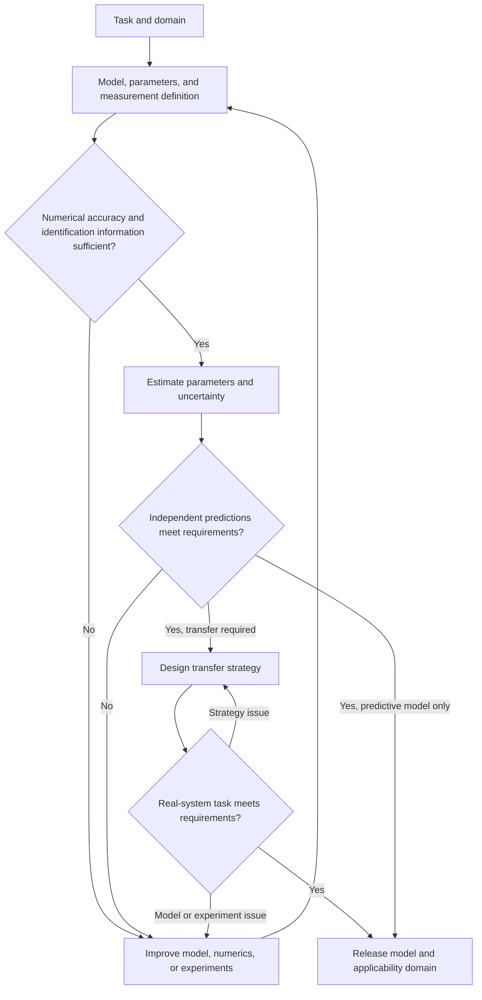
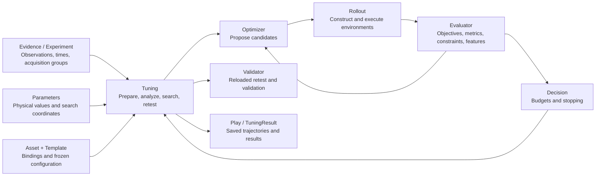

# Task-oriented parameter identification and simulation calibration

[Home](../README.md) · [Installation and quick start](user-guide.md) · [Cable example](../examples/cable_calibration/README.md)

Use this guide to define an identification problem, design experiments, choose an estimator, and interpret results with Newton Calibration. It covers rigid bodies, deformable bodies, contact, and combined robotic systems.

You supply the experiments, physical interpretation, and real-system acceptance tests. Newton Calibration runs the defined problem and records the evidence needed to assess its results.

Start with [Section 3](#3-connecting-a-problem-to-newton-calibration) if you already have data and an adapter. Follow [Section 2](#2-workflow-and-stage-deliverables) to define a new problem. Use [Section 4](#4-using-residuals-to-plan-the-next-iteration) to investigate unsuccessful results.

## 1 Goals, methods, and the role of the module

### 1.1 Three related goals with distinct evidence requirements

| Goal | What the evidence should establish |
|---|---|
| Credible physical parameters | Parameters have a clear physical meaning and sufficient measurement and identifiability support |
| Credible simulation predictions | The model predicts real responses under conditions withheld from fitting |
| Effective task transfer | Control trained or planned with the model accomplishes the task on the real system |

State which goal the calibration serves and which conclusions still need validation. Evidence for one goal does not establish the others. Parameters whose errors compensate for each other can still reproduce the measured trajectories, so a good fit does not show that the parameters are physically right. A biased model can predict accurately, but only within a restricted range. Robust control can succeed on the real task despite substantial parameter error. Judge each conclusion by its evidence about model assumptions, numerical error, and uncertainty. [R1] [R6]

A calibration should provide evidence for its parameters and response predictions under a stated model, numerical configuration, dataset, and domain of applicability. Report the uncertainty that remains. To claim sim-to-real transfer, also test the task on the real system after freezing the model and strategy.

### 1.2 Identification methods

Choose a method based on the available equations, observations, gradients, statistical goal, and computational cost. Choose the model structure, estimation criterion, and optimizer separately. Several solution methods can work with the same physical model, and approaches can be combined. [R4]

| Approach | How it uses information | Applicability and limitations |
|---|---|---|
| Structured regression and physically constrained identification | Exploit linear structure in parameters or parameter combinations and impose physical constraints | Requires a known dynamics structure and reliable inputs and torque data. Often identifies base parameter combinations. Constraints still require informative experiments |
| State-space and prediction-error identification | Specify state transitions, observations, initial states, delays, and noise, then minimize prediction error | Suits input-output dynamics and hidden states. Evaluate one-step prediction, multistep prediction, and free forward rollout separately |
| Black-box forward-simulation search | Evaluate candidate parameters through simulation and scoring | Requires only forward evaluations. Cost depends on dimension, rollout cost, and search difficulty |
| Differentiable simulation and gradient methods | Obtain loss derivatives through automatic differentiation or adjoints | Can be efficient with reliable gradients. Check contact transitions, long-horizon backpropagation, scaling, and local minima |
| Bayesian identification and simulation-based inference (SBI) | Estimate parameter or predictive distributions under explicit prior, noise, and model-discrepancy assumptions | Supports uncertainty and multiple solutions. Check prior sensitivity, inference calibration, and posterior predictions |
| Physical models with residual models | Use learnable terms to represent missing behavior | Specify whether compensation enters dynamics, observations, or control, and assess generalization and confounding with physical parameters |

Examples include physical-consistency constraints for robot inertial parameters, DPSI's differentiable joint identification, conditional-density-based SBI, and Universal Differential Equations. Section 1.3 lists the methods available in Newton Calibration. [R5] [R7] [R8] [R9]

### 1.3 Newton Calibration uses black-box forward simulation and search

$$
\theta
\longrightarrow \text{simulation}
\longrightarrow \text{predicted observations}
\longrightarrow \text{loss}.
$$

Black-box refers to how the optimizer uses the simulator. It proposes parameters and receives scores computed from simulated responses. The model itself can contain explicit geometry, dynamics, constitutive equations, and contact laws.

CMA-ES, the cross-entropy method (CEM), parallel sampling, and Bayesian optimization can solve this kind of problem. Evaluating candidates in parallel can reduce wall-clock time, depending on backend batching, resource use, and the cost of each simulation.

The built-in optimizers are `GridSearch` and `CMAES`. CEM, Bayesian optimization, differentiable optimization, and Bayesian posterior inference require additional members or external workflows. Use external systems for automated physical experiment design, policy training, domain-randomization training, and online adaptation. The [user guide](user-guide.md#1-install) lists the extra each optimizer needs.

The module freezes the problem definition, checks parameter bindings and numerical settings, and analyzes local sensitivity and identifiability. It then evaluates candidates within a budget and exports, reloads, retests, and validates the selected candidate. Measurement, model selection, and real-system experiments stay outside the module, in the wider engineering workflow.

## 2 Workflow and stage deliverables

The order of work depends on observability, cost, and how errors affect one another. Expect to revisit model choices, numerical settings, and experiments as evidence develops.

| Stage | Main work | Required record |
|---|---|---|
| 1 Task and domain of applicability | Define task, speed, load, initial state, contact modes, and quantities of interest (QOIs) | Task specification, acceptance thresholds, error budget, and operating domain |
| 2 Model definition | Select rigid/deformable representations, constitutive laws, contact, actuation, observations, and internal states | Assumptions, candidate models, represented and unsupported phenomena |
| 3 Parameter and evidence registration | Measure known quantities, list unknowns, establish prior information and dependencies | Parameter Registry, Prior Envelope, and evidence sources |
| 4 Measurement and data design | Calibrate the measurement chain, synchronize, repeat acquisitions, and split by experiment | Data protocol, initial and boundary conditions, fitting/development/sealed datasets |
| 5 Numerical qualification | Check effects of discretization, integration, iteration, precision, and coupling on QOIs | Frozen configuration with a stated scope and numerical-error records |
| 6 Identifiability and experiment design | Assess sensitivity, correlated directions, and prior dependence, then design additional excitation | Identifiable parameters or combinations and an active experiment plan |
| 7 Parameter estimation | Estimate jointly or in stages using physical constraints and multiple evidence types | Values and intervals or feasible sets, losses, and residual diagnostics |
| 8 Independent response prediction | Test new motions, speeds, loads, boundaries, and contact modes | Prediction errors, intervals, mismatch types, and model-revision decisions |
| 9 Transfer strategy design | Translate remaining uncertainty into randomization, online adaptation, or residual compensation | Training distribution, adaptation mechanism, and coverage limits |
| 10 Sealed task acceptance | Freeze model and strategy, then perform independent real-system tests | Success rate and confidence interval, forces, timing, failure modes, and applicability |
| 11 Versioned release and maintenance | Preserve model, numerical, data, parameter, and validation versions | Reproducible parameter package, model card, and recalibration triggers |

The stages organize engineering deliverables using ideas from verification, validation, and uncertainty quantification (VVUQ), application-oriented identification, and active experiment design. [R1] [R2] [R3]

State the statistical procedure behind any reported interval. If you have not estimated intervals, say so and retain feasible-set or sensitivity evidence. Stages 9 and 10 apply to transfer goals. Mark them inapplicable when delivering only a predictive model, and state that scope. A task-transfer claim requires Stage 10 evidence.



### Running example: cable insertion with a robot and dexterous hand

The stage examples below follow one task. A robot arm with a dexterous hand grasps a network cable, carries it, aligns the plug with the socket, inserts it until the latch engages, then releases the latch and pulls the plug out. The simulation must also predict the force during insertion.

The task needs all three goals of Section 1.1, and evidence for one does not settle the others. The simulated robot can complete the insertion while the predicted peak insertion force is wrong, and a cable trajectory can fit well without identifying bending stiffness, clamp boundary and damping uniquely. Stages 1 and 2 treat the whole task. From Stage 3, the example follows the completed no-plug calibration in the [recorded 17 cm cable study](../examples/cable_calibration/README.md): register measured quantities, compare static and dynamic responses, investigate residuals, and qualify the fitted model under those conditions. The study provides no robot insertion or force-validation results. Its model variants A, B, B*, and C are successive calibration choices, distinct from the numbered workflow stages below.

### Stage 1 Task and domain of applicability

Define the task's quantities of interest before choosing parameters to fit. In cable insertion, the transport, alignment, initial-contact, guided-insertion, and latch-engagement phases each place different demands on the model.

| Object or phase | QOIs | Available observations | Relevant mechanisms |
|---|---|---|---|
| Robot joint motion | Tracking error, phase lag, reversal, and limit response | Commands, joint position/velocity, torque feedback | Actuation, inertia, friction, control timing, limits |
| Static cable loading | Sag, tip position, directional differences | Centerline, load, clamp pose | Stiffness, natural shape, mass, boundaries |
| Dynamic cable release | Peak/trough timing, amplitude, decay, final equilibrium | Time-varying centerline | Inertia, elasticity, dissipation, material history, release state |
| Plug insertion and locking | Axial/lateral forces, torque, latch events | Displacement and force records, success events | Contact geometry, friction, latch and contact-component deformation |

List each response separately from the parameters that might explain it, since one response usually depends on several parameters. Tracking lag may depend on drive gains, inertia, friction, and control delay. Tip sag may depend on stiffness, free length, mass, and clamp angle.

Define the primary objective, critical acceptance metrics, and diagnostic metrics before searching. Preserve critical peaks, event timing, and local worst-case errors alongside average error. Set thresholds using task tolerances, measurement error, and the numerical-error allowance. Retain previous definitions and reasons when revising them. The applicability domain should cover the object, speed, load, temperature or rate conditions, initial state, and contact modes.

#### Cable insertion example: sub-modules and quantities of interest

To align insertion force, record insertion displacement and speed, the plug's pose relative to the socket, contact and slip at the hand, and the force sensor's frame transform, offset and filtering. Compare the axial force-displacement curve, its peak and the peak's position, insertion work, and the latch engagement and release events, and keep lateral force, torque and the spread between repeated trials. Compute insertion work along the declared insertion axis over a declared interval, and state how gravity, inertial force and mounting reaction are removed from the sensor signal. Thresholds for these metrics come from task requirements, measurement error and repeatability, and are fixed before any sealed test. This example does not yet have those thresholds or independent acceptance data.

| Sub-module | Effect on the task | Quantities to register or identify first | Experiments or observations |
|---|---|---|---|
| Robot arm and control | Wrist pose, speed, drive force and response under load | Kinematics, mass and inertia, drive gains, friction, delay, limits, and how commanded input relates to actual input | Unloaded and known-load excitation, joint commands and feedback, end-effector motion |
| Dexterous hand and drives | Grasp stability, fingertip motion and contact force | Joint drives, friction, transmission and limits, finger-pad geometry and compliance | Free motion, known loads, constrained contact and grasp tests |
| Cable material and rest shape | Carrying resistance, tip spring-back, reaction torque and recovery of orientation | Axial, bending and torsional response under task loads, material memory, rest curvature and linear density | Static shape, release dynamics, torque against twist angle, cross-section orientation |
| Plug body | Inertia and local deformation | Geometry, mass, center of mass, inertia, latch and contact-spring compliance | Geometry and mass measurement, local loading, structural analysis where needed |
| Plug and socket | Guidance, insertion resistance, latching and extraction | Contact geometry, friction, deformation of the metal contacts and the latch | Force-displacement, latch and unlatch records at several speeds and poses |
| Plug-cable connection | Carries axial force, bending moment and torque between plug and cable | Effective joint location, translational and rotational compliance, damping, slip | Load the cable with the plug held fixed, and measure relative pose and load |
| Hand with plug or cable | Slip, local compression, grip force and held pose | Contact material pairs, finger-pad compliance, grasp location, normal force | Pull and twist tests under a fixed grasp, with contact force and slip observation |
| Socket mount, environment and measurement chain | The reaction boundary and the measured force and pose | Mount stiffness, sensor extrinsics, offsets, time synchronization, support contact | Rigid reference, sensor calibration, mount deformation and synchronization checks |

The table organizes evidence; it does not make the sub-modules separable. One insertion-force curve depends on plug geometry, contact friction, finger-pad compliance, grip normal force, cable reaction and controller response at once, and parameters from different physical categories can still be confounded in the available observations. [R6] [R7]

Fitting every parameter to complete insertion trajectories at once meets high simulation cost, weak excitation, correlated parameters and compensation: a stiffer cable and a different clamp boundary both change tip spring-back, and contact friction and grip normal force both change slip. This example therefore builds evidence for sub-modules and interfaces in controlled experiments first, then carries the results into the full task and adjusts the parameters that remain uncertain within the range that evidence supports. Controlled experiments vary loads, boundaries and inputs independently, so parameters produce more distinct responses. Each search fixes quantities that are measured or that the task is insensitive to, which concentrates the budget on a few directions. A residual that appears after integration can be traced to material, connection, contact, control or measurement instead of being absorbed by every parameter. Component parameters, with their domains, numerical settings and records, can serve other tasks or act as priors and constraints at system level.

Staged estimates keep the conditions and uncertainty of the experiments behind them. When an interface cannot be isolated, design a joint experiment or keep the identifiable combination, and after system-level adjustment, rerun the component experiments to check that the adjustment did not break them. [R2] [R6]

For the cable component, make the response requirements concrete before fitting. The recorded study uses static coordinate RMSE at most 3 mm and maximum coordinate error at most 9 mm; for release dynamics, the limits are 4 mm and 12 mm. It assigns 0.5 mm to numerical changes under the qualified conditions. These are the [case-specific requirements](../examples/cable_calibration/TUNING-SPEC.md#scope), not general tolerances for cable calibration or insertion force. The immediate goal is an equivalent model for a 17 cm free cable represented by 32 segments.

### Stage 2 Model definition

For each required mechanism, check how the physical phenomenon maps to an equation, its parameters, and the solver implementation. A robot model needs actuation, friction, limits, and control timing. A deformable model needs bending, torsion, natural shape, dissipation, and material memory. Contact also requires collision geometry, contact laws, and material pairs.

A complete forward problem can be written as

$$
\hat y_e=\mathcal H_{\eta_e}\!\left[
\operatorname{Sim}_{M,\nu}(\theta;u_e,x_{0,e},b_e,z_{0,e})
\right].
$$

Here, $M$ is the model structure, $\nu$ the numerical configuration, $\theta$ the physical or effective parameters, $u_e$ the input, $x_{0,e}$ and $b_e$ the initial and boundary conditions, and $z_{0,e}$ internal states such as material memory. The observation model $\mathcal H_{\eta_e}$ includes coordinate transforms, projection, and offsets. Scoring compares predicted $\hat y_e$ with real measurements of the same meaning.

Record phenomena the model represents, intentionally omits, or cannot express. When an important mechanism is missing, parameter compensation may reduce local error while degrading other conditions. [R6]

Select a solver by checking physical capabilities, parameter binding and observation interfaces, numerical accuracy, and budget. Newton's feature matrix helps shortlist candidates. Verify the actual version and backend, including whether the backend consumes each field used by the adapter. [R10]

#### Cable insertion example: one model per sub-module

| Sub-module | Model |
|---|---|
| Robot arm and dexterous hand | MuJoCo |
| Plug | MuJoCo rigid body |
| Plug and socket | SDF contact |
| Cable | VBD rod |
| Plug-cable connection | A solver coupling that exchanges forces between the MuJoCo plug and the VBD cable |

Calibrate the cable in an isolated experiment before using it in the full task. The study below uses a 20 cm cable of 7 mm diameter, with a 17 cm free length from the clamp to the free cable end and no plug attached. The board is flipped to obtain left- and right-facing cantilevers while preserving the same clamp.

The component model uses a 32-segment Newton VBD rod, a curved natural shape inferred from unloaded photographs, planar XZ motion, and no board contact. The task-level MuJoCo coupling above is outside this isolated cable experiment. Start with elastic bending and viscous damping. Add a shared clamp-angle correction or a rate-dependent material law only when the residuals and numerical checks support that choice. These assumptions are recorded in the [experimental specification](../examples/cable_calibration/TUNING-SPEC.md#confirmed-facts-and-assumptions).

### Stage 3 Parameter and evidence registration

#### Classify quantities by their role in the equations

| Category | Typical quantities | Management principle |
|---|---|---|
| Geometry and kinematics | Lengths, radii, collision surfaces, joint axes, mounting poses, natural shape | Prefer direct measurement and retain uncertainty and geometry versions |
| Inertia | Mass, center of mass, inertia, linear density | Combine measurements and CAD information, identifying observable combinations |
| Constitutive behavior | EA, bending matrix B, GJ, viscoelastic time constants, yield and plasticity parameters | Define units and mappings from the actual solver equations |
| Interactions | Friction, adhesion, physical contact compliance, connection compliance | Attribute values to material pairs and conditions |
| Actuation and control | Gains, delay, saturation, transmission friction, dead zones, filtering | Identify alongside command and actual-input semantics |
| Measurement and initial state | Transforms, offsets, time shifts, initial velocity, prestress | Calibrate independently or treat as nuisance parameters with prior information |
| Numerical configuration | dt, substeps, resolution, iterations, tolerances, precision | Select through numerical-error checks and retain as conditions of the parameter result |

Nuisance parameters account for auxiliary effects that influence the observations while you estimate the primary parameters. Manage the seven categories separately and justify which quantities enter a joint search.

Fields such as `stiffness`, `margin`, and `softness` can represent physical effective compliance, collision-geometry offsets, or numerical regularization. Classify them after checking their equations, dimensions, and software version. Normally, Stage 5 selects numerical settings. If they are deliberately co-tuned to obtain a task-equivalent model, state the resulting conditional interpretation and validate the new configuration. [R10]

#### Build a Parameter Registry and Prior Envelope

Keep a Parameter Registry with enough information to trace each quantity from its physical definition and evidence to its use in simulation.

| Information | What to record |
|---|---|
| Definition and implementation | Owning object, equation role, field or adapter entry point, units, discretization mapping |
| Baseline and evidence | Current value, measurement/CAD/historical identification/exploratory assumption, evidence version, uncertainty |
| Search and constraints | Bounds, linear/log scale, coupled constraints, measured/searched/frozen/diagnostic status |
| Identifiability support | Constraining experiments and observations, correlated parameters, identifiable combinations |
| Application and checks | When values take effect, rebuild/reset requirements, actual-object readback, perturbation response |
| Applicability and maintenance | Temperature, rate, load, control mode, discretization, model and parameter versions |

The Prior Envelope records justified ranges and dependencies. Distinguish hard physical constraints, measurement- or literature-supported ranges, and provisional exploration ranges. A probabilistic prior or confidence interval requires additional statistical definitions beyond search bounds. Preserve component evidence during system-level calibration so that component parameters remain constrained by their own measurements.

Positive parameters spanning orders of magnitude can use logarithmic search. Handle zero-valued friction or damping separately when needed. Check actual readback, rebuilding/resetting, single-parameter perturbations, and state isolation between candidates for every search parameter. Material-memory initialization is also part of the problem definition.

#### Cable example: registering measured quantities and initial assumptions

Begin with the quantities that can be established without fitting a trajectory: Cable length, diameter and mass determine geometry and linear density. The unloaded photographs supply a curved natural shape; the cantilever shape under gravity is a response to predict. Keep the clamp pose visible in the registry because boundary errors can be absorbed by material parameters.

| Quantity | Role in the initial fit A | Value or baseline | Search range or evidence |
|---|---|---|---|
| Free cable length | Fixed geometry | 0.17 m | Clamp to the free cable end |
| Diameter | Fixed, measured | 7 mm | Asset measurement |
| Linear density | Fixed, derived from measurements | 0.052 kg/m | 10.4 g over 0.20 m |
| Natural shape | Fixed observation-based geometry | Nonstraight planar centerline | Unloaded rest photographs; extrapolation beyond the last observed location |
| Bending rigidity EI | Searched, log scale | 0.00816 N m² | 0.002 to 0.012 N m² |
| Discrete bending damping | Searched, log scale | 0.012 N m s/rad at 32 segments | 0.003 to 0.025 N m s/rad at 32 segments |
| Clamp tangent | Initially fixed from the image geometry | Per-orientation tangent | Uncertain effective boundary; investigated after the first fit |

The EI and damping baselines and bounds are initial search choices from [configuration A](../examples/cable_calibration/configs/A.json), not independently measured material constants or confidence intervals. The [asset record](../examples/cable_calibration/data/asset.md) supplies the measured dimensions and mass. Fixed axial, shear and torsional coefficients are also part of the model definition; retain their exact per-model settings in the configurations rather than treating them as identified properties.

In the pinned adapter, interior joint bending stiffness is EI/h, where h is the segment length, and the clamp joint uses 2 EI/h for its half-segment span. The registered damping coefficient is the discrete value for 32 segments; a refinement maps it by (0.17/32)/h. Numerical damping used to settle a static configuration is kept separate from the physical damping fitted to the release. The [adapter](../examples/cable_calibration/backends/b/newton_backend.py) checks actual model values through parameter readback. These mappings belong to the recorded Newton version and must be checked again for another solver version.

Update the registry when the model changes. In B, a shared mount-angle offset enters with bounds of −5° to +5°, with opposite signs for the two orientations. Clamp compliance is fixed to zero after a flexible-clamp model fails numerical qualification; this is a modeling restriction, not a measurement of zero compliance. In C, the fitted EI becomes the fixed long-time rigidity, the old physical bending damping is set to zero, and transient rigidity and relaxation time become the searched parameters. Stage 7 explains the evidence behind those changes.

### Stage 4 Measurement and data design

Record timestamps, frames, units, sampling and filtering, commands and feedback, sensor calibration, initial and boundary conditions, processing scripts, and data versions. Repeat experiments to estimate noise and experimental variability before interpreting small improvements.

Record the measurement sampling rate, command update rate, controller update rate, physics integration step, and output sampling rate separately. A 50 Hz recording can require a much faster physical integrator. For image-derived centerlines, specify projection, occlusion, and the pixel-to-physical-coordinate conversion. Models such as the standard linear solid (SLS) also need preload, hold duration, and pre-release history.

State which quantities are inputs and which predictions you are testing. Prescribing measured end-effector motion lets you evaluate an object's response to that motion. Test robot dynamics and control response separately.

Split by independent experiment or acquisition group. Fitting data support estimation, development data support residual diagnosis and model selection, and sealed data support acceptance after freezing decisions. Time slices from one recording usually share initial conditions, noise, and processing errors. Once a dataset informs changes to model, bounds, loss, or thresholds, register it as development evidence for subsequent work.

Reserve separate evidence for Stage 8 response validation and Stage 10 real-system task acceptance. With limited data, use cross-validation during development and report whether an independent sealed test is still missing.

Save the measurement and synchronization protocols, initialization records, processing procedure, and each dataset's group and intended use.

#### Cable example: turning photographs and releases into observations

Use separate observations for natural geometry, equilibrium response and release motion. In this example, we use photographs of unloaded rest and left/right cantilevers, plus a left-facing release video. A visible ruler provides the image-to-length scale. Each response is sampled at 15 arc-length stations from 10 to 150 mm and stored as 30 x/z coordinate channels. The last 20 mm of the 170 mm model relies on extrapolation.

| Evidence | Observation and use |
|---|---|
| Unloaded rest photographs | Define the natural curved geometry used to construct the model |
| left/right cantilevers | Two static training experiments in A/B, sharing material and clamp parameters |
| dynamic release | Dynamic training experiment; video window 7.84–8.44 s |
| Pre-release shape history | Initialize the SLS internal state in C using the preceding 0.6 s |

The release window contains 31 frames at 0.02 s intervals. Initialize from the observed release state and estimated initial motion, then simulate freely. Mask the first three frames from scoring to reduce the effect of uncertain release timing and initial velocity, leaving 28 scored frames. The 50 Hz observation rate is distinct from the integration steps in Stage 5. B* and C use only the release states for fitting, with the static estimates frozen.

Keep the limits of this measurement chain explicit. Video presentation timestamps support the sample spacing, but recording speed was not independently verified. Ruler scaling does not provide a full camera calibration, and repeated-acquisition uncertainty was not established. The processed observations are reproducible inputs to scoring; the complete raw videos and extraction scripts are not bundled. [Processed experiments](../examples/cable_calibration/data/experiments.json) · [Observation details](../examples/cable_calibration/README.md#2-experiment-and-observation-pipeline)

### Stage 5 Numerical qualification

Assess whether simulation is sufficiently stable under numerical changes before interpreting fitting residuals. Check time integration, substeps, iterations, tolerances, spatial discretization, precision, and solver coupling wherever they affect QOIs. Use representative parameters and high-risk conditions, and repeat checks for the final candidate. [R1]

Keep the physical problem consistent during comparisons. Spatial refinement requires appropriate mappings for mass, stiffness, damping, and boundaries. Record the refinement sequence, QOI changes, and allowed numerical-error budget while keeping constitutive assumptions fixed.

Agreement across repeated runs at fixed settings establishes repeatability. To assess accuracy, use suitable refinements and judge the results against the declared error budget, protocol, and scope. Investigate nonmonotonic changes as part of that assessment.

For effective parameters tied to a particular discretization, you may use spatial changes as a diagnostic and require time/iteration accuracy for deployment. Include that discretization in the parameter package. Transfer to another discretization requires separate evidence.

Freeze the chosen configuration and record its accuracy or repeatability mode, checked conditions and boundaries, and numerical errors. Reassess qualification when the model, parameter range, or deployment configuration changes.

#### Cable example: qualifying the configuration used to interpret residuals

Before asking an optimizer to explain a trajectory, check whether numerical choices change that trajectory enough to affect the conclusion. In this case, the initial axial/shear settings of 3e7 did not converge for the cantilever. Later configurations use 1e5/1e4 after separate benchmark checks. A four-parameter model with a flexible clamp also failed time/space qualification within its budget; the subsequent search uses a rigid clamp. Neither change establishes the real cable's axial/shear properties or the real clamp's rigidity.

The B/B*/C configuration uses 32 segments and float32 VBD simulation: static integration at 1/960 s with 320 iterations, and dynamic integration at 1/1920 s with 160 iterations. Numerical settling damping is applied only to static calculations. The recorded solver is Newton 1.6.0.dev0 at commit `d37f4d3d341ccce1e06a1dff21e9a054759b4855`; C adds the bundled SLS patch. Simulation used Warp 1.17.0 on an NVIDIA RTX 5070 Ti Laptop GPU. These settings describe this case, not defaults for a new cable. [Configurations](../examples/cable_calibration/configs/) · [Solver and runtime requirements](../examples/cable_calibration/README.md#5-construct-or-rerun-a-stage-with-newton)

Recheck the selected candidate as well as the starting configuration. For C's dynamic prediction, the recorded maximum changes are:

| Check | Maximum coordinate change | Interpretation |
|---|---:|---|
| Halve the integration step | 0.179 mm | Below the 0.5 mm numerical allowance |
| Double solver iterations | 0.003 mm | Below the same allowance |
| Refine from 32 to 64 segments with iteration checks | 0.229 mm | Spatial diagnostic under the declared 32-segment interpretation |

The delivered interpretation is equivalent parameters for the 32-segment model under the no-plug conditions. The spatial diagnostic alone does not establish transferable continuum material properties. Retain this numerical configuration with the fitted parameters and requalify it when the experimental conditions change. [Numerical scope](../examples/cable_calibration/README.md#4-numerical-accuracy-and-remaining-limits) · [Candidate diagnostics](../examples/cable_calibration/archive/C-final-diagnostics.json)

### Stage 6 Identifiability and experiment design

Identifiability is whether different parameters produce distinguishable responses under the current model, experiments, and observation precision. Task sensitivity is how parameter changes affect the task's QOIs. Assess both.

#### Use two dimensions to set priorities

| Task sensitivity | Current identifiability | Action |
|---|---|---|
| High | High | Prioritize measurement and calibration |
| High | Low | Improve experiments, add observations, or retain correlated parameter sets |
| Low | High | Measure cheaply or take from existing records, and spend little search effort |
| Low | Low | Simplify, fix using documented prior information, or retain uncertainty |

Start with single-parameter perturbations. Check reproducibility, compare response changes with measurement noise and numerical error, and examine whether different parameters cause similar changes. With explicit scaling, singular values and correlated parameter directions characterize local information. Stronger conclusions may require profile likelihood, repeated experiments, or posterior analysis. [R11]

Local full rank depends on the analysis point, scaling, and threshold. Global uniqueness and statistical confidence require further analysis. Also distinguish information supplied by data from conditional identifiability obtained by fixing other quantities through prior assumptions.

#### Use experiments to distinguish competing explanations

| Experiment | Main purpose | Conditions to control or record |
|---|---|---|
| Multifrequency robot joint motion | Separate dynamic responses across time scales | Mode, frequency, amplitude, time axis, load, limits |
| Low-speed forward/reverse motion, reversals, varying loads | Separate friction, direction effects, and control influences | Temperature, velocity, torque semantics, repetitions |
| Static cantilevers in multiple directions or lengths | Constrain stiffness, natural shape, and clamping | Free length, mass, clamp pose, relaxation wait |
| Releases at multiple amplitudes, holds, cyclic loading | Separate inertia, damping, viscoelasticity, and history | Release state, preload, history, sampling, force/displacement |
| Contact/sliding motions at different normal loads | Separate contact parameters, boundaries, and drive compensation | Material pair, geometry, normal force, surface, velocity |

Material and contact parameters can affect the same observations. Friction depends on normal load, which depends on geometry, material, clamping, and control. DPSI jointly identifies material and environment parameters through a shared differentiable forward model. Use multiple actions, observations, and independent predictions to help distinguish coupled effects from parameter compensation. [R7]

Low-cost experiments with relatively isolated mechanisms can constrain parameters before joint system-level checks. Retain their uncertainty when fixing stage-wise estimates, since treating estimates as exact transfers error into later parameters. Active experiment design can choose excitation to reduce target uncertainty. The current module supplies local sensitivity analysis, while choosing and executing physical experiments remains external work. [R2] [R3]

Record which parameters or combinations are identifiable, why other quantities are temporarily fixed, and which experiments or observations to add first.

#### Cable example: separating material, boundary and dynamic explanations

Use the left/right cantilevers to ask whether one material model explains both orientations under a shared boundary. In A, improving the left static shape worsens the right one. Since the same clamp is preserved when the board is flipped, investigate one shared angle correction before assigning different material properties to each orientation. This is a hypothesis about the boundary, not proof that the angle caused the whole discrepancy. A and B also differ in numerical settings and search history; setting the angle to zero at B's other fitted values worsens the joint objective by only about 1.8%.

Next isolate the information in the release. With EI and angle frozen at B's values, a damping sweep shows that lower damping retains oscillations but predicts periods of about 0.24–0.26 s, compared with roughly 0.16 s in the measurement. Increasing damping suppresses the oscillations. That pattern motivates testing rate-dependent stiffness, while retaining release-state and timing uncertainty as competing explanations. [Residual investigation](../examples/cable_calibration/README.md#3-progress-and-the-reason-for-each-model-change)

When C introduces transient rigidity and relaxation time, the recorded local analysis finds rank 2 of 2, with singular values about 51.78 and 17.55 against a threshold of 0.0518. These values use the configured parameter scaling and training residuals at three analysis anchors. They support a local search over those two directions with long-time EI and angle held fixed. They do not establish global uniqueness, identify the frozen quantities independently, or provide confidence intervals. [Sensitivity and identifiability record](../examples/cable_calibration/archive/C-comparison.json)

Additional experiments were unavailable in this study. For a new study, direct clamp-pose measurements would constrain the boundary, repeated releases and an independently checked time base would constrain initialization and timing, and varied hold times or release amplitudes would help test material history. Record these as missing evidence rather than assuming that a good local fit resolves the competing explanations.

### Stage 7 Parameter estimation

Estimate parameters for the declared model, observations, initial states, boundaries, and numerical settings. Choose staged or joint estimation based on the information available, cost, and parameter dependencies. In staged estimation, retain earlier evidence and uncertainty. Recheck parameters jointly within those constraints where needed, and confirm that system-level adjustments still explain component experiments.

#### Different evidence types constrain different responses

| Data | Information provided | Common gaps |
|---|---|---|
| Static shape or centerline | Equilibrium stiffness, natural shape, boundaries | Dynamic inertia, damping, relaxation time |
| Motion trajectories | Dynamics, frequency, phase, decay | Unmeasured force scale and hidden internal states |
| Forces and torques | Resistance, load paths, stiffness, dissipation | Sensor offsets and gravity/inertia-compensation errors |
| Tactile observations and slip | Local contact, grasping, tangential response | Confounding between sensing elastomer and object parameters |
| Force-displacement and cyclic curves | Contact events, energy, hysteresis, locking | Time alignment and rate effects |
| Task-success events | Task boundaries and failure modes | A successful run can still hide wrong loads or parameter compensation |

Whether these observations uniquely determine parameters depends on the full problem. Shape and motion also depend on mass, boundaries, and initial states. Record hold time and relaxation state when using static observations to estimate long-term stiffness. DiffTactile combines motion, force, and tactile evidence. [R16]

#### Construct losses from evidence

Specify scales, temporal correlation, modality weights, and experiment normalization. Normalize squared millimeters, newtons, and pixels before combining them. Choose normalization so an experiment's frame count alone does not determine its importance. Record noise scales, which describe measurement reliability, separately from task weights, which describe importance.

- Align corresponding trajectories and shapes in time and space. Retain period, decay, and peak/trough timing alongside residuals. Model estimated time offsets explicitly, since unconstrained time warping can hide control delay.
- For point clouds without correspondence, consider Chamfer distance or Earth Mover's Distance (EMD). Specify occlusion, point density, squared or unsquared distance, and whether observations represent surfaces or reconstructed volumes. Filled particles incorporate reconstruction assumptions. DPSI compares observation representations and distance choices. [R7]
- Check frames, reference points, offsets, and gravity/inertia compensation for force, torque, tactile, and slip observations. Preserve peaks, impulse, slip onset, and sustained limit violations alongside averages.
- Define detection, matching, and missing-event rules for contact, latch, and success events before comparing timing, order, or probabilities. Include missing events in scoring.
- Calculate work and cyclic hysteresis from synchronized force-displacement curves. Equal work can accompany different peaks and timing, and measured dissipation can include fixture, contact, and drive effects.
- When combining modalities, retain physical-unit metrics and critical hard constraints for each channel. Explicit noise covariance or correlated-error models require appropriate implementations and statistical assumptions.

The default `Evaluator(loss="squared_error")` uses a normalized weighted mean squared error. For experiment $e$, repeat $r$, and valid observation set $\mathcal I_e$, the objective is

$$
L(\theta)=\sum_e\frac{w_e}{\sum_jw_j}\frac{1}{R_e}
\sum_{r=1}^{R_e}\frac{1}{N_e}
\sum_{i\in\mathcal I_e}
\left(\frac{\hat y_{e,r,i}(\theta)-y_{e,i}}{s_{e,i}}\right)^2.
$$

Here, $s$ is `Experiment.scale`, $N_e$ counts valid observations, $w_e$ is experiment weight, and $R_e$ is `Experiment.repeats`, the number of simulation repetitions against the same reference. Register independently acquired real repetitions as separate experiments. The default metrics, `normalized_rmse` and `normalized_max_error`, are dimensionless.

The built-in `cross_entropy` mode requires complete normalized probability rows. Event times, impulses, and work can be constructed as additional observation features under a declared protocol. MAE, Huber, Chamfer, or EMD require a suitable `Evaluator` implementation. Event extraction and probability calibration remain separate steps. Custom scoring must preserve the objective, metric, constraint, validity-mask, and feature contracts. Keep feature scales and dimensions consistent throughout a run for sensitivity and numerical checks. See Section 3.4 for metric-column requirements.

#### Choose estimators for the problem structure

| Conditions | Methods to consider | Main checks |
|---|---|---|
| Known linear parameter structure and reliable dynamic data | Weighted least squares, maximum likelihood, or suitable instrumental-variable methods according to noise assumptions | Base parameter combinations, regressor/noise correlation, likelihood or instrument validity, physical constraints |
| Low dimension, frequent contact transitions, inexpensive rollouts | CMA-ES, CEM, parallel sampling | Multiple starts, bounds, validation error |
| Expensive simulation and low dimension | Bayesian optimization or a surrogate | Surrogate error, budget, full-model verification |
| Higher dimension, reliable gradients, favorable local basin | Gauss-Newton for nonlinear least squares, L-BFGS or Adam for other smooth objectives | Parameter scaling, directional derivatives, local minima |
| Multiple modes with useful gradients in some regions | Global search followed by local differentiable refinement | Equal-budget comparison with a gradient-free baseline |
| Uncertainty estimation or multiple solutions | MCMC, SMC, approximate SBI, profile likelihood, bootstrap | Prior sensitivity, statistical assumptions, interval or posterior coverage |
| Persistent mismatch across conditions | Revise constitutive or boundary models, possibly add a residual model | Generalization, interpretability, model version |

Least squares specifies an objective and CMA-ES specifies a solution method, so they can be combined. A simulation objective can remain difficult to optimize even with useful gradients. Compare hybrid methods against equal-budget baselines. [R4] [R15]

#### What an estimate should include

Report candidate parameters, stopping reason, bound hits, training residuals, and correlated parameter directions. Agreement across search seeds supports search stability. Interpret search bounds, near-optimal candidate sets, and CMA-ES sampling covariance according to their algorithmic roles.

When reporting intervals, state whether they come from repeated experiments, profile likelihood, bootstrap, or an explicit statistical model. Posterior samples, Bayesian credible intervals, frequentist confidence intervals, and engineering acceptance ranges have distinct meanings. BayesSim provides an example of dedicated probabilistic inference. A conventional black-box search needs additional inference work for such outputs. [R11] [R12]

Recheck candidate numerical accuracy under critical conditions and assess how uncertainty affects QOIs. Return to Stage 6 when several parameter sets explain the data equally well, and to Stage 5 when numerical changes exceed budget. Persistent structured residuals after those checks motivate tests of model and boundary assumptions.

Include interpretation conditions, interval or feasible-set methods, loss and residual diagnostics, and unresolved issues with the parameter values.

#### Cable example: revising the estimate from its residuals

Start with a loss whose terms correspond to the observations and acceptance requirements. A/B give equal weight to the no-plug left static, right static and release experiments, using coordinate scales of 3 mm for static shapes and 4 mm for dynamics. Retain each experiment's RMSE and maximum error alongside the combined objective.

| Model | Search and evidence | Result and next question |
|---|---|---|
| A: EI and damping | CMA-ES, 16 candidates over two generations; joint static/dynamic fit | Left static improves, right static worsens; dynamic maximum error is 12.084 mm, just above the 12 mm limit. Investigate the boundary and search budget |
| B: add a shared angle | CMA-ES, 24 candidates over three generations; joint fit with rigid clamp | Training stopping target is reached. Freeze the static estimates conditionally and inspect the remaining dynamic waveform |
| B*: damping only | A 17-point grid with EI and angle frozen | Damping alone trades oscillation amplitude against period. Test a material model with rate-dependent stiffness |
| C: SLS transient rigidity and relaxation time | CMA-ES, 128 candidates over 16 generations | dynamic RMSE and maximum error meet the stated limits; retain the waveform diagnostics and numerical scope |

A ends at its generation budget, B at its training target, B* after exhausting its grid, and C at its generation budget. A's failure within a small budget does not demonstrate that the model has no better fit. B's configuration also includes qualification and warm-start work, so the A → B change is not a controlled angle-only experiment. The [case configurations](../examples/cable_calibration/configs/) preserve the corresponding starts, bounds and stopping rules.

For B* and C, use the same dynamic objective so their comparison has a defined meaning:

$$
L_{\mathrm{dyn}}=0.5\,\mathrm{MSE}_{\mathrm{all}}+0.5\,\mathrm{MSE}_{\mathrm{distal}\ z}.
$$

Both terms use a 4 mm coordinate scale and the same 28 scored frames. The distal term uses z at 130, 140 and 150 mm along the cable, preserving sensitivity to oscillation near the free end. This is a changed scoring protocol from A/B; compare B* with C under it rather than interpreting all four objectives as the same quantity. [Evaluator](../examples/cable_calibration/backends/staged_evaluator.py)

The SLS model places a relaxing Maxwell branch in parallel with the long-time bending stiffness. Freeze EI∞ at B's 0.00222896 N m² and the shared angle at +0.29056°, set the old physical viscous bending damping to zero, and search ΔEI over 0.001–0.009 N m² and τ over 0.015–0.1 s on logarithmic scales. Initialize the internal state using the observed pre-release history. C gives ΔEI = 0.00269861 N m² and τ = 0.0343552 s, so the instantaneous rigidity EI₀ = EI∞ + ΔEI is 0.00492757 N m². These are conditional point estimates; no statistical intervals were established.

| Model | left static RMSE (mm) | right static RMSE (mm) | dynamic RMSE / maximum (mm) |
|---|---:|---:|---:|
| Initial baseline | 3.486 | 0.421 | 6.366 / 25.127 |
| A | 0.699 | 2.395 | 3.230 / 12.084 |
| B | 0.238 | 0.887 | 1.617 / 9.016 |
| B* | — | — | 1.598 / 9.353 |
| C | 0.241 | 0.886 | 0.844 / 3.203 |

These are coordinate errors under the declared masks; C's static values are separate checks after the dynamic fit. The comparable B* → C objective falls from 0.509257 to 0.122177, a 76.0% reduction. The first trough/peak timing improves to 0.08/0.16 s, but later peak intervals of 0.20/0.18 s still differ from the measured 0.16/0.16 s. Use this improvement as evidence for the model within the observed window, while retaining the unresolved timing and transfer questions. [Scores and parameters](../examples/cable_calibration/README.md#3-progress-and-the-reason-for-each-model-change)

The completed example covers no-plug fitting, static rechecks and numerical qualification. Its observations were used to estimate parameters and choose the model, so these results establish fit quality under the stated conditions; independent response validation remains a separate requirement. The [archive check](../examples/cable_calibration/README.md#1-verify-the-reported-results-without-simulation) reproduces the reported scores from saved predictions and processed observations on the CPU.

### Stage 8 Independent response prediction

Freeze the candidate, then predict shapes, trajectories, forces, or events using data withheld from parameter, model, scoring, and threshold selection. Cover the claimed motions, speeds, loads, lengths, boundaries, and contact modes. Report aggregate and local errors, systematic bias, and failure conditions.

Separate any observation prefix used for initialization from the prediction-scoring window. With measured tool motion as input, conclusions concern object response under that boundary. Export/reload checks reproducibility, and numerical refinement checks sensitivity to solver settings. Retain these as separate evidence alongside independent prediction.

Report both coverage and width for prediction intervals, specifying whether observation noise or model discrepancy is included. Resampling should preserve complete trajectories or experimental groups when neighboring frames are correlated. Once Stage 8 results inform revisions, they become development evidence. A revised model needs new independent testing or an explicit validation limitation. Keep Stage 10 sealed task data outside parameter, model, randomization-range, controller, and threshold selection.

Use the errors, residuals, and interval evidence under new conditions to decide whether to use the frozen candidate, restrict its applicability, or revise the model.

### Stage 9 Transfer strategy design

Choose nominal-model training, evidence-based domain randomization, robust control, online adaptation, or residual compensation to suit the goal. Mark this stage inapplicable when delivering only parameters or a predictive model. When using dynamics randomization, explain how it addresses the task and its uncertainty. [R13]

Distinguish uncertainty about one object's parameters, real variation between objects, and robustness stress-test ranges. Preserve parameter correlations and physical constraints when sampling. After expanding the training domain, check numerical usability for representative high-risk configurations.

For online adaptation, state the observations available, updated states or parameters, and update timing. For residual compensation, identify whether it enters dynamics, observations, or control. Correct missing mechanisms and alignment errors as evidence warrants. Use development data for strategy selection, then freeze the strategy and permitted online-update rules.

Record the training distribution or nominal model, adaptation/compensation mechanisms, coverage limits, and model and strategy versions. Run training and deployment through external tools.

### Stage 10 Sealed task acceptance

Freeze the model, numerical settings, controller or policy, initialization protocol, success definition, critical thresholds, and statistical method before independent real-system testing. Report success rate together with force peaks, errors, timing, maintained states, and failure modes. Record which acceptance constraints passed and the applicable conditions. State the task-success evidence and physical-parameter evidence separately.

Use independent real-system episodes as the statistical unit. Report successes, total trials, conditions, and interval method. Frames, control steps, and simulation replays belong to their originating episodes. Fixed-sample designs can preselect Wilson or exact binomial intervals and a confidence level. If stopping depends on observed results, use an appropriate sequential design, because repeatedly inspecting a fixed-sample interval changes its interpretation. [R14]

Handle correlation between objects, batches, or consecutive trials through experimental grouping, stratified reporting, or suitable statistical methods. Preserve failed acceptance results and return to experimental, model, numerical, or transfer design as supported by evidence. Arrange new independent acceptance tests for revisions informed by those results.

### Stage 11 Versioned release and maintenance

A release should let another user reconstruct the problem and interpret the conclusion. Preserve model and solver versions and their dependencies, numerical settings, parameters and Registry, data and processing versions, scoring and thresholds, search records, post-freeze validation, applicability, and unresolved issues.

The model card should state what evidence supports each of the three goals and which goals remain incomplete. Software status `accepted` covers the configured checks, data, and thresholds. If numerical qualification used `repeatability` mode only, or real-system testing is still pending, say so in the model card.

Recalibration triggers can include geometry or sensor changes, maintenance and wear, controller updates, loads/rates/temperatures outside the supported domain, solver or discretization changes, and persistent excessive residuals. Retain previous results and identify new evidence and validation conditions for each update.

## 3 Connecting a problem to Newton Calibration

Once you have defined the problem, Newton Calibration checks the data, runs analysis and search, retests the candidate, and records the results. Arrange real measurements, model selection, statistical inference, and real-system acceptance in the surrounding workflow. The [user guide](user-guide.md) covers installation, the demo command, and the Python API.

### 3.1 Run a complete minimal example

Use Python 3.11 or newer and install from the repository root. The core uses NumPy. CMA-ES requires the `cma` extra, and each physics case supplies its Newton solver installation separately.

```bash
python -m pip install -e ".[cma]"
```

Run the built-in oscillator to try the lifecycle and read its results.

```python
from newton_calibration.examples import make_tuning

tuning = make_tuning(
    "oscillator",
    workspace="workspace/api_example",
    optimizer="cma_es",
    capacity=4,
)
result = tuning.run()

print(result.acceptance)
print(result.termination_reason)
print(result.parameters)
print(result.run_directory)
print(result.asset_path)
```

The factory constructs the members, and `run()` executes the lifecycle, including simulation and optimization. Each `Tuning` object runs once, so construct a new one for each run. Call `run()` rather than `prepare()`; `run()` calls `prepare()` for you.

For a real object, supply measured evidence and an adapter that implements the contracts below.

### 3.2 Mapping the problem definition to software members

Define the task, model, parameters, and experimental data through the members below. `Tuning` runs numerical checks, analysis, search, and validation, and records the results.

A member can support several engineering stages, and a stage usually needs several members.

#### Members and the eleven stages

| Problem definition | Member or organizer | Related stages | What to supply or check |
|---|---|---|---|
| Observations and data split | `Evidence`, `Experiment` | Primarily 4 measurement/data design and 8 independent prediction, supporting evidence registration in 3 | References, times, scales, masks, weights, simulation repeats, acquisition groups, training and validation datasets |
| Search parameters | `Parameter`, `Parameters` | Primarily 3 registration and 7 estimation, supporting analysis in 6 | Names, units, bounds, baselines, linear/log transforms, analyzed combinations, and a separately maintained full Registry |
| Assets and bindings | `Asset`, `Environment` | Implements 2 model definition, simulates for 5-8, exports for 11 | Model construction, parameter application/readback, initial/internal state, outputs, export/reload |
| Fixed problem configuration | `Template` | Primarily 2 model definition, 4 experimental conditions, 5 numerical qualification | Fixed physical quantities, numerics, discretization, per-experiment inputs/boundaries/seeds, qualification mode, refinements, tolerance |
| Execution and scoring | `Rollout`, `Evaluator` | Primarily 7 estimation, reused in 5 numerics, 6 identifiability, 8 prediction | Independent or batched execution, validity, objectives, metrics, constraints, residual features, user-defined QOIs and scoring |
| Search and stopping | `Optimizer`, `Decision` | Primarily 7 estimation, with lifecycle-wide budgeting | Candidate proposals/feedback, budgets, continue/stop decisions, built-in `GridSearch` and `CMAES` |
| Post-freeze checks | `Validator` | Primarily 8 independent prediction, plus training retest | Reloaded-candidate training retest, validation scores and thresholds, declared data and scope |
| Presentation | `Play` | Diagnostics and 11 result presentation | Comparison and export of saved trajectories |
| Shared lifecycle | `Tuning` | Implemented work in 5-8, archiving and conditional release in 11, checking/freezing inputs from 2-4 | Numerical qualification, local sensitivity/SVD, search, export/reload, retest, validation, state, results, accepted release packages |

Assemble `Tuning` from ten members named `evidence`, `asset`, `evaluator`, `parameters`, `rollout`, `optimizer`, `decision`, `validator`, `template`, and `play`. It owns `RunState` and produces `TuningResult`, with numerical qualification and local identifiability analysis built into the lifecycle. Sections 3.4-3.6 describe the scope of those checks.

#### Current boundaries and additional work

Users and external tools supply task requirements and physical evidence, and carry out analysis beyond the module's scope.

| Work or boundary | Stages | Current support and additional work |
|---|---|---|
| Task definition and model selection | 1-2 | Define task, QOIs, error budget, acceptance criteria, applicability, and constitutive/contact/actuation/observation models. Connect them through `Asset`, `Template`, `Evaluator`, and other members |
| Complete parameter and evidence registration | 3 | Bounds, baselines, and transforms are represented. Maintain physical definitions, measurement sources, dependencies, applicability, and the full Prior Envelope separately |
| Measurement and evidence-use management | 4, 8 | Observation containers and acquisition-group checks are provided. Sensor calibration, synchronization, real repeats, raw-data processing, and fitting/development/sealed-data management remain external. Independence requires acquisition evidence beyond group labels |
| Numerical verification beyond current coverage | 5, 8 | Initial and final core checks use training experiments. Choose meaningful refinements and tolerances, then add checks for claimed new loads, boundaries, or contacts |
| Global identifiability and active experiment design | 6 | Finite-difference sensitivity and local SVD are provided. Global uniqueness, prior dependence, additional excitation/observations, physical acquisition, and statistical intervals need further work |
| Task-specific scoring, other estimators, uncertainty | 7-8 | Default scoring, black-box search, and frozen-response validation are provided. Extend members or external workflows for special losses/constraints, other estimators, intervals/posteriors, and model revision |
| Transfer strategy and real-task acceptance | 9-10 | Domain randomization, policy training, adaptation, residual compensation, frozen real-task tests, and their statistics are external |
| Long-term release and maintenance | 11 | Run records, result files, and conditional release packages are provided. Complete model cards, long-term data/dependency management, deployment monitoring, and recalibration triggers belong to the engineering workflow |

#### Design choices and example integration

The core handles work shared by calibration problems through stable interfaces that can be checked independently. This includes problem freezing, binding checks, numerical qualification, local identifiability, candidate search/scoring, export/reload, retesting, validation, and recording.

Model selection, experiments, task evaluation, and transfer strategy depend on the object, sensors, control mode, and application. Implement adapters and analysis through the members, connecting them to experimental or control tools as needed. Revise the model or experiments and run another calibration when new evidence calls for it.

The cable example combines static and dynamic measurements with a material model, clamp boundaries, parameters, and validation conditions. Newton Calibration runs the numerical checks, analysis, search, and response validation. Residuals guide the next measurement or model revision. [Cable walkthrough](../examples/cable_calibration/README.md) · [Cable factory](../examples/cable_calibration/run.py)

### 3.3 Module usage reference

For background on solver capabilities and interfaces, see Newton's solver reference. [R10]

These interfaces and defaults apply to Newton Calibration 0.2.0. Import core classes through `newton_calibration` and synthetic examples through `newton_calibration.examples`. Section 3.3.12 assembles a complete example. [Public API](../newton_calibration/__init__.py) · [Synthetic example exports](../newton_calibration/examples.py)



#### 3.3.1 Evidence and Experiment store observations

`Experiment` holds one experiment's reference outputs and scoring conditions. `Evidence` groups experiments into training and validation data and records their sources. Put control commands, loads, and initial states in `Template.experiment_settings` under the same experiment ID. The environment uses those settings to run the forward problem.

```text
Experiment(id, group, reference, times=None, scale=1.0,
           mask=None, weight=1.0, repeats=1)
Evidence(train_data, validation_data=(), *, sources=None)
```

| Argument | Type or default | Usage |
|---|---|---|
| `id` | Required string | Unique across all training and validation experiments, and a key in `experiment_settings` |
| `group` | Required string | Real acquisition group. Training and validation group labels must be disjoint |
| `reference` | Nonempty `[T,D]` array | `T` times and `D` observation channels, converted to NumPy `float64` during preparation |
| `times` | `None` or `[T]` array | Finite, nonnegative, strictly increasing observation times. Record units, such as seconds. Omitted times become `0, 1, …, T-1` |
| `scale` | `1.0` | Positive finite scalar, `[D]`, or array broadcastable to `[T,D]`, used to normalize residuals |
| `mask` | `None` | Boolean `[T,D]`, with `True` selecting observations for scoring. Defaults to all valid, and must retain at least one element |
| `weight` | `1.0` | Positive finite relative experiment weight in the combined objective |
| `repeats` | `1` | Simulation repeats against the same reference, executed with experiment `seed + repeat` |
| `train_data` | Experiment sequence | At least one experiment for analysis and search |
| `validation_data` | `()` | Held-out experiments for individual evaluation after freezing the candidate |
| `sources` | `None` | Provenance dictionary for data versions, processing protocols, and measurement sources, included in the fingerprint |

`Evidence.prepare()` normalizes inputs, checks shapes, finiteness, IDs, and groups, then creates `evidence_id`. `Tuning` calls it during a complete run. For a standalone data check, construct `Evidence`, call `prepare()`, and inspect `train_data`, `validation_data`, and `fingerprint()`.

Robot channels might be `[q_1, …, q_n, qd_1, …, qd_n]` with separate position and velocity scales. Cable centerlines can be flattened into channels at fixed arc-length samples, with masks for occlusion and initialization windows. Register independent real recordings as separate `Experiment`s and preserve acquisition relationships with `group`. Document channel order, frames, and units.

#### 3.3.2 Parameter and Parameters define the search space

`Parameter` defines one scalar to estimate. `Parameters` keeps the vector in the supplied order and converts between physical values, normalized values, and search coordinates for parameter combinations. `Asset` applies the values to the solver.

```text
Parameter(name, bounds, baseline, unit="1", transform="linear")
Parameters(definitions)
```

| Argument | Requirements and meaning |
|---|---|
| `name` | Nonempty and unique, matching the asset's parameter key |
| `bounds` | Finite `(lower, upper)` with `lower < upper` |
| `baseline` | Finite and within the closed bounds, representing the pre-calibration value |
| `unit` | Unit description, default `"1"`. Data processing and adapters perform the agreed conversions |
| `transform` | `"linear"` or `"log"`. Logarithmic normalization requires a positive lower bound |
| `definitions` | Nonempty `Parameter` sequence whose order defines physical-vector columns |

For example, `Parameter("friction", (0.05, 0.65), 0.15)` defines dimensionless friction. `Parameter("tau", (0.001, 0.1), 0.02, unit="s", transform="log")` defines a positive time constant spanning two orders of magnitude, provided the material model and adapter implement the mechanism represented by `tau`.

| Interface | Result or purpose |
|---|---|
| `names`, `bounds`, `baseline` | Names, `[P,2]` bounds, and `[P]` baseline |
| `as_dict(row)` | Map one physical row to names, commonly for constructing the asset baseline |
| `to_normalized(values)` / `from_normalized(values)` | Convert between physical values and per-parameter `[0,1]` coordinates |
| `encode(values)` / `decode(values)` | Convert between physical values and the current combination search space, whose size is `dimension` |
| `check_bounds(values)` | Boolean validity of each physical row against finiteness and bounds |
| `snapshot()`, `parameter_space_id` | Record definitions, combination mapping, and identity |

The initial mapping normalizes each parameter independently. After identifiability analysis, `Tuning` can call `set_mapping(origin, basis)` to establish combination coordinates, then `freeze()` to lock the space. Decoded candidates still undergo physical-bound checks. Construct new `Parameters` when changing bounds or baseline for another run. Keep physical definitions, evidence, and dependencies in the Section 2 Registry.

#### 3.3.3 Template fixes a run's configuration

`Template` stores the physical conditions, numerical settings, and experiment inputs shared by all candidates. When constructing an environment, it merges fixed and candidate parameters and passes the experiment's settings to the asset adapter. The adapter defines and interprets the dictionary keys.

```text
Template(*, numeric_settings, discretization, fixed_parameters,
         experiment_settings, refinements=(), precision_tolerance=0.05,
         qualification_mode="refinement")
```

| Argument | Usage |
|---|---|
| `numeric_settings` | Required nonempty dictionary for integrator, timestep, substeps, iterations, and related settings, using keys understood by the environment |
| `discretization` | Required dictionary for rod segments, mesh resolution, or degrees of freedom. May be empty when appropriate |
| `fixed_parameters` | Required dictionary of fixed physical scalars, with keys disjoint from search parameters |
| `experiment_settings` | Required nonempty dictionary keyed by every experiment `id`. Each entry explicitly includes `seed` and adapter-specific inputs |
| `refinements` | Default `()`. Each configuration override may contain only `numeric_settings` and `discretization` |
| `precision_tolerance` | Default `0.05`, positive and finite, limiting maximum feature changes in numerical checks |
| `qualification_mode` | Default `"refinement"`, requiring valid refinement settings during a run. `"repeatability"` with empty `refinements` checks a fixed configuration |

The sliding example uses `numeric_settings={"dt": 0.02, "integrator": "event_trapezoid", "dtype": "float64"}`, fixes gravity with `fixed_parameters={"gravity": 9.81}`, and refines time with `{"numeric_settings": {"dt": 0.01}}`. A robot environment must consume the physics step, control period, and command sequence explicitly. A cable SLS environment must also preserve pre-release history and internal-state initialization conditions. [Cable factory](../examples/cable_calibration/run.py)

`resolve()` checks configuration, `freeze()` locks it, `snapshot()` returns serializable configuration data, and `template_id` identifies it. `refined(change)` creates a frozen refined template, with each refinement applied independently to the original. `instantiate(asset, parameter_values, experiment)` constructs one environment, and `instantiate_batch(...)` constructs a batch. `Rollout` normally calls these methods. Section 3.5 explains qualification scope and tolerance scaling.

#### 3.3.4 Asset, Environment, and Trace connect the simulator

`Asset` holds construction information, baseline parameters, and parameter-binding logic. `Environment` owns the mutable simulation state for one candidate and experiment and returns a `Trace`. When adding a robot or material model, implement model construction, parameter application, initial-state reset, and observation readout in these classes.

```text
Asset(baseline_parameters, *, config=None)
Asset.create_environment(template, parameter_values, experiment_settings)
Environment.run(times, *, seed, deadline)
Trace(times, values, positions=None)
```

`Asset` and `Environment` are abstract base classes. Use existing subclasses or implement their abstract methods above. The asset's `baseline_parameters` must exactly match `parameters.as_dict(parameters.baseline)`. Fixed physical values belong to the template. `config` stores construction information such as asset locations and model options, and is retained by default JSON export.

1. `create_environment()` receives merged fixed and candidate parameters, constructs an independent model, solver, and state, and applies experiment boundaries and initial conditions.
2. `applied_parameters` reports the effective values, read back from fields actually used in computation. Its key set must exactly match the combined fixed and search parameter keys.
3. `run()` samples at the requested `times`. `seed` applies to the current repeat. `deadline` is an absolute `time.monotonic()` deadline checked by the environment at interruptible points.
4. `close()` releases environment resources. `Rollout` calls it after execution.

The returned `Trace` uses the following layout.

| Field | Shape | Meaning |
|---|---|---|
| `times` | `[T]` | Matches reference times, checked by the built-in evaluator with absolute tolerance `1e-9` |
| `values` | `[T,D]` | Same channel order, units, and frame semantics as reference observations, finite wherever the mask selects data |
| `positions` | `None` or `[T,N,3]` | Optional display points. Default USDA output uses meters and Z-up |

Raise `SimulationError` for expected physical or numerical candidate failures and `TimeoutError` for deadlines. The lifecycle records other exceptions as execution errors and handles the failure. Include enough context to locate the model, input, or numerical issue.

Assets also provide `load_or_create()`, `snapshot()`, `asset_id`, `export(parameter_values, path)`, and `reload(path)`. Default export writes `newton-calibration-asset/1` JSON with the asset type, candidate parameters, and construction configuration. Calling `reload(path)` on the original asset returns an instance of the same type with the candidate baseline. Its `create_environment()` must still construct fresh mutable state. Subclasses that cache mutable models must handle rebuilding and isolation.

`SlidingAsset` and `OscillatorAsset` are available from `newton_calibration.examples`. The cable factory demonstrates a real-physics adapter, and robot environments can implement the same contracts. [Synthetic example exports](../newton_calibration/examples.py) · [Cable factory](../examples/cable_calibration/run.py)

#### 3.3.5 BatchEnvironment, Rollout, and Episode execute candidates

`Rollout` runs the candidate/experiment combinations, checks parameter readback, and collects results. Each candidate, experiment, and repeat produces an `Episode`, identified by `(trial_id, experiment_id, repeat)`.

```text
Rollout(capacity=1, *, worlds=None,
        parameter_rtol=1e-10, parameter_atol=1e-12)
Rollout.execute_batch(template, asset, trials, experiments, *, deadline=None)
```

| Argument | Behavior |
|---|---|
| `capacity` | Positive capacity, limiting worker threads for ordinary independent environments |
| `worlds` | `None` or a positive integer limiting candidates per batch environment. `None` puts the current batch's valid candidates in one environment |
| `parameter_rtol` | Readback relative tolerance, default `1e-10` |
| `parameter_atol` | Readback absolute tolerance, default `1e-12` |

For direct `execute_batch()` calls, supply `trials` as `(trial_id, physical_parameter_dict)` pairs, prepared `experiments`, and a frozen `template`. In a complete run, `Tuning` decodes candidates and calls the method. It returns an `Episode` tuple in candidate, experiment, and repeat order.

| Episode field | Meaning |
|---|---|
| `trial_id`, `experiment_id`, `repeat` | Candidate, experiment, and repetition identity |
| `status` | `completed`, or a failure such as `invalid_parameters`, `numerical_failure`, `timeout`, or `execution_error` |
| `trace` | Successful simulation `Trace`, default `None` |
| `error` | Error description, default `None` |
| `applied_parameters` | Full readback mapping, default empty dictionary |

Overriding `Asset.create_batch_environment(template, parameter_values, experiment_settings)` makes `asset.supports_batch` true and selects the batch path. `parameter_values` is a sequence of complete parameter dictionaries. Both `BatchEnvironment.applied_parameters` and `run(times, seed=..., deadline=...)` results preserve candidate order.

Each successful batch member returns a `Trace`. For a physical failure, return a `SimulationError` instance in that member's slot. Raising an exception from the batch call affects the entire current chunk. Each experiment and repeat gets a fresh batch environment. `worlds` controls chunking. NumPy, Warp, or another backend implements parallelism within each chunk. The ordinary path uses `capacity` threads. See `BatchedOscillatorAsset` for array-based batch execution. [Synthetic example exports](../newton_calibration/examples.py)

For example, 8 candidates, 2 training experiments, and `repeats=3` produce 48 episodes. The rollout budget counts all 48 even when the backend simulates candidates together.

#### 3.3.6 Evaluator converts trajectories into objectives and constraints

`Evaluator` matches the complete set of episodes to reference data by experiment, candidate, and repeat. It returns an objective, metrics, constraints, and residual features for each candidate. The objective ranks candidates, constraints determine feasibility, and features support sensitivity and numerical qualification.

```text
Evaluator(*, loss="squared_error", max_normalized_error=None)
Evaluator.score_batch(episodes, trial_ids, experiments)
```

| Argument | Behavior |
|---|---|
| `loss="squared_error"` | Aggregate normalized squared residuals using experiment weights, repeats, and valid observation counts, as defined in Section 2 |
| `loss="cross_entropy"` | Score probability rows. References and predictions must be nonnegative normalized rows, with whole rows selected or excluded by the mask |
| `max_normalized_error=None` | Default constraint matrix has zero columns. A positive finite threshold adds `max_error / threshold - 1 <= 0` |

For batch size `B`, constraint count `K`, and concatenated feature count `F`, `score_batch()` returns five arrays in this order.

| Return value | Shape | Meaning |
|---|---|---|
| `objectives` | `[B]` | Per-candidate objective, positive infinity for invalid candidates |
| `metrics` | `[B,2]` | Default columns `normalized_rmse` and `normalized_max_error`, with maximum error at column 1 |
| `constraints` | `[B,K]` | Each entry must be `<= 0` for satisfaction. Built-in `K` is 0 or 1 |
| `valid_mask` | `[B]` | True when traces, times, finite valid observations, and loss-specific inputs meet the contract |
| `features` | `[B,F]` | Normalized residuals concatenated in fixed experiment/repeat order, scaled by square-root factors for experiment weights, repeats, and valid sample counts |

With squared error, `objectives[i]` equals the sum of squares of `features[i]`, and `metrics[i,0]` is its square root. With cross-entropy, the objective uses probabilities while features and both default error metrics still use scaled prediction-minus-reference residuals. Interpret `scale` accordingly.

For positions in meters, `scale=0.03` and `max_normalized_error=2.0` impose an absolute-error limit of 0.06 m on valid position channels. With different channel scales, convert the threshold separately for each channel.

`metric_spec` records the scoring protocol and `evaluation_id` identifies it. Custom evaluators can override `score_batch()` and `metric_spec`, including objectives, units, constraints, and every adjustable scoring setting in the protocol. Preserve array shapes, order, and feature count. Current `Tuning` and `Validator` read maximum error from `metrics[:,1]`, so retain that column's contract or adapt the affected members together.

#### 3.3.7 Optimizer, GridSearch, and CMAES propose candidates

`Optimizer` uses an ask/tell protocol. After parameter analysis, `Tuning` calls `initialize(parameters)`. Once the budget allows a batch, it calls `ask(batch_size)` and returns scores through `tell(result)`. The optimizer must receive feedback for the pending batch before proposing another.

```text
Optimizer(batch_size=8, seed=42)
GridSearch(levels=11, batch_size=16)
CMAES(batch_size=8, sigma=0.2, seed=42)
```

| Member or argument | Meaning |
|---|---|
| `GridSearch.levels` | Equally spaced points per search dimension, at least 2, with `levels ** parameters.dimension` total points |
| `GridSearch.batch_size` | Requested candidates per batch. Remaining budget and grid points can reduce the last batch |
| `CMAES.batch_size` | Population per generation, at least 4. `full_batch=True` requires complete-generation evaluation |
| `CMAES.sigma` | Initial step size in the current normalized search coordinates, with `0 < sigma < 1` |
| `CMAES.seed` | Sampling seed, default 42, configured separately from experimental simulation seeds |

Use `GridSearch` to explore a few parameters and inspect responses across their ranges. It generates a grid in the current search coordinates and maps it to physical values with `Parameters.decode()`. `CMAES` requires the `cma` extra and at least two search dimensions. If rank reduction is enabled, choose the optimizer for the reduced `parameters.dimension`.

`ask()` returns `TrialBatch(trial_ids, search_values)` with `[B,Q]` values in `[0,1]`, where `Q` is search dimension. `tell()` receives the corresponding `BatchResult`, whose candidate IDs, search values, and `purpose="train"` must match.

`BatchResult` stores search and physical values, all five scoring outputs, `episode_records`, problem `identity`, and `purpose`. `feasible` combines validity and constraints. `feedback` maps feasible candidates below 1, constraint violations to `[1,2)`, and invalid candidates to 3. Built-in CMA-ES updates from `feedback`, while run records retain the raw objective.

To implement another algorithm, subclass `Optimizer` and implement `ask()`. Extend `initialize()`, `tell()`, `diagnostics()`, and `state_dict()` as needed, and optionally provide `checkpoint()` as CMA-ES does. `diagnostics()["exhausted"]` informs `Decision` about search-space exhaustion. Shared stopping and budget decisions remain in `Decision.next_action()`.

#### 3.3.8 Decision controls budgets and stopping

Before baseline, analysis, training, and validation work, `Decision` checks state and budgets and returns `DecisionResult(action, reason, batch_size=0)`. `Tuning` uses that decision to start the work or finish the run.

```text
Decision(max_trials=512, max_rollouts=10000, max_generations=100,
         max_seconds=300.0, target=1e-5, patience=None,
         improvement_tolerance=1e-10)
```

| Argument | Scope and meaning |
|---|---|
| `max_trials` | Training-candidate limit. Baseline and analysis probes are recorded in their own phases |
| `max_rollouts` | Episode limit across all phases, including scheduled failed or invalid candidates |
| `max_generations` | Training-batch limit, corresponding to generations for CMA-ES and chunks for GridSearch |
| `max_seconds` | Total wall-clock limit from preparation, handled through cooperative backend deadlines |
| `target` | Stop search when the best feasible training objective reaches this value |
| `patience` | Default `None`. When enabled, detect stagnation from improvement across the specified number of recent batches |
| `improvement_tolerance` | Threshold for old best objective minus new best objective when patience is enabled |

Budget limits are positive, `target` is finite and nonnegative, and enabled `patience` is a positive batch count. `next_action(state, request)` receives a read-only state snapshot and work request, then returns `action="continue"` or `"stop"`. Its `reason` enters decision history.

For example, `Decision(max_trials=41, max_generations=3, max_rollouts=200)` accommodates a one-dimensional 41-point grid in batches of 16, with episode capacity for analysis and validation. Estimate the full budget using experiments, repeats, parameter dimension, and refinements. `Validator` supplies final acceptance thresholds. Section 3.6 explains stopping and acceptance.

#### 3.3.9 Validator checks the exported candidate

`Validator` checks acceptance for each experiment. `Tuning` exports and reloads the selected asset, then retests it on training experiments and evaluates it on held-out validation experiments. Both checks call `validate()` and produce separate reports.

```text
Validator(max_objective=0.01, max_error=1.0)
Validator.accepts(result)
Validator.validate(candidate_asset, validation_data, evaluate)
```

| Argument or method | Usage |
|---|---|
| `max_objective` | Finite nonnegative objective limit, default `0.01` |
| `max_error` | Finite nonnegative limit on `metrics[:,1]`, default `1.0` |
| `accepts(result)` | True when every candidate is feasible and within objective and maximum-error limits |
| `validate(...)` | Call `evaluate(candidate_asset, (experiment,))` for each experiment and return a dictionary with `passed`, `status`, and `experiments` |

With default squared error, `max_objective=0.01` requires normalized RMSE of at most 0.1 for that evaluation. The maximum-error condition must also pass. Retesting each experiment separately checks even those given low weight during search.

`Tuning` supplies the `evaluate` callback, locks candidate identity, and performs budgeting, simulation, and scoring. Custom validators can add condition grouping or historical-evidence restrictions while preserving report fields and candidate identity. The default validator returns `status="unvalidated"` for empty validation data. `Tuning` organizes numerical rechecks separately and includes them in the final report.

#### 3.3.10 Play displays saved trajectories

`Play()` uses saved `Trace.positions` from episodes, matching before/after trajectories by `(experiment_id, repeat)`. The default comparison contains `baseline` and `calibrated` tracks and an acceptance flag.

| Method | Arguments and result |
|---|---|
| `compare(baseline, calibrated, references=None, *, accepted=False)` | Accept two episode sequences and return `accepted` and `tracks`. Matched traces require positions on both sides and exactly equal time axes |
| `export_usd(comparison, output_path)` | Write USDA point animation and return its path, with second-based time codes, meters, and Z-up |
| `show_gl(comparison, *, max_frames=None, screenshot=None, headless=False)` | Use Pyglet from the `gl` extra to project xyz onto xy, optionally limit frames and save a screenshot |

`references` is currently a reserved argument. Default tracks come from the two simulated position sequences. Extend comparison or presentation to overlay measurements or plot joints and torques.

After a run, inspect `tuning.comparison`. USDA and GL display require position tracks. Run the following after the complete example in Section 3.3.12.

```python
if tuning.comparison and tuning.comparison["tracks"]:
    path = tuning.play.export_usd(
        tuning.comparison,
        result.run_directory / "comparison-copy.usda",
    )
    print(path)
```

`Tuning.run()` attempts to generate `comparison.usda` automatically. The example above exports another copy. Presentation errors appear in `RunState.errors`. Scoring, validation, and numerical checks determine acceptance.

#### 3.3.11 Tuning assembles members and returns results

Pass the ten members to `Tuning` to run preparation, analysis, search, export/reload, retesting, and validation. Compose members and implement case adapters for your application.

```text
Tuning(*, evidence, asset, evaluator, parameters, rollout, optimizer,
       decision, validator, template, play, workspace="workspace",
       analysis_step=0.03, rank_tolerance=1e-3,
       allow_rank_reduction=False, orthogonalize=True)
```

| Additional argument | Default and behavior |
|---|---|
| `workspace` | `"workspace"`, the parent directory for distinct run directories with timestamp and random suffix |
| `analysis_step` | `0.03`, finite-difference step in per-parameter normalized coordinates, requiring `0 < step <= 0.25` |
| `rank_tolerance` | `1e-3`, relative rank threshold with `0 < tolerance < 1`. The singular-value cutoff is `max(s_max * tolerance, 1e-10)` |
| `allow_rank_reduction` | `False`, allowing search in retained identifiable combinations of nonzero rank when enabled |
| `orthogonalize` | `True`, building search coordinates from local SVD combinations. Required for rank reduction |

Start with `result = tuning.run()`. Calling `prepare()`, `sensitivity()`, `identifiability(report)`, and `evaluate_batch(...)` manually requires following the lifecycle, freezing, and budget protocols. Let `run()` manage those steps, using a fresh instance for each run.

`tuning.state` is a `RunState` containing `phase`, `identity`, `budget_usage`, `batch_history`, `best_candidate`, `analysis_reports`, `optimizer_snapshot`, `decision_history`, `validation_report`, `artifact_refs`, and errors. `state.view()` supplies a read-only decision snapshot. Inspect `run_state.json` after execution to trace these records.

`run()` returns a `TuningResult` with five fields.

| Field | Meaning |
|---|---|
| `acceptance` | Acceptance status, such as `accepted`, `rejected_training`, or `rejected_validation` |
| `termination_reason` | Search or run stopping reason, such as `target_reached` or `budget_exhausted` |
| `parameters` | Best candidate's physical parameter dictionary, or `None` before a candidate exists. Interpret it within the acceptance scope |
| `asset_path` | Accepted `release/asset.json` path, otherwise `None` |
| `run_directory` | Directory containing this run's records and results |

#### 3.3.12 Assemble all ten members in a runnable example

Assemble `SlidingAsset`, `GridSearch`, and the shared members to identify friction in a single-degree-of-freedom sliding model. The analytical reference uses friction `0.35`, two initial speeds for training, and a different speed for validation. This checks the API connections and result access. Use measured data and a physical adapter when identifying a real system.

Run the complete code below in an environment with Newton Calibration installed. Numerical settings, scales, and thresholds are specific to this synthetic example.

```python
import numpy as np

from newton_calibration import (
    Decision,
    Evaluator,
    Evidence,
    Experiment,
    GridSearch,
    Parameter,
    Parameters,
    Play,
    Rollout,
    Template,
    Tuning,
    Validator,
)
from newton_calibration.examples import SlidingAsset

parameters = Parameters([Parameter("friction", bounds=(0.05, 0.65), baseline=0.15)])
asset = SlidingAsset(parameters.as_dict(parameters.baseline))

settings = {
    "slow": {"initial_speed": 1.2, "seed": 1},
    "fast": {"initial_speed": 2.1, "seed": 2},
    "holdout": {"initial_speed": 1.7, "seed": 3},
}
times = np.linspace(0.0, 1.0, 41)
gravity = 9.81
deceleration = 0.35 * gravity
experiments = []
for experiment_id, setting in settings.items():
    speed = setting["initial_speed"]
    moving_time = np.minimum(times, speed / deceleration)
    position = speed * moving_time - 0.5 * deceleration * moving_time**2
    experiments.append(
        Experiment(
            id=experiment_id,
            group=experiment_id,
            reference=position[:, None],
            times=times,
            scale=0.03,
        )
    )

evidence = Evidence(
    train_data=experiments[:2],
    validation_data=experiments[2:],
    sources={"kind": "analytical synthetic sliding trajectories"},
)
template = Template(
    numeric_settings={
        "dt": 0.02,
        "integrator": "event_trapezoid",
        "dtype": "float64",
    },
    discretization={"degrees_of_freedom": 1},
    fixed_parameters={"gravity": gravity},
    experiment_settings=settings,
    refinements=({"numeric_settings": {"dt": 0.01}},),
    precision_tolerance=0.02,
    qualification_mode="refinement",
)
tuning = Tuning(
    evidence=evidence,
    asset=asset,
    evaluator=Evaluator(loss="squared_error", max_normalized_error=2.0),
    parameters=parameters,
    rollout=Rollout(capacity=2),
    optimizer=GridSearch(levels=41, batch_size=16),
    decision=Decision(
        max_trials=41,
        max_rollouts=200,
        max_generations=3,
        max_seconds=180.0,
        target=1e-4,
    ),
    validator=Validator(max_objective=0.04, max_error=0.6),
    template=template,
    play=Play(),
    workspace="workspace/sliding-guide",
)
result = tuning.run()
print(result.acceptance)
print(result.termination_reason)
print(result.parameters)
print(result.run_directory)
print(result.asset_path)

assert result.acceptance == "accepted"
assert abs(result.parameters["friction"] - 0.35) < 1e-8
assert result.asset_path.is_file()
```

For a robot adapter, define joint actuation, initial states, control timing, and observation channels. A cable SLS adapter also needs material history, discretization mapping, and numerical refinement. Both use the member contracts to run through `Tuning.run()`. [Cable factory](../examples/cable_calibration/run.py)

### 3.4 Contracts to check during integration

Check these contracts before the first complete run. The Section 3.3 subsection named in each item gives the details.

- Evidence (Section 3.3.1). Supply `[T,D]` reference values, `[T]` times, Boolean `[T,D]` masks, and positive broadcastable scales. `Evidence` rejects a group label shared by training and validation data, but the label itself does not prove independence, so keep the acquisition records. `Evidence` holds only training and validation data. Track development and sealed-data use across runs outside the module, along with image processing, camera calibration, and data collection.
- Parameters and template (Sections 3.3.2 and 3.3.3). The asset baseline must equal the `Parameters` baseline, search keys must be disjoint from `Template.fixed_parameters`, and log-transformed parameters need a positive lower bound. Keep provenance, dependencies, and applicability in the Registry or experimental specification.
- Adapter (Section 3.3.4). `create_environment()` reads `Template.experiment_settings[experiment.id]` as inputs, initial states, boundaries, and seeds, builds independent mutable state, and reports values read back from the model through `applied_parameters`. `run()` uses the template's integration settings and returns a `Trace` aligned with the reference times. Raise `SimulationError` only for expected candidate failures, not for implementation errors. The backend must check the deadline itself, because a blocked simulation can run past the thread-based execution deadline.
- Scoring (Section 3.3.6). A custom evaluator returns all five arrays and keeps maximum error in `metrics[:,1]`, which `Tuning` and `Validator` read. Change the affected members together if that column moves.
- Execution (Section 3.3.5). Ordinary assets run in independent environments on `Rollout.capacity` threads. A batch environment must preserve candidate order and per-candidate readback and results. GPU batching and distributed execution need backend support; see [running candidates together](user-guide.md#running-candidates-together) in the user guide.

### 3.5 Lifecycle and analysis scope

`run()` prepares and freezes inputs, evaluates the baseline and numerical qualification, analyzes sensitivity and identifiability, searches, exports/reloads the candidate, retests training experiments, validates, and performs final numerical checks. It then records results and creates a release package when acceptance conditions pass.

Choose the numerical qualification mode explicitly. The default, `qualification_mode="refinement"`, requires at least one refinement that changes numerical or discretization settings. To check repeatability at fixed settings, select `qualification_mode="repeatability"` and `refinements=()`. Independent environments use the same settings and seeds, with scope reported as `fixed_configuration_only`. Check numerical convergence and cross-seed variation separately.

Initial qualification probes the baseline and normalized vectors filled with 0.25 and 0.75. The lifecycle repeats numerical qualification for the final candidate. Both initial and final core numerical checks use training experiments. Check other parameter regions and new validation loads or contact modes separately when they fall within the claimed domain.

`precision_tolerance` limits the maximum absolute change in `Evaluator.features`. Features incorporate residual scales, experiment weights, and valid sample counts. A physical tolerance such as 0.5 mm therefore requires an explicit mapping or an additional physical-unit metric.

Identifiability analysis uses finite differences at the same three anchors in normalized parameter coordinates. It applies SVD to the combined training-feature sensitivity matrix. By default, insufficient rank yields an inconclusive result. With positive retained rank, `allow_rank_reduction=True` and `orthogonalize=True` permit search in the retained local combinations, with omitted directions fixed at the normalized baseline. Zero rank stops the search. These orthogonalized coordinates describe local parameter combinations. Global physical separation and statistical intervals require further evidence.

### 3.6 Stopping reasons, acceptance, and budgets

`termination_reason` explains why search stopped. `acceptance` reports completion and outcome of the candidate's required checks. Target, generation, or time stopping conditions are evaluated separately from release eligibility.

| Status | Interpretation and next steps |
|---|---|
| `accepted` | Passed training scoring, exported/reloaded per-experiment training retest and validation, and numerical checks, within the stated conditions, thresholds, and qualification mode |
| `rejected_training` | Training candidate misses acceptance thresholds. Inspect residuals, bounds, model, and search adequacy |
| `rejected_validation` | Frozen-candidate validation fails. Inspect generalization, boundaries, model, and validation report |
| `rejected_numerics` | Qualification or final numerical recheck fails. Inspect solver settings and error budget first |
| `inconclusive` | Analysis cannot support the requested parameter conclusion. Improve identifiability or narrow the claimed scope |
| `unvalidated` | Validation data are absent or finalization was incomplete because of budget limits. Further validation is required for release |
| `no_feasible_candidate`, `run_failed` | No feasible candidate or fatal execution error. Use detailed reasons to investigate implementation, physics, or numerics |

`Validator` and related members define acceptance thresholds. `Decision.target` governs search stopping. The default lifecycle requires nonempty validation data for an accepted release, even with low training error.

`max_trials` limits training candidates. `max_rollouts` includes baseline, analysis, qualification, training, retesting, and validation. `max_seconds` covers the complete run. Leave budget for export/reload, validation, and final numerical checks. Checkpoints retain state for inspection, but a run cannot yet resume from one automatically. See [budgets and acceptance](user-guide.md#6-budgets-and-acceptance) in the user guide.

### 3.7 Result files

| File | Purpose |
|---|---|
| `resolved.json` | Observations, frozen configuration, identities, and versions needed to reconstruct the problem |
| `run_state.json` | Budget use, decisions, and phase state |
| `batches/*.json`, `checkpoints/*.pkl` | Candidate evaluation records and optimizer state |
| `candidate_asset.json` | Candidate saved on reaching export, with acceptance recorded separately |
| `result.json` | Stopping reason, acceptance, parameters, and result paths |
| `comparison.usda` | Visualization exported from saved trajectories |
| `release/asset.json`, `release/template.json`, `release/manifest.json` | Accepted asset, reconstruction conditions, and release manifest |

Default asset JSON stores parameters, adapter type, and construction configuration. Rebuilding simulation requires that adapter and the template. `Play` exports animated points/trajectories to USDA and displays saved states. The user guide shows [how to read the artifacts](user-guide.md#7-read-the-artifacts).

## 4 Using residuals to plan the next iteration

Identify how the run ended before changing the calibration. Check for execution errors, numerical candidate failures, exhausted budgets, training rejection, or validation failure. If the run completed with excessive error, inspect residuals by experiment, channel, and phase. Locate the problem in steady-state behavior, reversals, contact, peaks, or post-release motion.

Start with parameter binding and readback, then check data and input semantics, numerical accuracy, bounds, and budget. These checks are usually inexpensive and help isolate the cause before revising model assumptions. Adjust the order when the evidence points elsewhere. Measure mass or boundary conditions alongside other checks where useful.

| Main symptom | Check first | Return to |
|---|---|---|
| Response barely changes with parameters | Effective binding, units, indices, reset, experimental sensitivity | 3 registration and 6 identifiability |
| Global time or spatial shift | Synchronization, frames, input/output semantics, initial/boundary conditions | 4 measurement/data design |
| Refinement changes exceed budget | Integration, iterations, discretization mapping, coupling, initialization | 5 numerical qualification |
| Best candidates repeatedly hit bounds | Range evidence, scales, parameter compensation, numerical failures | 3 registration, and 2 model definition if needed |
| Several parameter sets fit similarly | Correlated directions, insufficient excitation or observations | 6 identifiability |
| Aggregate score improves but critical responses worsen | Weights, averaging of peaks, event/constraint coverage | 1 task definition and 7 estimation |
| Static/dynamic or load conditions cannot be explained together | Constitutive laws, control, contact, boundaries, internal states | 2 model definition and 4 measurement/data design |
| Training passes but new conditions fail | Data coverage, model transfer, coupling, numerics under new conditions | 8 independent prediction, then 2, 4, 5, or 6 according to cause |
| Predictions are adequate but real tasks fail | Policy coverage, observations, delays, control interface, task metrics | 9 transfer strategy, with model revision if needed |

Increase the search budget if candidates are still improving and the current budget is insufficient. Collect new evidence when the experiments leave parameters unresolved. A solver change should address a specific physical capability or accuracy requirement, with both solvers compared on the same benchmark. For persistent structured residuals, test a concrete hypothesis. Hold/cycle experiments can test material relaxation, while independent geometry or force measurements can help separate contact effects from boundary compensation.

## References

- **R1** National Research Council, 2012. Foundations for separating numerical verification, model validation, and uncertainty. [Assessing the Reliability of Complex Models][R1]
- **R2** Bombois et al., 2006. Application-oriented experiment design under cost constraints. [Least costly identification experiment for control][R2]
- **R3** Huan and Marzouk, 2013. Information-gain-based design for targeted parameters. [Simulation-based optimal Bayesian experimental design for nonlinear systems][R3]
- **R4** MIT *Underactuated Robotics*. Equation structure, prediction error, and simulation-error identification. [System Identification][R4]
- **R5** Wensing et al., 2017. Physical-consistency constraints on inertial parameters. [Linear Matrix Inequalities for Physically-Consistent Inertial Parameter Identification][R5]
- **R6** Brynjarsdóttir and O'Hagan, 2014. Confounding between model discrepancy and parameter interpretation. [Learning about physical parameters][R6]
- **R7** Yang et al., 2025. DPSI, joint material/environment identification, and observation/loss design. [Differentiable Physics-based System Identification for Robotic Manipulation of Elastoplastic Materials][R7]
- **R8** Papamakarios and Murray, 2016. Simulation-based inference with intractable likelihoods. [Fast ε-free Inference of Simulation Models with Bayesian Conditional Density Estimation][R8]
- **R9** Rackauckas et al. Combining physical and learnable model terms. [Universal Differential Equations for Scientific Machine Learning][R9]
- **R10** Newton official documentation. Solver capability selection, with interfaces checked against the deployed version. [Solvers][R10]
- **R11** Raue et al., 2009. Structural/practical identifiability and profile likelihood. [Structural and practical identifiability analysis of partially observed dynamical models by exploiting the profile likelihood][R11]
- **R12** Ramos et al., 2019. Probabilistic inference for simulator parameters. [BayesSim][R12]
- **R13** Peng et al., 2018. Dynamics randomization for transfer. [Sim-to-Real Transfer of Robotic Control with Dynamics Randomization][R13]
- **R14** NIST/SEMATECH *e-Handbook of Statistical Methods*, Section 7.2.4.1. Binomial-proportion intervals. [Confidence intervals][R14]
- **R15** Antonova et al., 2023. Combining global and local methods for difficult simulation objectives. [Rethinking Optimization with Differentiable Simulation from a Global Perspective][R15]
- **R16** *DiffTactile*, ICLR 2024. Multiple contact observations and differentiable calibration. [DiffTactile project and paper][R16]

## Related documents

- [Installation, API entry points, budgets, and outputs](user-guide.md)
- [Public core exports](../newton_calibration/__init__.py)
- [Public synthetic example exports](../newton_calibration/examples.py)
- [Cable experiments, historical results, numerical scope, and reproduction](../examples/cable_calibration/README.md)
- [Cable factory and member assembly](../examples/cable_calibration/run.py)
- [Cable experimental specification](../examples/cable_calibration/TUNING-SPEC.md)

[R1]: https://www.nationalacademies.org/read/13395/chapter/3
[R2]: https://research.tudelft.nl/en/publications/least-costly-identification-experiment-for-control/
[R3]: https://arxiv.org/abs/1108.4146
[R4]: https://underactuated.mit.edu/sysid.html
[R5]: https://arxiv.org/abs/1701.04395
[R6]: https://doi.org/10.1088/0266-5611/30/11/114007
[R7]: https://arxiv.org/abs/2411.00554
[R8]: https://arxiv.org/abs/1605.06376
[R9]: https://arxiv.org/abs/2001.04385
[R10]: https://newton-physics.github.io/newton/latest/solvers/index.html
[R11]: https://pubmed.ncbi.nlm.nih.gov/19505944/
[R12]: https://arxiv.org/abs/1906.01728
[R13]: https://arxiv.org/abs/1710.06537
[R14]: https://itl.nist.gov/div898/handbook/prc/section2/prc241.htm
[R15]: https://proceedings.mlr.press/v205/antonova23a.html
[R16]: https://difftactile.github.io/
