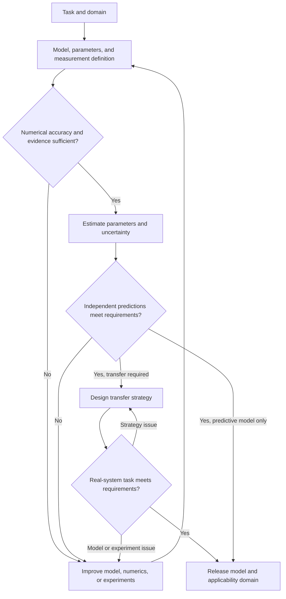

<!--
SPDX-FileCopyrightText: Copyright (c) 2026 The Newton Developers
SPDX-License-Identifier: CC-BY-4.0
-->

# Task-oriented parameter identification and simulation calibration

[Quick start](quickstart.md) · [API reference](api-reference.md) · [Cable study](../examples/cable_calibration/README.md)

Use this guide to decide what a calibration should establish, design the evidence it needs, fit parameters, and judge the result. It applies to rigid bodies, deformable bodies, contact, and combined robotic systems. The completed 17 cm cable study illustrates the decisions with static shapes and release motion.

Begin with the quick start to run an example and connect your own measurements and model. Here, follow the workflow from task definition through validation, returning to earlier decisions when the evidence calls for a revision.

An **adapter** connects a simulator to Newton Calibration. Its `Asset` and `Environment` classes construct the model, apply parameters, reset the experiment, and return simulated observations in the same units and order as the measurements.

- [Choose the calibration goal](#choose-the-goal-and-the-evidence-it-needs).
- [Work through the stages](#workflow-and-stage-deliverables).
- [Use residuals to choose the next experiment or model change](#using-residuals-to-plan-the-next-iteration).

## Goals, methods, and the role of the module

### Choose the goal and the evidence it needs

| Goal | What the evidence should establish |
|---|---|
| Credible physical parameters | Parameters have a clear physical meaning and sufficient measurement and identifiability support |
| Credible simulation predictions | The model predicts real responses under conditions withheld from fitting |
| Effective task transfer | Control trained or planned with the model accomplishes the task on the real system |

Choose the goal before selecting experiments, parameters, and acceptance criteria. Different goals can lead to different fitted values because they emphasize different responses and allow different model approximations.

For example, increasing cable stiffness and changing the assumed clamp angle can both reduce tip sag. A fit to one static image may therefore leave the stiffness uncertain. Additional shapes, boundary measurements, or dynamic evidence are needed to identify the material response. A robot controller may also complete insertion with an approximate cable model while the predicted cable forces remain inaccurate. The evidence for a task-success claim comes from real task trials, while a material-property claim needs measurements that constrain those properties. [R1](#ref-r1) [R6](#ref-r6)

For a prediction goal, specify the motions, speeds, loads, and boundaries that the model must predict on held-out experiments. A model may predict accurately within that domain while its parameters retain an effective, model-dependent interpretation. State the intended conclusion and the uncertainty that remains with each result.

This workflow focuses the parameter search on physical or effective model parameters. First select numerical settings and check their effect on the responses, then freeze them during parameter estimation. Repeat numerical verification at the fitted parameters. The timestep, solver iterations, precision, and discretization are conditions under which the parameter result applies. If numerical checks call for a different configuration, revise that configuration and reassess the fit before using the result.

### Identification methods

Newton Calibration currently implements black-box forward-simulation search through `GridSearch` and `CMAES`. The table below places that approach among other identification methods. The other rows require additional implementations or external workflows. The following section explains the built-in execution path.

Choose a method based on the available equations, observations, gradients, statistical goal, and computational cost. Choose the model structure, estimation criterion, and optimizer separately. Several solution methods can work with the same physical model, and approaches can be combined. [R4](#ref-r4)

| Approach | How it uses evidence | Applicability and limitations |
|---|---|---|
| Structured regression and physically constrained identification | Exploit linear structure in parameters or parameter combinations and impose physical constraints | Requires a known dynamics structure and reliable inputs and torque data. Often identifies base parameter combinations. Constraints still require informative experiments |
| State-space and prediction-error identification | Specify state transitions, observations, initial states, delays, and noise, then minimize prediction error | Suits input-output dynamics and hidden states. Evaluate one-step prediction, multistep prediction, and free forward rollout separately |
| Black-box forward-simulation search | Evaluate candidate parameters through simulation and scoring | Requires only forward evaluations. Cost depends on dimension, rollout cost, and search difficulty |
| Differentiable simulation and gradient methods | Obtain loss derivatives through automatic differentiation or adjoints | Can be efficient with reliable gradients. Check contact transitions, long-horizon backpropagation, scaling, and local minima |
| Bayesian identification and simulation-based inference (SBI) | Estimate parameter or predictive distributions under explicit prior, noise, and model-discrepancy assumptions | Supports uncertainty and multiple solutions. Check prior sensitivity, inference calibration, and posterior predictions |
| Physical models with residual models | Use learnable terms to represent missing behavior | Specify whether compensation enters dynamics, observations, or control, and assess generalization and confounding with physical parameters |

Examples include physical-consistency constraints for robot inertial parameters, DPSI's differentiable joint identification, conditional-density-based SBI, and Universal Differential Equations. The following section lists the methods available in Newton Calibration. [R5](#ref-r5) [R7](#ref-r7) [R8](#ref-r8) [R9](#ref-r9)

### Newton Calibration uses black-box forward simulation and search

```math
\theta
\longrightarrow \text{simulation}
\longrightarrow \text{predicted observations}
\longrightarrow \text{loss}.
```

Black-box refers to how the optimizer uses the simulator. It proposes parameters and receives scores computed from simulated responses. The model itself can contain explicit geometry, dynamics, constitutive equations, and contact laws.

CMA-ES, the cross-entropy method (CEM), parallel sampling, and Bayesian optimization can solve this kind of problem. Evaluating candidates in parallel can reduce wall-clock time, depending on backend batching, resource use, and the cost of each simulation.

The built-in optimizers are `GridSearch` and `CMAES`. CEM, Bayesian optimization, differentiable optimization, and Bayesian posterior inference require additional members or external workflows. Use external systems for automated physical experiment design, policy training, domain-randomization training, and online adaptation. The [quick start](quickstart.md#install) lists the extra each optimizer needs.

The module freezes the problem definition, checks parameter bindings and numerical settings, and analyzes local sensitivity and identifiability. It then evaluates candidates within a budget and exports, reloads, retests, and validates the selected candidate. Measurement, model selection, and real-system experiments stay outside the module, in the wider engineering workflow.

## Workflow and stage deliverables

The stages describe the engineering work needed to support a calibration claim. You choose the goal, model, measurements, and acceptance criteria. A configured `Tuning.run()` performs the numerical checks, local analysis, parameter search, and candidate checks supported by the module.

| Work | Your responsibility | Module execution | Skill assistance |
|---|---|---|---|
| Define the problem and obtain evidence | Choose the task, model, physical experiments, measured quantities, and thresholds | Check and freeze the supplied problem definition | `standard-tuning` coordinates configuration, while `tuning-evidence` and `tuning-environment` help specify observations and model conditions |
| Check numerics and identify parameters | Choose refinement settings, parameter bounds, evidence coverage, and interpretation | Run configured numerical comparisons, local sensitivity/SVD analysis, and budgeted search | `tuning-environment` and `tuning-search` help configure and interpret these checks |
| Test the candidate | Provide independent experiments and decide the claimed domain | Export/reload, retest, score held-out responses, and repeat numerical checks | Skills help inspect the reports and configure the next run when a revision is needed |
| Test the real task and maintain the model | Run physical task trials, evaluate transfer, and decide when recalibration is needed | Save run records and an accepted release package when its conditions pass | Skills can help organize the required configuration and records |

Skills guide an agent through configuration and implementation decisions. You provide the physical evidence and unresolved experimental facts. When a simulator needs a new connection, `tuning-adapter` helps implement the required member interfaces. Execution follows the scope you request. [Skill workflow](codex-skills.md)

The order of work depends on observability, cost, and how errors affect one another. Expect to revisit model choices, numerical settings, and experiments as evidence develops.

| Stage | Main work | Required record |
|---|---|---|
| 1 Task and domain of applicability | Define task, speed, load, initial state, contact modes, and quantities of interest (QOIs) | Task specification, acceptance thresholds, error budget, and operating domain |
| 2 Model definition | Select rigid/deformable representations, constitutive laws, contact, actuation, observations, and internal states | Assumptions, candidate models, represented and unsupported phenomena |
| 3 Parameter and evidence registration | Measure known quantities, list unknowns, record prior evidence and dependencies | Parameter definitions, justified ranges, and evidence sources |
| 4 Measurement and data design | Calibrate the measurement chain, synchronize, repeat acquisitions, and split by experiment | Data protocol, initial and boundary conditions, fitting/development/sealed datasets |
| 5 Numerical qualification | Check effects of discretization, integration, iteration, precision, and coupling on QOIs | Frozen configuration with a stated scope and numerical-error records |
| 6 Identifiability and experiment design | Assess sensitivity, correlated directions, and prior dependence, then design additional excitation | Identifiable parameters or combinations and an active experiment plan |
| 7 Parameter estimation | Estimate jointly or in stages using physical constraints and multiple evidence types | Values and intervals or feasible sets, losses, and residual diagnostics |
| 8 Independent response prediction | Test new motions, speeds, loads, boundaries, and contact modes | Prediction errors, intervals, mismatch types, and model-revision decisions |
| 9 Transfer strategy design | Translate remaining uncertainty into randomization, online adaptation, or residual compensation | Training distribution, adaptation mechanism, and coverage limits |
| 10 Sealed task acceptance | Freeze model and strategy, then perform independent real-system tests | Success rate and confidence interval, forces, timing, failure modes, and applicability |
| 11 Versioned release and maintenance | Preserve model, numerical, data, parameter, and validation versions | Reproducible parameter package, model card, and recalibration triggers |

The stages organize engineering deliverables using ideas from verification, validation, and uncertainty quantification (VVUQ), application-oriented identification, and active experiment design. [R1](#ref-r1) [R2](#ref-r2) [R3](#ref-r3)

State the statistical procedure behind any reported interval. If you have not estimated intervals, say so and retain feasible-set or sensitivity evidence. Stages 9 and 10 apply to transfer goals. Mark them inapplicable when delivering only a predictive model, and state that scope. A task-transfer claim requires Stage 10 evidence.



### Running example: cable insertion with a robot and dexterous hand

The stage examples below follow one task. A robot arm with a dexterous hand grasps a network cable, carries it, aligns the plug with the socket, inserts it until the latch engages, then releases the latch and pulls the plug out. The simulation must also predict the force during insertion.

The task needs all three calibration goals, and evidence for one does not settle the others. The simulated robot can complete the insertion while the predicted peak insertion force is wrong, and a cable trajectory can fit well without identifying bending stiffness, clamp boundary and damping uniquely. Stages 1 and 2 treat the whole task. From Stage 3, the example follows the completed no-plug calibration in the [recorded 17 cm cable study](../examples/cable_calibration/README.md): register measured quantities, compare static and dynamic responses, investigate residuals, and qualify the fitted model under those conditions. The study provides no robot insertion or force-validation results. Its model variants A, B, B*, and C are successive calibration choices, distinct from the numbered workflow stages below.

### Stage 1 Task and domain of applicability

Define the task's quantities of interest before choosing parameters to fit. In cable insertion, the transport, alignment, initial-contact, guided-insertion, and latch-engagement phases each place different demands on the model.

| Object or phase | QOIs | Available observations | Relevant mechanisms |
|---|---|---|---|
| Robot joint motion | Tracking error, phase lag, reversal, and limit response | Commands, joint position/velocity, torque feedback | Actuation, inertia, friction, control timing, limits |
| Static cable loading | Sag, tip position, directional differences | Centerline, load, clamp pose | Stiffness, natural shape, mass, boundaries |
| Dynamic cable release | Peak/trough timing, amplitude, decay, final equilibrium | Time-varying centerline | Inertia, elasticity, dissipation, material history, release state |
| Plug insertion and locking | Axial/lateral forces, torque, latch events | Displacement and force records, success events | Contact geometry, friction, latch and contact-component deformation |

List each response separately from the parameters that might explain it, since one response usually depends on several parameters. Tracking lag may depend on drive gains, inertia, friction, and control delay. Tip sag may depend on stiffness, free length, mass, and clamp angle.

Define the primary objective, critical acceptance metrics, and diagnostic metrics before searching. Preserve critical peaks, event timing, and local worst-case errors alongside average error. Set thresholds using task tolerances, measurement error, and the numerical-error allowance. Retain previous definitions and reasons when revising them. The applicability domain should cover the object, speed, load, temperature or rate conditions, initial state, and contact modes.

#### Cable insertion example: sub-modules and quantities of interest

To align insertion force, record insertion displacement and speed, the plug's pose relative to the socket, contact and slip at the hand, and the force sensor's frame transform, offset and filtering. Compare the axial force-displacement curve, its peak and the peak's position, insertion work, and the latch engagement and release events, and keep lateral force, torque and the spread between repeated trials. Compute insertion work along the declared insertion axis over a declared interval, and state how gravity, inertial force and mounting reaction are removed from the sensor signal. Thresholds for these metrics come from task requirements, measurement error and repeatability, and are fixed before any sealed test. This example does not yet have those thresholds or independent acceptance data.

| Sub-module | Effect on the task | Quantities to register or identify first | Experiments or observations |
|---|---|---|---|
| Robot arm and control | Wrist pose, speed, drive force and response under load | Kinematics, mass and inertia, drive gains, friction, delay, limits, and how commanded input relates to actual input | Unloaded and known-load excitation, joint commands and feedback, end-effector motion |
| Dexterous hand and drives | Grasp stability, fingertip motion and contact force | Joint drives, friction, transmission and limits, finger-pad geometry and compliance | Free motion, known loads, constrained contact and grasp tests |
| Cable material and rest shape | Carrying resistance, tip spring-back, reaction torque and recovery of orientation | Axial, bending and torsional response under task loads, material memory, rest curvature and linear density | Static shape, release dynamics, torque against twist angle, cross-section orientation |
| Plug body | Inertia and local deformation | Geometry, mass, center of mass, inertia, latch and contact-spring compliance | Geometry and mass measurement, local loading, structural analysis where needed |
| Plug and socket | Guidance, insertion resistance, latching and extraction | Contact geometry, friction, deformation of the metal contacts and the latch | Force-displacement, latch and unlatch records at several speeds and poses |
| Plug-cable connection | Carries axial force, bending moment and torque between plug and cable | Effective joint location, translational and rotational compliance, damping, slip | Load the cable with the plug held fixed, and measure relative pose and load |
| Hand with plug or cable | Slip, local compression, grip force and held pose | Contact material pairs, finger-pad compliance, grasp location, normal force | Pull and twist tests under a fixed grasp, with contact force and slip observation |
| Socket mount, environment and measurement chain | The reaction boundary and the measured force and pose | Mount stiffness, sensor extrinsics, offsets, time synchronization, support contact | Rigid reference, sensor calibration, mount deformation and synchronization checks |

The table organizes evidence; it does not make the sub-modules separable. One insertion-force curve depends on plug geometry, contact friction, finger-pad compliance, grip normal force, cable reaction and controller response at once, and parameters from different physical categories can still be confounded in the available observations. [R6](#ref-r6) [R7](#ref-r7)

Fitting every parameter to complete insertion trajectories at once meets high simulation cost, weak excitation, correlated parameters and compensation: a stiffer cable and a different clamp boundary both change tip spring-back, and contact friction and grip normal force both change slip. This example therefore builds evidence for sub-modules and interfaces in controlled experiments first, then carries the results into the full task and adjusts the parameters that remain uncertain within the range that evidence supports. Controlled experiments vary loads, boundaries and inputs independently, so parameters produce more distinct responses. Each search fixes quantities that are measured or that the task is insensitive to, which concentrates the budget on a few directions. A residual that appears after integration can be traced to material, connection, contact, control or measurement instead of being absorbed by every parameter. Component parameters, with their domains, numerical settings and records, can serve other tasks or act as priors and constraints at system level.

Staged estimates keep the conditions and uncertainty of the experiments behind them. When an interface cannot be isolated, design a joint experiment or keep the identifiable combination, and after system-level adjustment, rerun the component experiments to check that the adjustment did not break them. [R2](#ref-r2) [R6](#ref-r6)

For the cable component, make the response requirements concrete before fitting. The recorded study uses static coordinate RMSE at most 3 mm and maximum coordinate error at most 9 mm; for release dynamics, the limits are 4 mm and 12 mm. It assigns 0.5 mm to numerical changes under the qualified conditions. These are the [case-specific requirements](../examples/cable_calibration/TUNING-SPEC.md#scope), not general tolerances for cable calibration or insertion force. The immediate goal is an equivalent model for a 17 cm free cable represented by 32 segments.

### Stage 2 Model definition

For each required mechanism, check how the physical phenomenon maps to an equation, its parameters, and the solver implementation. A robot model needs actuation, friction, limits, and control timing. A deformable model needs bending, torsion, natural shape, dissipation, and material memory. Contact also requires collision geometry, contact laws, and material pairs.

A complete forward problem can be written as

```math
\hat y_e=\mathcal H_{\eta_e}\!\left[
\mathrm{Sim}_{M,\nu}\!\left(\theta;u_e,x_{0,e},b_e,z_{0,e}\right)
\right].
```

Here, $M$ is the model structure, $\nu$ the numerical configuration, $\theta$ the physical or effective parameters, $u_e$ the input, $x_{0,e}$ and $b_e$ the initial and boundary conditions, and $z_{0,e}$ internal states such as material memory. The observation model $\mathcal H_{\eta_e}$ includes coordinate transforms, projection, and offsets. Scoring compares predicted $\hat y_e$ with real measurements of the same meaning.

Record phenomena the model represents, intentionally omits, or cannot express. When an important mechanism is missing, parameter compensation may reduce local error while degrading other conditions. [R6](#ref-r6)

Select a solver by checking physical capabilities, parameter binding and observation interfaces, numerical accuracy, and budget. Newton's feature matrix helps shortlist candidates. Verify the actual version and backend, including whether the backend consumes each field used by the adapter. [R10](#ref-r10)

#### Cable insertion example: one model per sub-module

| Sub-module | Model |
|---|---|
| Robot arm and dexterous hand | MuJoCo |
| Plug | MuJoCo rigid body |
| Plug and socket | SDF contact |
| Cable | VBD rod |
| Plug-cable connection | A solver coupling that exchanges forces between the MuJoCo plug and the VBD cable |

Calibrate the cable in an isolated experiment before using it in the full task. The study below uses a 20 cm cable of 7 mm diameter, with a 17 cm free length from the clamp to the free cable end and no plug attached. The board is flipped to obtain left- and right-facing cantilevers while preserving the same clamp.

The component model uses a 32-segment Newton VBD rod, a curved natural shape inferred from unloaded photographs, planar XZ motion, and no board contact. The task-level MuJoCo coupling above is outside this isolated cable experiment. Start with elastic bending and viscous damping. Add a shared clamp-angle correction or a rate-dependent material law only when the residuals and numerical checks support that choice. These assumptions are recorded in the [experimental specification](../examples/cable_calibration/TUNING-SPEC.md#confirmed-facts-and-assumptions).

### Stage 3 Parameter and evidence registration

#### Classify quantities by their role in the equations

| Category | Typical quantities | Management principle |
|---|---|---|
| Geometry and kinematics | Lengths, radii, collision surfaces, joint axes, mounting poses, natural shape | Prefer direct measurement and retain uncertainty and geometry versions |
| Inertia | Mass, center of mass, inertia, linear density | Combine measurements and CAD evidence, identifying observable combinations |
| Constitutive behavior | EA, bending matrix B, GJ, viscoelastic time constants, yield and plasticity parameters | Define units and mappings from the actual solver equations |
| Interactions | Friction, adhesion, physical contact compliance, connection compliance | Attribute values to material pairs and conditions |
| Actuation and control | Gains, delay, saturation, transmission friction, dead zones, filtering | Identify alongside command and actual-input semantics |
| Measurement and initial state | Transforms, offsets, time shifts, initial velocity, prestress | Calibrate independently or treat as nuisance parameters with prior evidence |
| Numerical configuration | dt, substeps, resolution, iterations, tolerances, precision | Select through numerical-error checks and retain as conditions of the parameter result |

Nuisance parameters account for auxiliary effects that influence the observations while you estimate the primary parameters. Manage the seven categories separately and justify which quantities enter a joint search.

Fields such as `stiffness`, `margin`, and `softness` can represent physical effective compliance, collision-geometry offsets, or numerical regularization. Classify them after checking their equations, dimensions, and software version. Stage 5 selects numerical settings through refinement checks. Freeze that configuration during the physical-parameter search, then repeat the checks at the fitted values. Record a revised numerical configuration as a new calibration condition and reassess the parameter result under it. [R10](#ref-r10)

#### Record parameter definitions and justified ranges

Keep a parameter registry, a table that traces each quantity from its definition and evidence to the field used by the simulator. Record units, solver meaning, and when changing the value takes effect. `Parameter` stores the search name, unit, baseline, bounds, and transform. Maintain the remaining definitions and evidence alongside the experiment specification.

| Registry entry | What to record |
|---|---|
| Definition and implementation | Owning object, equation role, field or adapter entry point, units, discretization mapping |
| Baseline and evidence | Current value, measurement/CAD/historical identification/exploratory assumption, evidence version, uncertainty |
| Search and constraints | Bounds, linear/log scale, coupled constraints, measured/searched/frozen/diagnostic status |
| Identifiability support | Constraining experiments and observations, correlated parameters, identifiable combinations |
| Application and checks | When values take effect, rebuild/reset requirements, actual-object readback, perturbation response |
| Applicability and maintenance | Temperature, rate, load, control mode, discretization, model and parameter versions |

Record justified ranges and dependencies with each parameter. Distinguish hard physical constraints, measurement- or literature-supported ranges, and provisional exploration ranges. A probabilistic prior or confidence interval requires additional statistical definitions beyond search bounds. Preserve component evidence during system-level calibration so that component parameters remain constrained by their own measurements.

Positive parameters spanning orders of magnitude can use logarithmic search. Handle zero-valued friction or damping separately when needed. Check actual readback, rebuilding/resetting, single-parameter perturbations, and state isolation between candidates for every search parameter. Material-memory initialization is also part of the problem definition.

#### Cable example: registering measured quantities and initial assumptions

Begin with the quantities that can be established without fitting a trajectory: Cable length, diameter and mass determine geometry and linear density. The unloaded photographs supply a curved natural shape; the cantilever shape under gravity is a response to predict. Keep the clamp pose visible in the registry because boundary errors can be absorbed by material parameters.

| Quantity | Role in the initial fit A | Value or baseline | Search range or evidence |
|---|---|---|---|
| Free cable length | Fixed geometry | 0.17 m | Clamp to the free cable end |
| Diameter | Fixed, measured | 7 mm | Asset measurement |
| Linear density | Fixed, derived from measurements | 0.052 kg/m | 10.4 g over 0.20 m |
| Natural shape | Fixed observation-based geometry | Nonstraight planar centerline | Unloaded rest photographs; extrapolation beyond the last observed location |
| Bending rigidity EI | Searched, log scale | 0.00816 N m² | 0.002 to 0.012 N m² |
| Discrete bending damping | Searched, log scale | 0.012 N m s/rad at 32 segments | 0.003 to 0.025 N m s/rad at 32 segments |
| Clamp tangent | Initially fixed from the image geometry | Per-orientation tangent | Uncertain effective boundary; investigated after the first fit |

The EI and damping baselines and bounds are initial search choices from [configuration A](../examples/cable_calibration/configs/A.json), not independently measured material constants or confidence intervals. The [asset record](../examples/cable_calibration/data/asset.md) supplies the measured dimensions and mass. Fixed axial, shear and torsional coefficients are also part of the model definition; retain their exact per-model settings in the configurations rather than treating them as identified properties.

In the pinned adapter, interior joint bending stiffness is EI/h, where h is the segment length, and the clamp joint uses 2 EI/h for its half-segment span. The registered damping coefficient is the discrete value for 32 segments; a refinement maps it by (0.17/32)/h. Numerical damping used to settle a static configuration is kept separate from the physical damping fitted to the release. The [adapter](../examples/cable_calibration/backends/b/newton_backend.py) checks actual model values through parameter readback. These mappings belong to the recorded Newton version and must be checked again for another solver version.

Update the registry when the model changes. In B, a shared mount-angle offset enters with bounds of −5° to +5°, with opposite signs for the two orientations. Clamp compliance is fixed to zero after a flexible-clamp model fails numerical qualification; this is a modeling restriction, not a measurement of zero compliance. In C, the fitted EI becomes the fixed long-time rigidity, the old physical bending damping is set to zero, and transient rigidity and relaxation time become the searched parameters. Stage 7 explains the evidence behind those changes.

### Stage 4 Measurement and data design

Record timestamps, frames, units, sampling and filtering, commands and feedback, sensor calibration, initial and boundary conditions, processing scripts, and data versions. Repeat experiments to estimate noise and experimental variability before interpreting small improvements.

Record the measurement sampling rate, command update rate, controller update rate, physics integration step, and output sampling rate separately. A 50 Hz recording can require a much faster physical integrator. For image-derived centerlines, specify projection, occlusion, and the pixel-to-physical-coordinate conversion. Models such as the standard linear solid (SLS) also need preload, hold duration, and pre-release history.

State which quantities are inputs and which predictions you are testing. Prescribing measured end-effector motion lets you evaluate an object's response to that motion. Test robot dynamics and control response separately.

Split by independent experiment or acquisition group. Fitting data support estimation, development data support residual diagnosis and model selection, and sealed data support acceptance after freezing decisions. Time slices from one recording usually share initial conditions, noise, and processing errors. Once a dataset informs changes to model, bounds, loss, or thresholds, register it as development evidence for subsequent work.

Reserve separate evidence for Stage 8 response validation and Stage 10 real-system task acceptance. With limited data, use cross-validation during development and report whether an independent sealed test is still missing.

Save the measurement and synchronization protocols, initialization records, processing procedure, and each dataset's group and intended use.

#### Cable example: turning photographs and releases into observations

Use separate observations for natural geometry, equilibrium response and release motion. In this example, we use photographs of unloaded rest and left/right cantilevers, plus a left-facing release video. A visible ruler provides the image-to-length scale. Each response is sampled at 15 arc-length stations from 10 to 150 mm and stored as 30 x/z coordinate channels. The last 20 mm of the 170 mm model relies on extrapolation.

| Evidence | Observation and use |
|---|---|
| Unloaded rest photographs | Define the natural curved geometry used to construct the model |
| left/right cantilevers | Two static training experiments in A/B, sharing material and clamp parameters |
| dynamic release | Dynamic training experiment; video window 7.84–8.44 s |
| Pre-release shape history | Initialize the SLS internal state in C using the preceding 0.6 s |

The release window contains 31 frames at 0.02 s intervals. Initialize from the observed release state and estimated initial motion, then simulate freely. Mask the first three frames from scoring to reduce the effect of uncertain release timing and initial velocity, leaving 28 scored frames. The 50 Hz observation rate is distinct from the integration steps in Stage 5. B* and C use only the release states for fitting, with the static estimates frozen.

Keep the limits of this measurement chain explicit. Video presentation timestamps support the sample spacing, but recording speed was not independently verified. Ruler scaling does not provide a full camera calibration, and repeated-acquisition uncertainty was not established. The processed observations are reproducible inputs to scoring; the complete raw videos and extraction scripts are not bundled. [Processed experiments](../examples/cable_calibration/data/experiments.json) · [Observation details](../examples/cable_calibration/README.md#2-experiment-and-observation-pipeline)

### Stage 5 Numerical qualification

Numerical qualification checks whether changes such as a smaller timestep or more solver iterations change the predicted observations by an acceptable amount. Select and freeze the base configuration before fitting physical parameters. After fitting, repeat the check with the final physical values held fixed.

Assess whether simulation is sufficiently stable under numerical changes before interpreting fitting residuals. Check time integration, substeps, iterations, tolerances, spatial discretization, precision, and solver coupling wherever they affect QOIs. Use representative parameters and high-risk conditions, and repeat checks for the final candidate. [R1](#ref-r1)

Keep the physical problem consistent during comparisons. Spatial refinement requires appropriate mappings for mass, stiffness, damping, and boundaries. Record the refinement sequence, QOI changes, and allowed numerical-error budget while keeping constitutive assumptions fixed.

Agreement across repeated runs at fixed settings establishes repeatability. To assess accuracy, use suitable refinements and judge the results against the declared error budget, protocol, and scope. Investigate nonmonotonic changes as part of that assessment.

For effective parameters tied to a particular discretization, you may use spatial changes as a diagnostic and require time/iteration accuracy for deployment. Include that discretization in the parameter package. Transfer to another discretization requires separate evidence.

Freeze the chosen configuration and record its accuracy or repeatability mode, checked conditions and boundaries, and numerical errors. Reassess qualification when the model, parameter range, or deployment configuration changes.

#### Cable example: qualifying the configuration used to interpret residuals

Before asking an optimizer to explain a trajectory, check whether numerical choices change that trajectory enough to affect the conclusion. In this case, the initial axial/shear settings of 3e7 did not converge for the cantilever. Later configurations use 1e5/1e4 after separate benchmark checks. A four-parameter model with a flexible clamp also failed time/space qualification within its budget; the subsequent search uses a rigid clamp. Neither change establishes the real cable's axial/shear properties or the real clamp's rigidity.

The B/B*/C configuration uses 32 segments and float32 VBD simulation: static integration at 1/960 s with 320 iterations, and dynamic integration at 1/1920 s with 160 iterations. Numerical settling damping is applied only to static calculations. The recorded solver is Newton 1.6.0.dev0 at commit `d37f4d3d341ccce1e06a1dff21e9a054759b4855`; C adds the bundled SLS patch. Simulation used Warp 1.17.0 on an NVIDIA RTX 5070 Ti Laptop GPU. These settings describe this case, not defaults for a new cable. [Configurations](../examples/cable_calibration/configs/) · [Solver and runtime requirements](../examples/cable_calibration/README.md#5-construct-or-rerun-a-stage-with-newton)

Recheck the selected candidate as well as the starting configuration. For C's dynamic prediction, the recorded maximum changes are:

| Check | Maximum coordinate change | Interpretation |
|---|---:|---|
| Halve the integration step | 0.179 mm | Below the 0.5 mm numerical allowance |
| Double solver iterations | 0.003 mm | Below the same allowance |
| Refine from 32 to 64 segments with iteration checks | 0.229 mm | Spatial diagnostic under the declared 32-segment interpretation |

The delivered interpretation is equivalent parameters for the 32-segment model under the no-plug conditions. The spatial diagnostic alone does not establish transferable continuum material properties. Retain this numerical configuration with the fitted parameters and requalify it when the experimental conditions change. [Numerical scope](../examples/cable_calibration/README.md#4-numerical-accuracy-and-remaining-limits) · [Candidate diagnostics](../examples/cable_calibration/archive/C-final-diagnostics.json)

### Stage 6 Identifiability and experiment design

Identifiability asks whether the available experiments can distinguish the parameters being estimated. When several parameter combinations produce nearly the same observations, retain that ambiguity or collect evidence that separates their effects.

Identifiability is whether different parameters produce distinguishable responses under the current model, experiments, and observation precision. Task sensitivity is how parameter changes affect the task's QOIs. Assess both.

#### Use two dimensions to set priorities

| Task sensitivity | Current identifiability | Action |
|---|---|---|
| High | High | Prioritize measurement and calibration |
| High | Low | Improve experiments, add observations, or retain correlated parameter sets |
| Low | High | Measure cheaply or take from existing records, and spend little search effort |
| Low | Low | Simplify, fix using documented prior evidence, or retain uncertainty |

Start with single-parameter perturbations. Check reproducibility, compare response changes with measurement noise and numerical error, and examine whether different parameters cause similar changes. With explicit scaling, singular values and correlated parameter directions characterize local information. Stronger conclusions may require profile likelihood, repeated experiments, or posterior analysis. [R11](#ref-r11)

Local full rank depends on the analysis point, scaling, and threshold. Global uniqueness and statistical confidence require further analysis. Report how measured evidence constrains the parameters and how fixing other quantities through prior assumptions affects that conclusion.

#### Use experiments to distinguish competing explanations

| Experiment | Main purpose | Conditions to control or record |
|---|---|---|
| Multifrequency robot joint motion | Separate dynamic responses across time scales | Mode, frequency, amplitude, time axis, load, limits |
| Low-speed forward/reverse motion, reversals, varying loads | Separate friction, direction effects, and control influences | Temperature, velocity, torque semantics, repetitions |
| Static cantilevers in multiple directions or lengths | Constrain stiffness, natural shape, and clamping | Free length, mass, clamp pose, relaxation wait |
| Releases at multiple amplitudes, holds, cyclic loading | Separate inertia, damping, viscoelasticity, and history | Release state, preload, history, sampling, force/displacement |
| Contact/sliding motions at different normal loads | Separate contact parameters, boundaries, and drive compensation | Material pair, geometry, normal force, surface, velocity |

Material and contact parameters can affect the same observations. Friction depends on normal load, which depends on geometry, material, clamping, and control. DPSI jointly identifies material and environment parameters through a shared differentiable forward model. Use multiple actions, observations, and independent predictions to help distinguish coupled effects from parameter compensation. [R7](#ref-r7)

Low-cost experiments with relatively isolated mechanisms can constrain parameters before joint system-level checks. Retain their uncertainty when fixing stage-wise estimates, since treating estimates as exact transfers error into later parameters. Active experiment design can choose excitation to reduce target uncertainty. The current module supplies local sensitivity analysis, while choosing and executing physical experiments remains external work. [R2](#ref-r2) [R3](#ref-r3)

Record which parameters or combinations are identifiable, why other quantities are temporarily fixed, and which experiments or observations to add first.

#### Cable example: separating material, boundary and dynamic explanations

Use the left/right cantilevers to ask whether one material model explains both orientations under a shared boundary. In A, improving the left static shape worsens the right one. Since the same clamp is preserved when the board is flipped, investigate one shared angle correction before assigning different material properties to each orientation. This is a hypothesis about the boundary, not proof that the angle caused the whole discrepancy. A and B also differ in numerical settings and search history; setting the angle to zero at B's other fitted values worsens the joint objective by only about 1.8%.

Next examine which dynamic properties the release evidence constrains. With EI and angle frozen at B's values, a damping sweep shows that lower damping retains oscillations but predicts periods of about 0.24–0.26 s, compared with roughly 0.16 s in the measurement. Increasing damping suppresses the oscillations. That pattern motivates testing rate-dependent stiffness, while retaining release-state and timing uncertainty as competing explanations. [Residual investigation](../examples/cable_calibration/README.md#3-progress-and-the-reason-for-each-model-change)

When C introduces transient rigidity and relaxation time, the recorded local analysis finds rank 2 of 2, with singular values about 51.78 and 17.55 against a threshold of 0.0518. These values use the configured parameter scaling and training residuals at three analysis anchors. They support a local search over those two directions with long-time EI and angle held fixed. They do not establish global uniqueness, identify the frozen quantities independently, or provide confidence intervals. [Sensitivity and identifiability record](../examples/cable_calibration/archive/C-comparison.json)

Additional experiments were unavailable in this study. For a new study, direct clamp-pose measurements would constrain the boundary, repeated releases and an independently checked time base would constrain initialization and timing, and varied hold times or release amplitudes would help test material history. Record these as missing evidence rather than assuming that a good local fit resolves the competing explanations.

### Stage 7 Parameter estimation

Estimate parameters for the declared model, observations, initial states, boundaries, and numerical settings. Choose staged or joint estimation based on the available evidence, cost, and parameter dependencies. In staged estimation, retain earlier evidence and uncertainty. Recheck parameters jointly within those constraints where needed, and confirm that system-level adjustments still explain component experiments.

#### Different evidence types constrain different responses

| Evidence | What it constrains | Common gaps |
|---|---|---|
| Static shape or centerline | Equilibrium stiffness, natural shape, boundaries | Dynamic inertia, damping, relaxation time |
| Motion trajectories | Dynamics, frequency, phase, decay | Unmeasured force scale and hidden internal states |
| Forces and torques | Resistance, load paths, stiffness, dissipation | Sensor offsets and gravity/inertia-compensation errors |
| Tactile observations and slip | Local contact, grasping, tangential response | Confounding between sensing elastomer and object parameters |
| Force-displacement and cyclic curves | Contact events, energy, hysteresis, locking | Time alignment and rate effects |
| Task-success events | Task boundaries and failure modes | A successful run can still hide wrong loads or parameter compensation |

Whether these observations uniquely determine parameters depends on the full problem. Shape and motion also depend on mass, boundaries, and initial states. Record hold time and relaxation state when using static observations to estimate long-term stiffness. DiffTactile combines motion, force, and tactile evidence. [R16](#ref-r16)

#### Construct losses from evidence

Specify scales, temporal correlation, modality weights, and experiment normalization. Normalize squared millimeters, newtons, and pixels before combining them. Choose normalization so an experiment's frame count alone does not determine its importance. Record noise scales, which describe measurement reliability, separately from task weights, which describe importance.

- Align corresponding trajectories and shapes in time and space. Retain period, decay, and peak/trough timing alongside residuals. Model estimated time offsets explicitly, since unconstrained time warping can hide control delay.
- For point clouds without correspondence, consider Chamfer distance or Earth Mover's Distance (EMD). Specify occlusion, point density, squared or unsquared distance, and whether observations represent surfaces or reconstructed volumes. Filled particles incorporate reconstruction assumptions. DPSI compares observation representations and distance choices. [R7](#ref-r7)
- Check frames, reference points, offsets, and gravity/inertia compensation for force, torque, tactile, and slip observations. Preserve peaks, impulse, slip onset, and sustained limit violations alongside averages.
- Define detection, matching, and missing-event rules for contact, latch, and success events before comparing timing, order, or probabilities. Include missing events in scoring.
- Calculate work and cyclic hysteresis from synchronized force-displacement curves. Equal work can accompany different peaks and timing, and measured dissipation can include fixture, contact, and drive effects.
- When combining modalities, retain physical-unit metrics and critical hard constraints for each channel. Explicit noise covariance or correlated-error models require appropriate implementations and statistical assumptions.

The default `Evaluator(loss="squared_error")` uses a normalized weighted mean squared error. For experiment $e$, repeat $r$, and valid observation set $\mathcal I_e$, the objective is

```math
L(\theta)=\sum_e\frac{w_e}{\sum_jw_j}\frac{1}{R_e}
\sum_{r=1}^{R_e}\frac{1}{N_e}
\sum_{i\in\mathcal I_e}
\left(\frac{\hat y_{e,r,i}(\theta)-y_{e,i}}{s_{e,i}}\right)^2.
```

Here, $s$ is `Experiment.scale`, $N_e$ counts valid observations, $w_e$ is experiment weight, and $R_e$ is `Experiment.repeats`, the number of simulation repetitions against the same reference. Register independently acquired real repetitions as separate experiments. The default metrics, `normalized_rmse` and `normalized_max_error`, are dimensionless.

The built-in `cross_entropy` mode requires complete normalized probability rows. Event times, impulses, and work can be constructed as additional observation features under a declared protocol. MAE, Huber, Chamfer, or EMD require a suitable `Evaluator` implementation. Event extraction and probability calibration remain separate steps. Custom scoring must preserve the objective, metric, constraint, validity-mask, and feature contracts. Keep feature scales and dimensions consistent throughout a run for sensitivity and numerical checks. See the [integration contracts](api-reference.md#contracts-to-check-during-integration) for metric-column requirements.

#### Choose estimators for the problem structure

| Conditions | Methods to consider | Main checks |
|---|---|---|
| Known linear parameter structure and reliable dynamic data | Weighted least squares, maximum likelihood, or suitable instrumental-variable methods according to noise assumptions | Base parameter combinations, regressor/noise correlation, likelihood or instrument validity, physical constraints |
| Low dimension, frequent contact transitions, inexpensive rollouts | CMA-ES, CEM, parallel sampling | Multiple starts, bounds, validation error |
| Expensive simulation and low dimension | Bayesian optimization or a surrogate | Surrogate error, budget, full-model verification |
| Higher dimension, reliable gradients, favorable local basin | Gauss-Newton for nonlinear least squares, L-BFGS or Adam for other smooth objectives | Parameter scaling, directional derivatives, local minima |
| Multiple modes with useful gradients in some regions | Global search followed by local differentiable refinement | Equal-budget comparison with a gradient-free baseline |
| Uncertainty estimation or multiple solutions | MCMC, SMC, approximate SBI, profile likelihood, bootstrap | Prior sensitivity, statistical assumptions, interval or posterior coverage |
| Persistent mismatch across conditions | Revise constitutive or boundary models, possibly add a residual model | Generalization, interpretability, model version |

Least squares specifies an objective and CMA-ES specifies a solution method, so they can be combined. A simulation objective can remain difficult to optimize even with useful gradients. Compare hybrid methods against equal-budget baselines. [R4](#ref-r4) [R15](#ref-r15)

#### What an estimate should include

Report candidate parameters, stopping reason, bound hits, training residuals, and correlated parameter directions. Agreement across search seeds supports search stability. Interpret search bounds, near-optimal candidate sets, and CMA-ES sampling covariance according to their algorithmic roles.

When reporting intervals, state whether they come from repeated experiments, profile likelihood, bootstrap, or an explicit statistical model. Posterior samples, Bayesian credible intervals, frequentist confidence intervals, and engineering acceptance ranges have distinct meanings. BayesSim provides an example of dedicated probabilistic inference. A conventional black-box search needs additional inference work for such outputs. [R11](#ref-r11) [R12](#ref-r12)

Recheck candidate numerical accuracy under critical conditions and assess how uncertainty affects QOIs. Return to Stage 6 when several parameter sets explain the data equally well, and to Stage 5 when numerical changes exceed budget. Persistent structured residuals after those checks motivate tests of model and boundary assumptions.

Include interpretation conditions, interval or feasible-set methods, loss and residual diagnostics, and unresolved issues with the parameter values.

#### Cable example: revising the estimate from its residuals

Start with a loss whose terms correspond to the observations and acceptance requirements. A/B give equal weight to the no-plug left static, right static and release experiments, using coordinate scales of 3 mm for static shapes and 4 mm for dynamics. Retain each experiment's RMSE and maximum error alongside the combined objective.

| Model | Search and evidence | Result and next question |
|---|---|---|
| A: EI and damping | CMA-ES, 16 candidates over two generations; joint static/dynamic fit | Left static improves, right static worsens; dynamic maximum error is 12.084 mm, just above the 12 mm limit. Investigate the boundary and search budget |
| B: add a shared angle | CMA-ES, 24 candidates over three generations; joint fit with rigid clamp | Training stopping target is reached. Freeze the static estimates conditionally and inspect the remaining dynamic waveform |
| B*: damping only | A 17-point grid with EI and angle frozen | Damping alone trades oscillation amplitude against period. Test a material model with rate-dependent stiffness |
| C: SLS transient rigidity and relaxation time | CMA-ES, 128 candidates over 16 generations | dynamic RMSE and maximum error meet the stated limits; retain the waveform diagnostics and numerical scope |

A ends at its generation budget, B at its training target, B* after exhausting its grid, and C at its generation budget. A's failure within a small budget does not demonstrate that the model has no better fit. B's configuration also includes qualification and warm-start work, so the A → B change is not a controlled angle-only experiment. The [case configurations](../examples/cable_calibration/configs/) preserve the corresponding starts, bounds and stopping rules.

For B* and C, use the same dynamic objective so their comparison has a defined meaning:

```math
L_{\mathrm{dyn}}=0.5\,\mathrm{MSE}_{\mathrm{all}}+0.5\,\mathrm{MSE}_{\mathrm{distal}\ z}.
```

Both terms use a 4 mm coordinate scale and the same 28 scored frames. The distal term uses z at 130, 140 and 150 mm along the cable, preserving sensitivity to oscillation near the free end. This is a changed scoring protocol from A/B; compare B* with C under it rather than interpreting all four objectives as the same quantity. [Evaluator](../examples/cable_calibration/backends/staged_evaluator.py)

The SLS model places a relaxing Maxwell branch in parallel with the long-time bending stiffness. Freeze EI∞ at B's 0.00222896 N m² and the shared angle at +0.29056°, set the old physical viscous bending damping to zero, and search ΔEI over 0.001–0.009 N m² and τ over 0.015–0.1 s on logarithmic scales. Initialize the internal state using the observed pre-release history. C gives ΔEI = 0.00269861 N m² and τ = 0.0343552 s, so the instantaneous rigidity EI₀ = EI∞ + ΔEI is 0.00492757 N m². These are conditional point estimates; no statistical intervals were established.

| Model | left static RMSE (mm) | right static RMSE (mm) | dynamic RMSE / maximum (mm) |
|---|---:|---:|---:|
| Initial baseline | 3.486 | 0.421 | 6.366 / 25.127 |
| A | 0.699 | 2.395 | 3.230 / 12.084 |
| B | 0.238 | 0.887 | 1.617 / 9.016 |
| B* | — | — | 1.598 / 9.353 |
| C | 0.241 | 0.886 | 0.844 / 3.203 |

These are coordinate errors under the declared masks; C's static values are separate checks after the dynamic fit. The comparable B* → C objective falls from 0.509257 to 0.122177, a 76.0% reduction. The first trough/peak timing improves to 0.08/0.16 s, but later peak intervals of 0.20/0.18 s still differ from the measured 0.16/0.16 s. Use this improvement as evidence for the model within the observed window, while retaining the unresolved timing and transfer questions. [Scores and parameters](../examples/cable_calibration/README.md#3-progress-and-the-reason-for-each-model-change)

The completed example covers no-plug fitting, static rechecks and numerical qualification. Its observations were used to estimate parameters and choose the model, so these results establish fit quality under the stated conditions; independent response validation remains a separate requirement. The [archive check](../examples/cable_calibration/README.md#1-verify-the-reported-results-without-simulation) reproduces the reported scores from saved predictions and processed observations on the CPU.

### Stage 8 Independent response prediction

Freeze the candidate, then predict shapes, trajectories, forces, or events using data withheld from parameter, model, scoring, and threshold selection. Cover the claimed motions, speeds, loads, lengths, boundaries, and contact modes. Report aggregate and local errors, systematic bias, and failure conditions.

Separate any observation prefix used for initialization from the prediction-scoring window. With measured tool motion as input, conclusions concern object response under that boundary. Export/reload checks reproducibility, and numerical refinement checks sensitivity to solver settings. Retain these as separate evidence alongside independent prediction.

Report both coverage and width for prediction intervals, specifying whether observation noise or model discrepancy is included. Resampling should preserve complete trajectories or experimental groups when neighboring frames are correlated. Once Stage 8 results inform revisions, they become development evidence. A revised model needs new independent testing or an explicit validation limitation. Keep Stage 10 sealed task data outside parameter, model, randomization-range, controller, and threshold selection.

Use the errors, residuals, and interval evidence under new conditions to decide whether to use the frozen candidate, restrict its applicability, or revise the model.

### Stage 9 Transfer strategy design

Choose nominal-model training, evidence-based domain randomization, robust control, online adaptation, or residual compensation to suit the goal. Mark this stage inapplicable when delivering only parameters or a predictive model. When using dynamics randomization, explain how it addresses the task and its uncertainty. [R13](#ref-r13)

Distinguish uncertainty about one object's parameters, real variation between objects, and robustness stress-test ranges. Preserve parameter correlations and physical constraints when sampling. After expanding the training domain, check numerical usability for representative high-risk configurations.

For online adaptation, state the observations available, updated states or parameters, and update timing. For residual compensation, identify whether it enters dynamics, observations, or control. Correct missing mechanisms and alignment errors as evidence warrants. Use development data for strategy selection, then freeze the strategy and permitted online-update rules.

Record the training distribution or nominal model, adaptation/compensation mechanisms, coverage limits, and model and strategy versions. Run training and deployment through external tools.

### Stage 10 Sealed task acceptance

Freeze the model, numerical settings, controller or policy, initialization protocol, success definition, critical thresholds, and statistical method before independent real-system testing. Report success rate together with force peaks, errors, timing, maintained states, and failure modes. Record which acceptance constraints passed and the applicable conditions. State the task-success evidence and physical-parameter evidence separately.

Use independent real-system episodes as the statistical unit. Report successes, total trials, conditions, and interval method. Frames, control steps, and simulation replays belong to their originating episodes. Fixed-sample designs can preselect Wilson or exact binomial intervals and a confidence level. If stopping depends on observed results, use an appropriate sequential design, because repeatedly inspecting a fixed-sample interval changes its interpretation. [R14](#ref-r14)

Handle correlation between objects, batches, or consecutive trials through experimental grouping, stratified reporting, or suitable statistical methods. Preserve failed acceptance results and return to experimental, model, numerical, or transfer design as supported by evidence. Arrange new independent acceptance tests for revisions informed by those results.

### Stage 11 Versioned release and maintenance

A release should let another user reconstruct the problem and interpret the conclusion. Preserve model and solver versions and their dependencies, numerical settings, parameters and Registry, data and processing versions, scoring and thresholds, search records, post-freeze validation, applicability, and unresolved issues.

The model card should state what evidence supports each of the three goals and which goals remain incomplete. Software status `accepted` covers the configured checks, data, and thresholds. If numerical qualification used `repeatability` mode only, or real-system testing is still pending, say so in the model card.

Recalibration triggers can include geometry or sensor changes, maintenance and wear, controller updates, loads/rates/temperatures outside the supported domain, solver or discretization changes, and persistent excessive residuals. Retain previous results and identify new evidence and validation conditions for each update.

## Using residuals to plan the next iteration

Identify how the run ended before changing the calibration. Check for execution errors, numerical candidate failures, exhausted budgets, training rejection, or validation failure. If the run completed with excessive error, inspect residuals by experiment, channel, and phase. Locate the problem in steady-state behavior, reversals, contact, peaks, or post-release motion.

Start with parameter binding and readback, then check data and input semantics, numerical accuracy, bounds, and budget. These checks are usually inexpensive and help isolate the cause before revising model assumptions. Adjust the order when the evidence points elsewhere. Measure mass or boundary conditions alongside other checks where useful.

| Main symptom | Check first | Return to |
|---|---|---|
| Response barely changes with parameters | Effective binding, units, indices, reset, experimental sensitivity | 3 registration and 6 identifiability |
| Global time or spatial shift | Synchronization, frames, input/output semantics, initial/boundary conditions | 4 measurement/data design |
| Refinement changes exceed budget | Integration, iterations, discretization mapping, coupling, initialization | 5 numerical qualification |
| Best candidates repeatedly hit bounds | Range evidence, scales, parameter compensation, numerical failures | 3 registration, and 2 model definition if needed |
| Several parameter sets fit similarly | Correlated directions, insufficient excitation or observations | 6 identifiability |
| Aggregate score improves but critical responses worsen | Weights, averaging of peaks, event/constraint coverage | 1 task definition and 7 estimation |
| Static/dynamic or load conditions cannot be explained together | Constitutive laws, control, contact, boundaries, internal states | 2 model definition and 4 measurement/data design |
| Training passes but new conditions fail | Data coverage, model transfer, coupling, numerics under new conditions | 8 independent prediction, then 2, 4, 5, or 6 according to cause |
| Predictions are adequate but real tasks fail | Policy coverage, observations, delays, control interface, task metrics | 9 transfer strategy, with model revision if needed |

Increase the search budget if candidates are still improving and the current budget is insufficient. Collect new evidence when the experiments leave parameters unresolved. A solver change should address a specific physical capability or accuracy requirement, with both solvers compared on the same benchmark. For persistent structured residuals, test a concrete hypothesis. Hold/cycle experiments can test material relaxation, while independent geometry or force measurements can help separate contact effects from boundary compensation.

## References

- <a id="ref-r1"></a>**R1** National Research Council, 2012. Foundations for separating numerical verification, model validation, and uncertainty. [Assessing the Reliability of Complex Models](https://www.nationalacademies.org/read/13395/chapter/3)
- <a id="ref-r2"></a>**R2** Bombois et al., 2006. Application-oriented experiment design under cost constraints. [Least costly identification experiment for control](https://research.tudelft.nl/en/publications/least-costly-identification-experiment-for-control/)
- <a id="ref-r3"></a>**R3** Huan and Marzouk, 2013. Information-gain-based design for targeted parameters. [Simulation-based optimal Bayesian experimental design for nonlinear systems](https://arxiv.org/abs/1108.4146)
- <a id="ref-r4"></a>**R4** MIT *Underactuated Robotics*. Equation structure, prediction error, and simulation-error identification. [System Identification](https://underactuated.mit.edu/sysid.html)
- <a id="ref-r5"></a>**R5** Wensing et al., 2017. Physical-consistency constraints on inertial parameters. [Linear Matrix Inequalities for Physically-Consistent Inertial Parameter Identification](https://arxiv.org/abs/1701.04395)
- <a id="ref-r6"></a>**R6** Brynjarsdóttir and O'Hagan, 2014. Confounding between model discrepancy and parameter interpretation. [Learning about physical parameters](https://doi.org/10.1088/0266-5611/30/11/114007)
- <a id="ref-r7"></a>**R7** Yang et al., 2025. DPSI, joint material/environment identification, and observation/loss design. [Differentiable Physics-based System Identification for Robotic Manipulation of Elastoplastic Materials](https://arxiv.org/abs/2411.00554)
- <a id="ref-r8"></a>**R8** Papamakarios and Murray, 2016. Simulation-based inference with intractable likelihoods. [Fast ε-free Inference of Simulation Models with Bayesian Conditional Density Estimation](https://arxiv.org/abs/1605.06376)
- <a id="ref-r9"></a>**R9** Rackauckas et al. Combining physical and learnable model terms. [Universal Differential Equations for Scientific Machine Learning](https://arxiv.org/abs/2001.04385)
- <a id="ref-r10"></a>**R10** Newton official documentation. Solver capability selection, with interfaces checked against the deployed version. [Solvers](https://newton-physics.github.io/newton/latest/solvers/index.html)
- <a id="ref-r11"></a>**R11** Raue et al., 2009. Structural/practical identifiability and profile likelihood. [Structural and practical identifiability analysis of partially observed dynamical models by exploiting the profile likelihood](https://pubmed.ncbi.nlm.nih.gov/19505944/)
- <a id="ref-r12"></a>**R12** Ramos et al., 2019. Probabilistic inference for simulator parameters. [BayesSim](https://arxiv.org/abs/1906.01728)
- <a id="ref-r13"></a>**R13** Peng et al., 2018. Dynamics randomization for transfer. [Sim-to-Real Transfer of Robotic Control with Dynamics Randomization](https://arxiv.org/abs/1710.06537)
- <a id="ref-r14"></a>**R14** NIST/SEMATECH *e-Handbook of Statistical Methods*, Section 7.2.4.1. Binomial-proportion intervals. [Confidence intervals](https://itl.nist.gov/div898/handbook/prc/section2/prc241.htm)
- <a id="ref-r15"></a>**R15** Antonova et al., 2023. Combining global and local methods for difficult simulation objectives. [Rethinking Optimization with Differentiable Simulation from a Global Perspective](https://proceedings.mlr.press/v205/antonova23a.html)
- <a id="ref-r16"></a>**R16** *DiffTactile*, ICLR 2024. Multiple contact observations and differentiable calibration. [DiffTactile project and paper](https://difftactile.github.io/)

## Related documents

- [Run and assemble a calibration](quickstart.md).
- [Member interfaces, lifecycle, and result contracts](api-reference.md).
- [Cable experiments, numerical scope, and reproduction](../examples/cable_calibration/README.md).
- [Cable experimental specification](../examples/cable_calibration/TUNING-SPEC.md).
